# System walkthrough: how the AI Request Router works

A plain-language study guide for the defence and for the build. It tells one continuous story: how an administrator sets the system up, what a configured example with seven models looks like, how three client requests travel through that example (one normal, one that fails mid-way, one that is infeasible), and then the use cases and user flows of the whole system. Reference chapters (the hybrid predictor in depth, algorithms, evaluation, defence questions, open decisions with recommendations) follow.

**Source of truth:** `Proposal Working Draft v2.docx` (Chapters 1 to 3), plus the team's `decisions/` notes. Nothing here is a result. The system is a proposal, so everything about it is in the future tense. Diagrams are SVG files in the folder `walkthrough-diagrams/` next to this file; each has a text caption under it so the story still reads in plain text.

---

## How to read the tags

Every statement carries one of three tags, so you always know what you can defend as "committed" and what is a suggestion.

| Tag | Meaning | Defence rule |
|---|---|---|
| **[Draft x.y]** | Stated in the Word draft. The section, table or requirement ID follows (for example 3.6.5, FR-08, Table 3.4). | Safe to state as the team's plan. |
| **[Extension]** | A reasonable design the team could adopt that the draft does not state. My recommendations in section 13 are also tagged this way. | Say "we could" or "one option is". Never say "the system does". |
| **[Open decision]** | The team must still decide or validate it (often "after the pilot" or "on validation data"). | Say "this will be decided on validation data" and name who or what decides. |

Tags apply to the sentence or table row they sit on. A paragraph may mix tags. In the diagrams, a **dashed outline** means an extension.

**Illustrative numbers.** Every name, price, score, latency and count in sections 4, 5 and 7 is invented to show the mechanics. None is a measurement, a result or a target. The only real numbers are the draft's targets (quality within 2 percentage points, cost at least 20% lower, p95 gateway overhead at most 100 ms, at least 95% completion under injected failures, zero unreported hard-constraint violations). **[Draft Table 3.2]**

## The story in five parts

| Part | Sections | What you get |
|---|---|---|
| A. How the setup works | 1 to 3 | The system in one page, what is stored, and the administrator's onboarding flows |
| B. A configured example | 4 | An invented seven-model setup: registry, price versions, policies, health, evidence |
| C. Requests traced | 5 and 6 | Three requests through the seven models: success, fallback with a circuit breaker, infeasible; then all failure paths in one place |
| D. Whole-system flows | 7 | Use cases for administrator, client app, evaluator, adding a new model later, monitoring and calibration |
| E. Reference | 8 to 14 | Hybrid predictor in depth, selection maths, algorithm list, evaluation, defence questions, open decisions with recommendations, requirement map |

## Diagram index

| # | File (in `walkthrough-diagrams/`) | Shows | Section |
|---|---|---|---|
| 1 | `01-architecture-overview.svg` | Modules, stores and model backends | 1 |
| 2 | `02-data-model-and-stores.svg` | The four groups of stored data | 2 |
| 3 | `03-admin-onboarding-flow.svg` | Adding a model deployment, step by step | 3 |
| 4 | `04-seven-model-pool.svg` | The invented seven-model pool, by location, evidence and health | 4 |
| 5 | `05-request-activity-flow.svg` | Every step and every exit of one request | 5.1 |
| 6 | `06-request1-sequence.svg` | Request 1 as a message sequence | 5.2 |
| 7 | `07-request1-funnel.svg` | Request 1: seven models down to one | 5.2 |
| 8 | `08-embedding-and-outcome-table.svg` | Embedding space joined to the model x request outcome table | 5.2 |
| 9 | `09-request2-fallback-sequence.svg` | Request 2: timeout, breaker opens, fallback | 5.3 |
| 10 | `10-circuit-breaker-states.svg` | Closed, open and half-open states | 5.3 |
| 11 | `11-request3-infeasible.svg` | Request 3: seven models down to none | 5.4 |
| 12 | `12-use-cases.svg` | Actors and use cases | 7.1 |
| 13 | `13-new-model-onboarding-flow.svg` | Benchmarking a newly added model | 7.5 |
| 14 | `14-evaluator-pipeline.svg` | Replay, pilot and failure injection pipeline | 7.4 |
| 15 | `15-monitoring-and-calibration-loop.svg` | Decision log, monitoring, offline calibration | 7.6 |

## Contents

1. [The system in one page](#1-the-system-in-one-page)
2. [What is stored, and where](#2-what-is-stored-and-where)
3. [Administrator flows: setting the system up](#3-administrator-flows-setting-the-system-up)
4. [A hypothetical seven-model setup](#4-a-hypothetical-seven-model-setup)
5. [One request traced through the seven-model setup](#5-one-request-traced-through-the-seven-model-setup)
6. [Failure and edge paths in one place](#6-failure-and-edge-paths-in-one-place)
7. [Whole-system use cases and user flows](#7-whole-system-use-cases-and-user-flows)
8. [The hybrid predictor in depth](#8-the-hybrid-predictor-in-depth)
9. [Choosing the final model](#9-choosing-the-final-model)
10. [Every algorithm and technique](#10-every-algorithm-and-technique)
11. [How the evaluation will prove (or disprove) it](#11-how-the-evaluation-will-prove-or-disprove-it)
12. [Anticipated defence questions](#12-anticipated-defence-questions)
13. [Open decisions: options, my recommendations and how to decide](#13-open-decisions-options-my-recommendations-and-how-to-decide)
14. [Requirement map](#14-requirement-map)

---

> **PART A. How the setup works**

## 1. The system in one page

### The problem in plain words

Companies that use AI chatbots and text tools can send every request to one model. That is simple, but a one-line question and a hard multi-step task get the same (often expensive) treatment. Models differ in price, speed, ability and uptime. Some are hosted by providers and paid in dollars. Others run on your own machine. A Nigerian team also faces dollar-priced services and rules on sending personal data abroad. **[Draft 1.1, 1.2]**

The router is a gateway that sits between client applications and the models. For each request it picks a model that is **allowed**, **good enough** and **cheapest among those**, then handles failures safely. If nothing fits the rules, it says so with an explicit error instead of quietly breaking a rule. **[Draft 1.2, 3.4.1, FR-09]**

### The problem in programming terms

It is a per-request **constrained discrete optimisation**: choose one item from a small set of deployments, minimise expected cost, subject to a predicted-quality floor, a deadline and a budget. The quality estimate comes from a learned estimator. Execution is wrapped in a **fault-tolerant executor** (health tracking, circuit breakers, bounded retries) and a **spend ledger** (reserve before the call, reconcile after). **[Draft 3.6.5]** is the formal statement.

### The parts

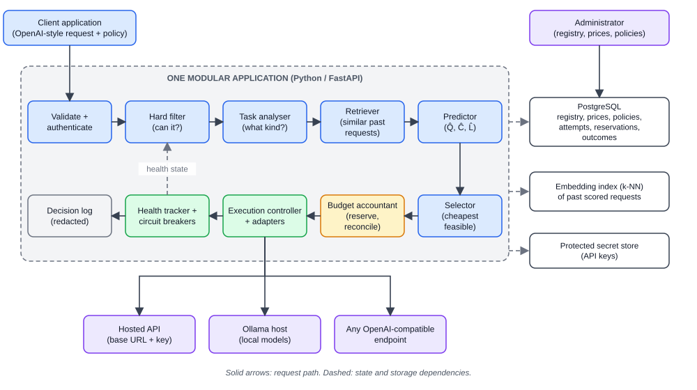

*Figure 1. The client request enters at the top and passes through validate and authenticate, hard filter, task analyser, retriever and predictor (top row, left to right), then selector, budget accountant, execution controller with adapters, health tracker with circuit breakers, and decision log (bottom row, right to left). The execution controller calls hosted APIs, Ollama or any OpenAI-compatible endpoint. PostgreSQL, the embedding index and the protected secret store sit beside the application; the administrator writes the registry through PostgreSQL. Health state feeds back into the hard filter.*


The draft describes one **modular application**, not separate services. Filter, predictor, selector, execution controller, accountant and adapters are logical modules. **[Draft 3.4.2, 3.6.1]** The first version is deliberately small, and this does not rule out splitting services later. **[Draft 3.4.2]**

### Model versus deployment

A **model** describes a capability and a pinned revision. A **deployment** is a runnable endpoint with current health, a price profile and latency history. The split lets the evaluation separate model quality from deployment conditions. **[Draft 3.4.1]**

Example: "Llama-3 8B, 4-bit quantised" (model) can run as the deployment "Ollama on one team laptop". The same model weights hosted by a provider would be a different deployment (and, as section 7.5 explains, often a different *configuration* for quality purposes).

### The three responsibilities

The draft separates three jobs. They never mix. **[Draft 3.4.1, 3.6.2; hybrid design record]**

| Job | Question it answers | Does not do |
|---|---|---|
| Predictor | How well would each model suit this request? | Call providers or change health state |
| Selector | Which feasible model is cheapest? | Execute calls |
| Reliability controller | Did the call work? What now? | Predict quality |

Provider health decides whether a model is *eligible*. It never substitutes for quality prediction. **[Draft, hybrid design record]**

### What is *not* in the system

No reinforcement learning, no response fusion, no fine-tuning of models. **[Draft 1.7, FR-20]** Redis, Prometheus and live GPU or queue telemetry are not in the committed core. **[Draft 1.7, 3.8]** A quality cascade (answer first, then escalate if the answer is judged inadequate) is a separate optional experiment, FR-19, and is kept apart from operational fallback. **[Draft 3.6.5, FR-19]**

---

## 2. What is stored, and where

Plain version: PostgreSQL holds the settings and the history. The secret keys live somewhere else (a protected store). The "memory" of how models performed on past prompts is a set of vectors plus a table of scores.

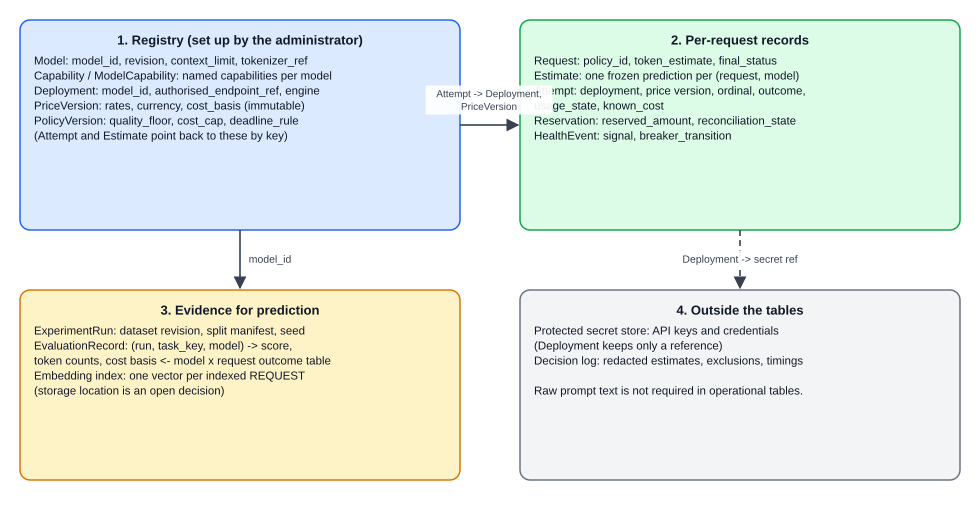

*Figure 2. Four groups of stored data: (1) the registry set up by the administrator (Model, Capability, Deployment, PriceVersion, PolicyVersion); (2) per-request records (Request, Estimate, Attempt, Reservation, HealthEvent); (3) evidence for prediction (ExperimentRun, EvaluationRecord which is the model x request outcome table, and the embedding index); (4) things outside the tables (the protected secret store and the decision log). Attempts point back to deployments and price versions; deployments point to a secret reference.*


| Store | What it holds | Where it lives | Tag |
|---|---|---|---|
| Model | model_id, revision, context_limit, tokenizer_ref | PostgreSQL | **[Draft Table 3.4]** |
| Capability and ModelCapability | Named capabilities, joined to models (no comma-separated fields) | PostgreSQL | **[Draft Table 3.4, 3.6.4]** |
| Deployment | deployment_id, model_id, authorised_endpoint_ref, engine | PostgreSQL | **[Draft Table 3.4]** |
| PriceVersion | deployment_id, effective_at, input_rate, output_rate, currency, cost_basis. Immutable, so old costs are never overwritten | PostgreSQL | **[Draft Table 3.4, 3.6.4]** |
| PolicyVersion | quality_floor, cost_cap, deadline_rule, policy_revision. A frozen version | PostgreSQL | **[Draft Table 3.4]** |
| Request | request_id, policy_id, accepted_at, token_estimate, final_status. No raw prompt required | PostgreSQL | **[Draft Table 3.4, 3.6.4]** |
| Estimate | One frozen prediction per (request, model): quality, cost, latency, predictor revision | PostgreSQL | **[Draft Table 3.4]** |
| Attempt | One row per execution try: deployment, price version, ordinal, times, outcome, usage state, known cost | PostgreSQL | **[Draft Table 3.4]** |
| Reservation | reserved_amount and reconciliation_state, one per dispatched attempt | PostgreSQL | **[Draft Table 3.4]** |
| HealthEvent | deployment, time, signal, breaker transition | PostgreSQL | **[Draft Table 3.4]** |
| ExperimentRun | dataset revision, split manifest, configuration, seed | PostgreSQL | **[Draft Table 3.4]** |
| EvaluationRecord | (run_id, task_key, model_id) -> score, token counts, cost basis reference. **This is the model x request outcome table.** | PostgreSQL | **[Draft Table 3.4]** |
| Provider keys and secrets | API keys, any endpoint credentials | A protected store, **not** the tables above | **[Draft 3.6.4, 3.6.7]**. Which store (secret manager, encrypted column, environment) is **[Open decision]** |
| Request embeddings and the k-NN index | One vector per indexed request | The draft names a "k-NN index" built only from permitted historical records but lists no vector table in Table 3.4. Where it lives (in-memory file, a Postgres extension, a library index) is **[Open decision]**. A Postgres vector extension is one **[Extension]** candidate | **[Draft 3.6.1, Table 3.7]** for the index; the rest as stated |
| Decision log | Redacted estimates, exclusions, timings, health outcomes | PostgreSQL | **[Draft FR-15, 3.6.5]** |

Rules that apply to everything above:

- Raw prompt text is not required in the operational request table and is not routinely logged. **[Draft 3.6.4, FR-15]**
- Currency uses fixed-precision decimals with explicit units to avoid rounding drift in the ledger. **[Draft 3.6.4]**
- Concurrent reservations are transactional (that is why PostgreSQL was chosen). **[Draft 3.6.4, Table 3.7]**

---

## 3. Administrator flows: setting the system up

The administrator is a person who registers models, sets policies and watches behaviour. Configuration changes need administrator rights and leave a versioned record. **[Draft 3.6.6, FR-03]**

> The draft fixes *what* must exist (registered models, capabilities, context windows, authorised deployments, versioned prices, versioned policies, protected secrets, SSRF protection). It does not describe screens or a wizard. The step lists below use the draft's data model and add small procedure steps. Steps that go beyond the draft are tagged **[Extension]**.

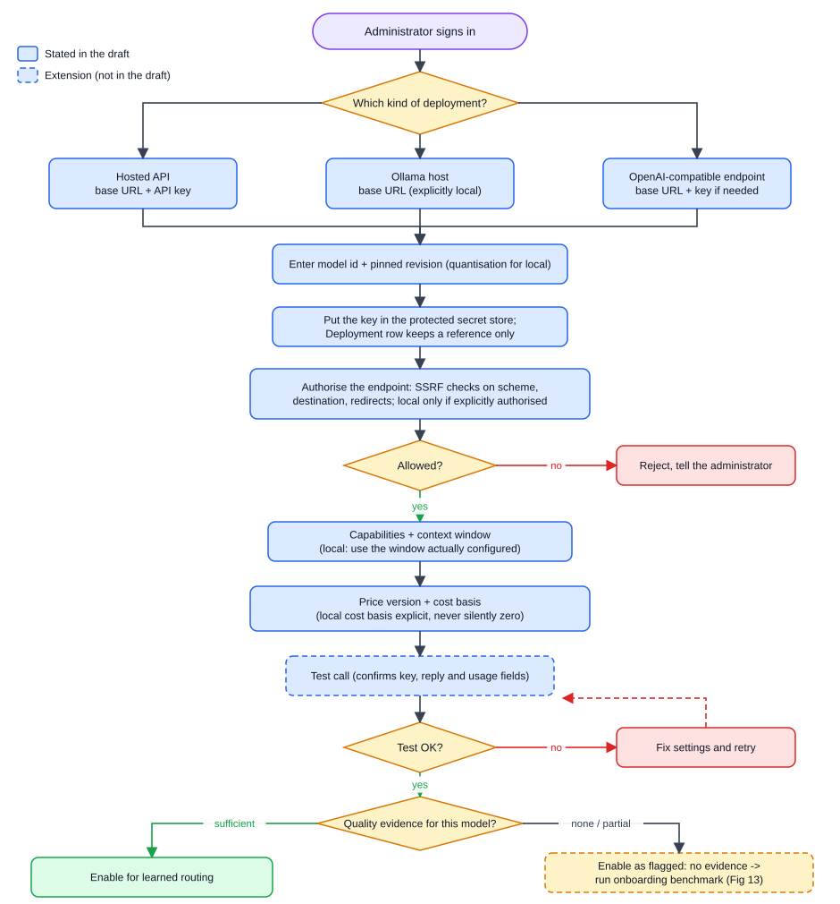

*Figure 3. Top to bottom: the administrator signs in and chooses the kind of deployment (hosted API, Ollama host, or OpenAI-compatible endpoint). All three join: enter model id and pinned revision, put the key in the protected secret store, authorise the endpoint (SSRF checks; rejected if not allowed), enter capabilities and context window, enter price version and cost basis, run a test call (retry if it fails), then either enable for learned routing (sufficient quality evidence) or enable as flagged and run the onboarding benchmark. Dashed outline marks extension steps.*


### 3.1 Add a hosted model with an API key

1. **Sign in as administrator.** Administrator permissions are separate from client permissions. **[Draft 3.6.7]**
2. **Choose the provider and engine** (hosted API). The engine value is stored on the Deployment row. **[Draft Table 3.4; FR-11]**
3. **Enter the model identifier and a pinned revision**, for example the provider's dated model name. Revisions are pinned so results stay comparable. **[Draft Table 3.4; risk table 3.11 "pin versions and record dates"]**
4. **Enter the API key.** It goes to the protected store. The Deployment row keeps only a reference. The key is never shown back, never sent to clients or to the model, and never written to routine logs. **[Draft 3.6.4, 3.6.7; NFR-07]** Whether the key is typed into an administrator screen or supplied through deployment configuration is **[Open decision]** (section 13, A1).
5. **Authorise the endpoint** (the provider's base URL). Deployment addresses are administrator-controlled and checked by the SSRF rules in 3.4 below. **[Draft 3.6.7]**
6. **Enter capabilities and context window.** Capabilities (for example tool calling, structured output, long input) go in the capability join table. The context limit goes on the model. These feed the hard filter later. **[Draft FR-03, FR-04, Table 3.4]**
7. **Enter the price**: input rate, output rate, currency and a `cost_basis` label (for a hosted model: the provider's list price). The system stores it as a new, immutable PriceVersion. **[Draft Table 3.4]**
8. **Run a test call.** A tiny request confirms the key works, the model replies and the usage fields are present. A success writes a HealthEvent. **[Extension]** (the draft tracks health, FR-12, but does not describe a registration test)
9. **Mark it enabled.** **[Extension]** (see 3.6 for status values)

### 3.2 Connect a local model through Ollama

Ollama is the local model server the draft names. **[Draft Table 3.7, FR-11]** The deployment is an Ollama host (for example the same laptop or the other team laptop).

1. **Enter the Ollama base URL** (often a localhost or LAN address). **[Extension]** (the draft says local endpoints are allowed only if *explicitly authorised*; it does not name an address)
2. **Explicitly authorise that local address.** SSRF protection normally blocks local and private addresses. An authorised local endpoint is the one deliberate hole. **[Draft 3.6.7]**
3. **Pick the model tag** that Ollama is serving. A model list from the server can help here. **[Extension]**
4. **Pin the revision and quantisation.** A quantised local model is a **separate configuration** from a similarly named hosted model and does not share quality labels. **[Draft 3.7, 3.11]**
5. **Record the context window actually configured on the server**, which can be smaller than the model's maximum. Use the smaller figure. **[Extension]** (the draft stores `context_limit` but does not discuss this mismatch)
6. **Set an explicit local cost basis.** A local model has no per-token fee, but it still costs electricity, hardware wear and time. The draft says local cost is **never silently set to zero**. **[Draft Table 3.9, Table 3.4 `cost_basis`]** How the basis is computed (for example an amortised per-token estimate, or an explicit declared figure with a reason) is **[Open decision]**.
7. **Test call and health.** Same test as 3.1 step 8. **[Extension]**

Why the zero-cost rule matters: if a local model were silently priced at zero, "cheapest feasible" would pick it every time it cleared the quality floor. The comparison with hosted models would be rigged by an omission, not by a design choice.

### 3.3 Connect any other OpenAI-compatible system

For a self-hosted server or another provider that speaks the OpenAI request format:

1. Provide the **base URL** and a **key** (if the server needs one). The key goes to the protected store. **[Extension]** as a generic adapter (the draft requires "one hosted API and at least one local engine", FR-11, and explicitly makes **no guarantee of compatibility with every provider**, 1.7)
2. Authorise the URL under the SSRF rules (3.4).
3. Enter capabilities, context window, revision, price and cost basis as in 3.1.
4. Run the test call. Compatibility is judged by this test and by the contract tests of the adapter, not assumed. **[Extension]**

The adapter's job is to translate protocol differences and return explicit usage and error information. It never decides routing. **[Draft 3.6.2]**

### 3.4 How endpoints are authorised (SSRF protection)

SSRF (server-side request forgery) means tricking a server into calling an address the attacker chose, for example an internal service. Because the gateway makes outgoing calls to administrator-supplied URLs, it must check them.

- The draft's rule: check **schemes, destinations and redirects**, and allow **only explicitly authorised local endpoints**. Clients cannot change endpoints. **[Draft 3.6.7]**
- Practical checks the team could adopt: allow only `https` for hosted providers; resolve the host name and refuse private, loopback and link-local ranges unless that exact address is on the authorised list; re-check after every redirect or refuse redirects; re-resolve at connect time to defeat DNS tricks. **[Extension]**
- A test case for it: a forbidden endpoint must be rejected. **[Draft 3.6.7 security tests]**

### 3.5 Health and test calls

- The controller tracks deployment health and circuit-breaker states. **[Draft FR-12]**
- Health can come from real attempts (passive) and from small periodic probes (active). The draft says breakers allow "bounded recovery probes" but does not set an active probe schedule. **[Draft 1.11 definition]** Whether to add scheduled health pings is **[Open decision]**.
- A new deployment starts with no latency history, so predicted latency is weak until real attempts accumulate. **[Extension]** (the draft stores latency history on the deployment; its source and window are **[Open decision]**)

### 3.6 Enable, disable, remove, rotate, re-price

| Action | What happens | Tag |
|---|---|---|
| **Enable** | Deployment becomes a candidate in E(q) if it passes the hard filter. For a model that has no quality evidence yet, "enabled" must mean "enabled but flagged"; see section 7.5 | **[Extension]** |
| **Disable** | Deployment is excluded from E(q) immediately. All history stays. Useful during an outage or an investigation | **[Extension]** |
| **Remove** | Treated as "retire", not "erase". Attempts, prices and estimates refer to the deployment by foreign key, so deleting rows would break history. A retired deployment is never selected | **[Extension]**, reasoning from **[Draft Table 3.4]** foreign keys and "current prices never overwrite historical costs" (3.6.4) |
| **Rotate a key** | Put the new key in the protected store under the same reference, run a test call, then retire the old key. The Deployment row and history are unchanged. The change leaves a versioned record | **[Extension]**, with versioned config records **[Draft 3.6.6]** |
| **Change a price** | Add a **new PriceVersion** with a new `effective_at`. Old attempts keep pointing at the price they were actually costed under | **[Draft 3.6.4, Table 3.4]** |
| **Change a policy** | Create a new frozen PolicyVersion. Requests record which version applied | **[Draft Table 3.4]** |
| **Change model revision** | A new revision is a different pinned model. It is not the same quality evidence (section 7.5) | **[Draft Table 3.4 "pinned model definition"; 3.7]** |

### 3.7 Policies: quality floor, cost cap, deadline, privacy

A policy is the set of rules a request is judged against. The draft names these fields: **quality floor** (τ), **cost cap**, **deadline rule**. **[Draft Table 3.4 PolicyVersion; 3.6.5]**

- The client "sends request and policy" (UC1). **[Draft Table 3.3]**
- Privacy rules (for example "this data must not leave the country") are enforced by the filter: "privacy-policy violations" exclude a deployment. **[Draft FR-04]** How a deployment is labelled for this (a location or data-handling attribute on the Deployment) is not in Table 3.4. **[Open decision]**
- If a client policy conflicts with an administrator's, which wins? A safe default is that a client may only *tighten* limits. **[Extension]**, final rule **[Open decision]**
- Hard rules (capability, context, privacy, budget) are never traded away for quality. Soft preferences might be relaxed under an explicit policy in later versions. **[Draft 3.4.2, 3.6.5]**

---

> **PART B. A configured example**

## 4. A hypothetical seven-model setup

> **Everything in this section is illustrative.** The names are made up (they are not real products), and every price, context size, score, state and number is invented to make the later traces concrete. They are not measurements or targets. The draft's *evaluated* pool is three to four models **[Draft 1.7, 3.7]**; a seven-model production-style setup is an **[Extension]** used only to explain how the router behaves with a realistic mix.

Imagine the administrator has finished the onboarding flows of section 3 seven times. This is what the system now holds.

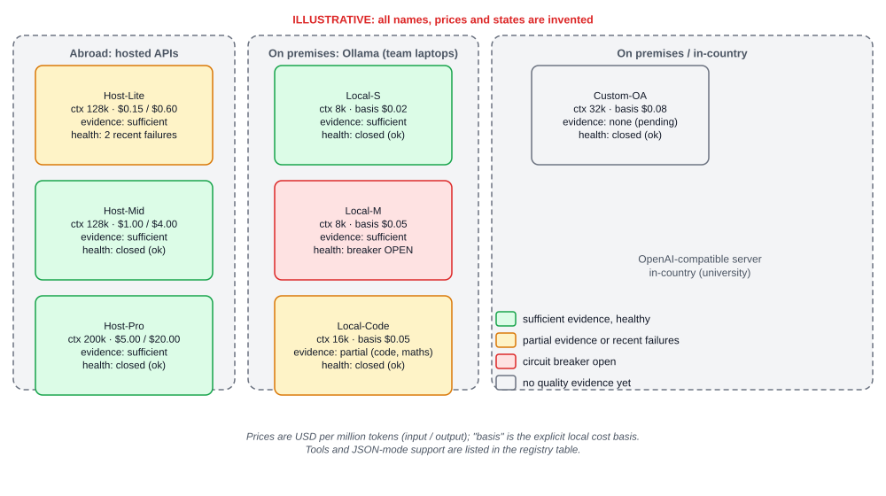

*Figure 4. Seven invented deployments in three groups: hosted APIs abroad (Host-Lite, Host-Mid, Host-Pro), Ollama models on team laptops (Local-S, Local-M, Local-Code), and one in-country OpenAI-compatible server (Custom-OA). Colour shows quality evidence and health: Local-M has an open circuit breaker, Host-Lite has two recent failures, Local-Code has partial evidence, and Custom-OA has none yet.*

### 4.1 The registry (models and deployments)

| # | Name | Engine / adapter | Where it runs | Revision (pinned) | Context | Tools | JSON mode |
|---|---|---|---|---|---|---|---|
| 1 | Local-S | Ollama | Team laptop 1 (on premises) | tiny-3b, 4-bit, r1 | 8k | no | no |
| 2 | Local-M | Ollama | Team laptop 2 (on premises) | mid-8b, 4-bit, r1 | 8k | no | yes |
| 3 | Local-Code | Ollama | Team laptop 1 (on premises) | code-7b, 4-bit, r1 | 16k | no | no |
| 4 | Host-Lite | Hosted API (provider X) | Abroad | lite, dated r1 | 128k | yes | yes |
| 5 | Host-Mid | Hosted API (provider X) | Abroad | mid, dated r1 | 128k | yes | yes |
| 6 | Host-Pro | Hosted API (provider Y) | Abroad | pro, dated r1 | 200k | yes | yes |
| 7 | Custom-OA | OpenAI-compatible server | In-country university server | custom-13b, r1 | 32k | no | yes |

- The columns Engine, Revision, Context and the capability columns map to the Deployment, Model and ModelCapability tables. **[Draft Table 3.4]**
- "Where it runs" is the data-location attribute the privacy rule needs. The draft says privacy-policy violations exclude a deployment (FR-04) but has no column for it. How it is stored is **[Open decision]** (section 13, S3).
- Each deployment's API key (or none, for Ollama) sits in the protected secret store, referenced from the Deployment row. **[Draft 3.6.4, 3.6.7]**

### 4.2 Price versions

Prices are in US dollars per million tokens (input / output). For local deployments the "price" is the explicit cost basis, never silently zero. **[Draft Table 3.4 `cost_basis`; Table 3.9]**

| price_id | Deployment | Effective | Input | Output | cost_basis |
|---|---|---|---|---|---|
| pv-1 | Local-S | 2027-02-01 | $0.02 | $0.02 | amortised hardware + electricity estimate |
| pv-2 | Local-M | 2027-02-01 | $0.05 | $0.05 | same method |
| pv-3 | Local-Code | 2027-02-01 | $0.05 | $0.05 | same method |
| pv-4 | Host-Lite | 2027-02-01 | $0.15 | $0.60 | provider list price |
| pv-5 | Host-Mid | 2027-02-01 | $1.00 | $4.00 | provider list price |
| pv-6 | Host-Pro | 2027-02-01 | $5.00 | $20.00 | provider list price |
| pv-7 | Custom-OA | 2027-02-01 | $0.08 | $0.08 | amortised server cost estimate |
| pv-5b | Host-Mid | 2027-04-01 (later) | $0.80 | $3.20 | provider list price (illustrative price cut) |

- A price change adds a new row (pv-5b). Attempts made before that date keep pointing at pv-5, so history never changes. **[Draft 3.6.4]**
- The method for the local cost basis is **[Open decision]** (section 13, A2). The three requests below happen before 2027-04-01, so pv-5b is not used.

### 4.3 Policies

| Policy | Quality floor τ | Cost cap per request | Deadline | Data location allowed | Attempt allowance |
|---|---|---|---|---|---|
| P-standard v3 | 0.75 | $0.010 | 8 s | any | 3 |
| P-sensitive v1 | 0.85 | $0.010 | 10 s | on premises or in-country only | 3 |

- Quality floor, cost cap and deadline are the PolicyVersion fields. **[Draft Table 3.4]** A changed policy is a new version; requests record the version they used.
- The "data location allowed" column and the attempt allowance as a policy field are not in Table 3.4. **[Open decision]** (section 13, S3 and R1)

### 4.4 Health at the moment of the three requests

| Deployment | Breaker | Recent history |
|---|---|---|
| Local-M | **OPEN** | Opened 40 s ago after repeated failures; cooldown not yet over |
| Host-Lite | closed | 2 qualifying failures in the last 60 s |
| All others | closed | No recent failures |

Breaker states and `HealthEvent` rows are in the draft. **[Draft FR-12, Table 3.4]** The threshold used in this example (3 qualifying failures in a 60 s window opens a breaker) and the 60 s window are invented; the real values are **[Open decision]**. **[Draft 3.6.5]**

### 4.5 Quality evidence

The router's quality evidence is the model x request outcome table (EvaluationRecord) plus the vector index of the requests in it. **[Draft Table 3.4, 3.6.1]**

| Deployment | code | maths | summarisation | extraction | Evidence level |
|---|---|---|---|---|---|
| Local-S, Local-M | scored | scored | scored | scored | sufficient |
| Local-Code | scored | scored | **not scored** | **not scored** | **partial** (benchmarked on code and maths prompts only) |
| Host-Lite, Host-Mid, Host-Pro | scored | scored | scored | scored | sufficient |
| Custom-OA | none | none | none | none | **none** (newly added, benchmark pending) |

- The "evidence level" label and per-task-family coverage are **[Extension]** (section 7.5). The draft requires only that the predictor *expose cases with insufficient evidence*. **[Draft FR-07]**
- Index settings for the example: exact k-NN, k = 5, a sentence-transformers embedding model. The draft says index type and k are chosen on validation data and the embedding model after testing. **[Draft Table 3.7]**; these particular choices are **[Open decision]**.

### 4.6 The three requests we will trace

| # | Prompt (invented) | Policy | What it shows |
|---|---|---|---|
| 1 | "Write a Python function that reads a CSV and returns the three rows with the highest sales." | P-standard v3 | Normal path; two models dropped by the filter; one flagged for no evidence; cheapest feasible chosen |
| 2 | "Summarise this 3-page meeting transcript in five bullet points." (about 2,500 tokens in) | P-standard v3 | First attempt times out; circuit breaker opens; uncertain spend stays reserved; fallback succeeds |
| 3 | "Extract the patient name and diagnosis from this note and return strict JSON." (a synthetic note) | P-sensitive v1 | Privacy and capability rules leave one model without evidence; explicit infeasibility |

> **PART C. Requests traced**

## 5. One request traced through the seven-model setup

### 5.1 The whole path in one picture

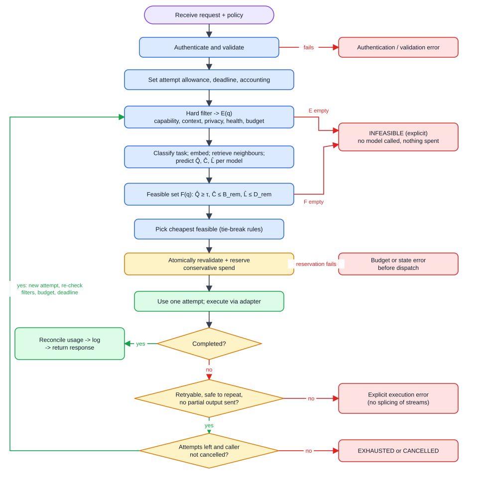

*Figure 5. One request, top to bottom: receive, authenticate and validate, set allowance and deadline, hard filter, classify and retrieve and predict, feasible set, pick cheapest, reserve spend, execute. A failed validation ends in an error; an empty E(q) or F(q) ends in an explicit INFEASIBLE; a failed reservation ends in a budget or state error. After execution a completed call is reconciled, logged and returned; a failed call either ends in an explicit execution error (not retryable, unsafe to repeat, or partial output already sent), ends as EXHAUSTED or CANCELLED, or loops back to the hard filter for a new constrained attempt.* **[Draft 3.6.3 Figure 3.8; 3.6.5 ROUTE]**

The 17 steps, in order. **[Draft 3.6.5 ROUTE, FR-01 to FR-15]**

| # | Step | What happens in plain words | Source |
|---|---|---|---|
| 1 | **Authenticate** | The call carries a client credential. The gateway checks it. Unauthenticated calls stop here | FR-02 |
| 2 | **Validate** | Check payload shape, size, context length, output caps, and any declared constraints. The interface is OpenAI-compatible, so existing client code works | FR-01, FR-02 |
| 3 | **Start the request record** | Set a finite attempt allowance, a deadline and an accounting entry. Assign a correlation ID returned with every response or error | ROUTE; 3.6.6 |
| 4 | **Hard filter** | Drop any deployment that lacks a needed capability, has too small a context window, violates privacy policy, is unavailable (unhealthy or breaker open), or cannot be afforded. Result: E(q) | FR-04 |
| 5 | **Classify the task** | A lightweight classifier labels the task type, needed capabilities and (as a feature) difficulty. It can add requirements but **never weakens a client restriction** | FR-05; 3.6.5 |
| 6 | **Re-filter** | Re-apply capability filters with what analysis found | 3.6.5 ROUTE |
| 7 | **Retrieve** | Embed the request, find similar *past scored requests* in the index (only permitted historical records) | FR-06 |
| 8 | **Predict** | For each remaining model, estimate quality Q̂, cost Ĉ and latency L̂. If evidence is thin, mark it "insufficient evidence" | FR-07 |
| 9 | **Feasible set** | Keep models with Q̂ ≥ τ, Ĉ ≤ remaining budget, L̂ ≤ remaining deadline. This is F(q) | FR-08; 3.6.5 |
| 10 | **Empty set?** | If F is empty, stop with an explicit INFEASIBLE error. No model is called | FR-09; UC2 |
| 11 | **Select** | Choose the cheapest model in F. Ties: lower predicted latency, then a stable deployment ID | FR-08; 3.6.5 |
| 12 | **Reserve** | Atomically re-check and reserve a *conservative* amount of money (from input and output caps) for this attempt. If reservation fails, stop with a budget or state error | FR-10 |
| 13 | **Spend an attempt** | Use up one unit of the attempt allowance | ROUTE |
| 14 | **Execute** | Call the chosen deployment through its adapter, with the remaining timeout | FR-11 |
| 15 | **Reconcile** | Replace the reservation with known usage. If usage is unknown (timeout, cut stream), the reservation **stays** | FR-10; 3.6.4 |
| 16 | **Record** | Write redacted estimates, timings, exclusions and the health outcome | FR-15 |
| 17 | **Return** | Completed: return the response. Otherwise follow the failure rules in section 6 | ROUTE |

The draft's pseudo-code (reformatted). Note that classify and retrieve sit inside the loop, so they re-run on each pass; a real build could compute them once, since the prompt does not change. **[Extension]** for that remark.

```
ROUTE(q, policy):
  validate client, payload, authorised endpoints, declared constraints
  initialise finite attempt allowance, deadline, request accounting
  while allowance remains and caller has not cancelled:
      E  <- filter capability, context, privacy, health, budget rules
      features <- classify q; retrieve only permitted historical evidence
      E  <- re-apply capability filters using analysed requirements
      estimates <- predict quality, cost, latency for E
      F  <- enforce quality floor, cost cap, remaining deadline
      if F is empty: return explicit INFEASIBLE under the declared policy
      candidate <- cheapest feasible candidate (deterministic tie break)
      atomically revalidate and reserve conservative attempt spend
      if reservation fails: return explicit budget or state error
      consume one attempt allowance
      outcome <- execute with remaining timeout through the adapter
      reconcile known usage; keep reservation for unresolved charges
      record redacted estimates, timing, exclusions, health outcome
      if completed: return response
      if not retryable, unsafe to repeat, or partial output sent: return error
  return explicit EXHAUSTED or CANCELLED outcome
```
**[Draft 3.6.5]**

---

### 5.2 Request 1: a normal request (success)

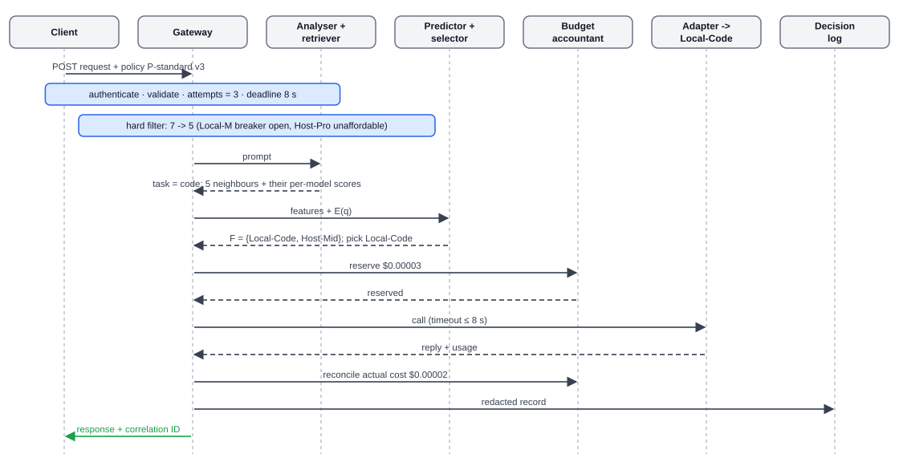

*Figure 6. Request 1 as messages. The client sends the request and policy P-standard v3. The gateway authenticates, validates and starts the accounting, then filters seven models down to five. The analyser classifies the task and returns five neighbours with their per-model scores. The predictor and selector return the feasible set (Local-Code and Host-Mid) and pick Local-Code. The accountant reserves $0.00003, the adapter calls Local-Code, the reply comes back with usage, the cost is reconciled at $0.00002, a redacted record is logged, and the client gets the response with a correlation ID.* **[Illustrative]**

**The request.** *(invented)*

```
POST /v1/chat/completions
Authorization: Bearer <client key>
policy: P-standard v3
{ "model": "router-auto",
  "messages": [{"role": "user", "content": "Write a Python function that reads a CSV
               and returns the three rows with the highest sales."}],
  "max_tokens": 600 }
```

The request is OpenAI-compatible. **[Draft FR-01]** How a client signals "let the router choose" and how it names a policy are **[Open decision]** (section 13, A4).

**Step 1: authenticate and validate.** The key is valid, the payload is well formed, the input is about 60 tokens, the output cap is 600. The gateway sets attempts = 3 and deadline = 8 s, and assigns a correlation ID. **[Draft FR-02, ROUTE]**

**Step 2: hard filter (which of the 7 drop out, and why).** **[Draft FR-04]**

| Deployment | Result | Reason |
|---|---|---|
| Local-S | pass | Context fits; no special capability needed; healthy |
| Local-M | **drop** | Health: circuit breaker is OPEN (unavailable) |
| Local-Code | pass | Context 16k fits; healthy |
| Host-Lite | pass | Healthy (breaker still closed despite 2 recent failures) |
| Host-Mid | pass | Healthy |
| Host-Pro | **drop** | Preliminary affordability: conservative cost = 60 x $5/M + 600 x $20/M = $0.0003 + $0.0120 = $0.0123, which is above the $0.010 cap |
| Custom-OA | pass | Passes the hard rules (endpoint enabled, context fits, healthy). Its lack of evidence appears later, at prediction |

Result: E(q) has 5 members (Local-S, Local-Code, Host-Lite, Host-Mid, Custom-OA). The filter rules are independent, so the order is only for reading.

**Step 3: classify the task.** The classifier says task = **code**, difficulty = medium (invented score 0.45), no extra capability required. The capability filter is re-applied; nothing changes. **[Draft FR-05, 3.6.5]**

**Step 4: embed and retrieve.** The prompt is turned into a vector, and the index returns the five nearest past requests. The outcome table is then read for those five rows (Figure 8). **[Draft FR-06; Table 3.4 EvaluationRecord]**

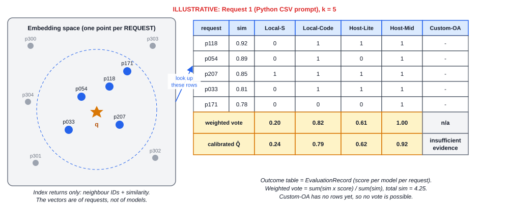

*Figure 8. Left: past requests are points in the embedding space; the new prompt q lands among five neighbours (p118, p054, p207, p033, p171). The index returns only their IDs and similarities. Right: the model x request outcome table rows for those five requests. Weighted votes: Local-S 0.20, Local-Code 0.82, Host-Lite 0.61, Host-Mid 1.00; Custom-OA has no scored rows. After calibration: 0.24, 0.79, 0.62, 0.92, and Custom-OA is flagged as insufficient evidence.* **[Extension for the voting mechanics; Draft FR-06, FR-07]**

What the neighbours say per model (1 = the model got that past request right, a dash = that model was never scored on it):

| Neighbour | Similarity | Local-S | Local-Code | Host-Lite | Host-Mid | Custom-OA |
|---|---|---|---|---|---|---|
| p118 | 0.92 | 0 | 1 | 1 | 1 | - |
| p054 | 0.89 | 0 | 1 | 0 | 1 | - |
| p207 | 0.85 | 1 | 1 | 1 | 1 | - |
| p033 | 0.81 | 0 | 1 | 1 | 1 | - |
| p171 | 0.78 | 0 | 0 | 0 | 1 | - |
| **Weighted vote** | total weight 4.25 | 0.85 / 4.25 = **0.20** | 3.47 / 4.25 = **0.82** | 2.58 / 4.25 = **0.61** | 4.25 / 4.25 = **1.00** | no vote possible |

**Step 5: estimate Q̂, Ĉ and L̂.** The estimator combines each vote with the task, difficulty, how many neighbours had a score, and how similar they were; calibration then adjusts it. Expected tokens: 60 in, 350 out (invented). **[Draft 3.6.5; Extension for the exact inputs]**

| Deployment | Vote | Calibrated Q̂ | Ĉ (expected) | L̂ | Evidence |
|---|---|---|---|---|---|
| Local-S | 0.20 | 0.24 | $0.00001 | 2.5 s | ok |
| Local-Code | 0.82 | 0.79 | $0.00002 | 4.0 s | ok (code is covered) |
| Host-Lite | 0.61 | 0.62 | $0.00022 | 1.6 s | ok |
| Host-Mid | 1.00 | 0.92 | $0.00146 | 2.4 s | ok |
| Custom-OA | none | none | n/a | n/a | **insufficient evidence** (no scored rows) |

Two teaching points: a perfect 5-out-of-5 vote does not become 1.00, because calibration shrinks extreme scores toward honest odds **[Extension]**; and the router never invents a number for Custom-OA, it flags the gap **[Draft FR-07]**.

**Step 6: feasible set.** F(q) = models with Q̂ ≥ 0.75, Ĉ ≤ B_rem ($0.010) and L̂ ≤ D_rem (8 s). Local-S (0.24) and Host-Lite (0.62) fail the quality floor. Custom-OA cannot be shown to clear it. F(q) = {Local-Code, Host-Mid}. **[Draft 3.6.5]**

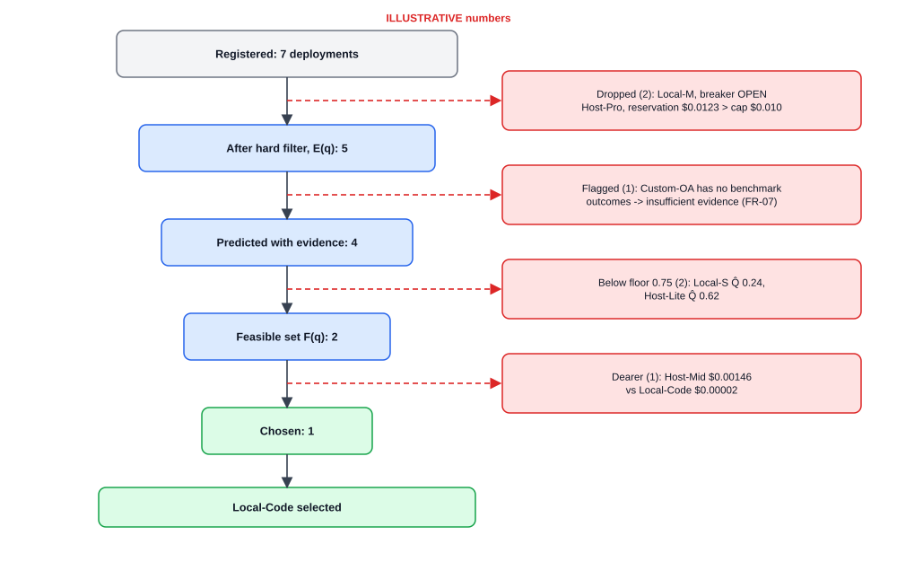

*Figure 7. Seven registered deployments; the hard filter drops two (Local-M breaker open, Host-Pro conservative cost above the cap); the evidence check flags one (Custom-OA); the quality floor drops two (Local-S 0.24, Host-Lite 0.62); of the two feasible models, Local-Code is cheaper ($0.00002 against $0.00146) and is chosen.*

**Step 7: choose the cheapest feasible.** argmin of Ĉ over F: Local-Code ($0.00002) beats Host-Mid ($0.00146). **[Draft FR-08]**

> Why a local model won: its declared cost basis is tiny. If a team set an unrealistically low basis, it would always win. That is why the draft insists the local cost basis is explicit and never silently zero, and why section 13 (A2) recommends a sensitivity check. **[Draft Table 3.9]**

**Step 8: reserve.** Conservative reservation from the input and output caps: (60 + 600) tokens x $0.05/M = $0.000033, recorded as $0.00003. The accountant atomically revalidates and holds it. **[Draft FR-10]**

**Step 9: execute.** The Ollama adapter calls Local-Code with the remaining timeout (8 s). It replies in 4.1 s with 310 output tokens. **[Draft FR-11]**

**Step 10: reconcile.** Actual usage is 60 + 310 = 370 tokens x $0.05/M = about $0.00002. The reservation is settled at that figure and the remainder is released. **[Draft FR-10]**

**Step 11: log (redacted).** The decision record holds no prompt text. **[Draft FR-15, 3.6.4]** Example fields (invented values):

```
correlation_id : c-0001        policy : P-standard v3 (version recorded)
task           : code          difficulty : medium
exclusions     : Local-M health(breaker open) | Host-Pro affordability
                 Custom-OA insufficient evidence
                 Local-S below floor (0.24)   | Host-Lite below floor (0.62)
estimates      : frozen per model (Q-hat, cost, latency, predictor revision)
chosen         : Local-Code   attempt 1 of 3 -> completed, usage known, $0.00002
timing         : router decision time and model time recorded separately
```

**Step 12: respond.** The client receives the answer with the correlation ID. The gateway's own work (embedding, retrieval, selection) is the part measured against the p95 100 ms overhead target. **[Draft NFR-03]**

---

### 5.3 Request 2: a request that fails mid-way (fallback and circuit breaker)

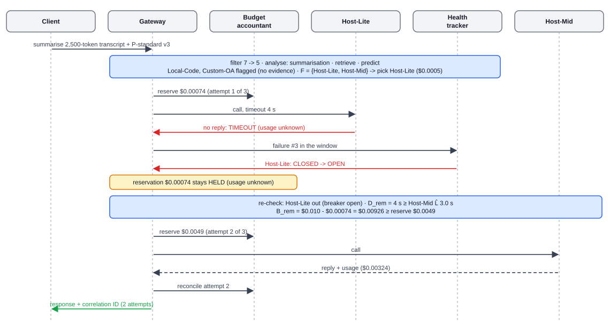

*Figure 9. Request 2 as messages. After filtering and prediction the gateway picks Host-Lite and reserves $0.00074. It calls Host-Lite with a 4 s timeout and gets nothing back. The health tracker records failure number 3 in the window, so Host-Lite goes from CLOSED to OPEN. The accountant keeps the $0.00074 reservation held because usage is unknown. The gateway re-checks constraints (Host-Lite out, 4 s of deadline left, $0.00926 of budget left), reserves $0.0049 for Host-Mid, calls it, gets a reply with usage ($0.00324), reconciles, and returns the response after 2 attempts.* **[Illustrative; Draft UC3, FR-10, FR-12, FR-13]**

**The request.** Policy P-standard v3, about 2,500 tokens in, output cap 600, deadline 8 s, attempts 3.

**Filter.** Local-M drops (breaker open). Host-Pro drops: 2,500 x $5/M + 600 x $20/M = $0.0125 + $0.0120 = $0.0245, above the $0.010 cap. E(q) = {Local-S, Local-Code, Host-Lite, Host-Mid, Custom-OA}.

**Analyse and retrieve.** Task = summarisation. Five neighbours (similarities 0.90, 0.87, 0.83, 0.79, 0.76, total 4.15) and their scores:

| Deployment | Scores on the 5 neighbours | Weighted vote | Calibrated Q̂ | Ĉ | L̂ | Note |
|---|---|---|---|---|---|---|
| Local-S | 1, 0, 1, 0, 0 | 1.73 / 4.15 = 0.42 | 0.45 | $0.00005 | 5.0 s | below floor |
| Local-Code | none scored | none | none | n/a | n/a | **insufficient evidence**: benchmarked on code and maths only |
| Host-Lite | 1, 1, 1, 0, 1 | 3.36 / 4.15 = 0.81 | 0.76 | $0.0005 | 2.2 s | clears 0.75 |
| Host-Mid | 1, 1, 1, 1, 1 | 1.00 | 0.91 | $0.0033 | 3.0 s | clears 0.75 |
| Custom-OA | none | none | none | n/a | n/a | **insufficient evidence** |

F(q) = {Host-Lite, Host-Mid}. The cheapest is **Host-Lite** ($0.0005, against $0.0033).

**Attempt 1.**

1. Reserve conservatively: 2,500 x $0.15/M + 600 x $0.60/M = $0.000375 + $0.00036 = about **$0.00074**. Attempts used: 1 of 3.
2. Call Host-Lite with a timeout of 4 s (invented: half the remaining deadline; the per-attempt timeout rule is **[Open decision]**, R1).
3. **No reply within 4 s.** Outcome: TIMEOUT, usage unknown. **[Draft FR-13]** names timeouts as an eligible retryable failure class; which exact failures count is **[Open decision]**.

**Health and circuit breaker.** The health tracker records a qualifying failure on Host-Lite: failure number 3 in the 60 s window, which meets the illustrative threshold. The breaker moves **CLOSED to OPEN** and a `HealthEvent` is written. From now on Host-Lite is excluded from E(q) until its cooldown ends. **[Draft FR-12, Table 3.4]**

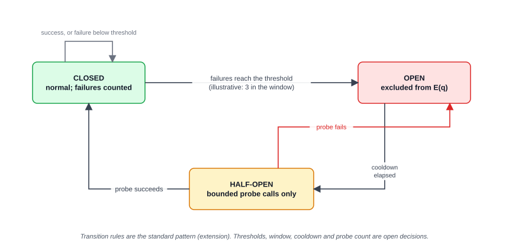

*Figure 10. Closed: normal, failures are counted. When failures reach the threshold the breaker goes to Open: the deployment is excluded from E(q). After a cooldown it goes to Half-open: only a small bounded number of probe calls are allowed. A successful probe returns it to Closed; a failed probe sends it back to Open. The three state names are in the draft; the transition rules are the standard pattern and the thresholds are open decisions.* **[Draft FR-12; Extension for transitions]**

**Accounting.** Because the timeout leaves usage unknown, the **$0.00074 reservation stays held**. Releasing it could let later attempts overspend if Host-Lite had in fact processed the request. It stays reserved until usage is resolved or it is conservatively charged. **[Draft FR-10, 3.6.4]** The rule for resolving it is **[Open decision]** (R5).

**Re-check before attempt 2.** The same rules run again on the new state: **[Draft FR-13]**

| Check | Value | Result |
|---|---|---|
| Hard filter | Host-Lite now excluded (breaker open) | Host-Mid still allowed |
| Remaining deadline D_rem | 8 s - 4 s = 4 s; Host-Mid L̂ = 3.0 s | fits |
| Remaining budget B_rem | $0.010 - $0.00074 held = $0.00926; Host-Mid Ĉ = $0.0033 | fits |
| Quality floor | Host-Mid Q̂ = 0.91 ≥ 0.75 | fits |
| Reserve (conservative) | 2,500 x $1/M + 600 x $4/M = $0.0025 + $0.0024 = $0.0049 | ≤ $0.00926, so the reservation succeeds |

**Attempt 2.** Attempts used: 2 of 3. Host-Mid replies: 2,480 tokens in, 190 out, so 2,480 x $1/M + 190 x $4/M = $0.00248 + $0.00076 = **$0.00324**. Reconcile that attempt. The response goes back to the client. The log shows two attempts, one failed with unresolved spend and one completed. **[Draft UC3 postconditions: attempts bounded; outcome and extra cost recorded]**

**What the client sees.** A normal successful response with a correlation ID. Whether the client is told that a fallback happened (for example in a response header) is not stated in the draft. **[Open decision]**

**What if it had gone differently?**

| Variation | What the router does | Tag |
|---|---|---|
| Host-Lite answers HTTP 503 at once and usage is known to be zero | Reservation released; breaker counts a failure; fallback to Host-Mid exactly as above | **[Draft FR-13]** |
| Host-Lite sends the first 40 tokens, then the connection drops | Partial output already reached the client, so **no splicing**: the client gets an explicit error; the breaker counts a failure; usage is uncertain so spend stays held | **[Draft 3.6.5, FR-14]** |
| The request could have side effects and no safe-retry flag was given | No automatic fallback after a failure; explicit error | **[Draft FR-14, 3.6.7]**; the flag is **[Open decision]** (R2) |
| The client cancels during attempt 1 | No further attempts; the held reservation is resolved later | **[Draft 3.6.3, ROUTE]** |
| Host-Mid also times out (say after 3 s) | About 1 s of deadline is left, Host-Mid L̂ is 3.0 s, so F(q) is empty: explicit INFEASIBLE under the declared policy. If the allowance had run out first the outcome would be EXHAUSTED | **[Draft 3.6.5]** |
| The remaining budget were below the Host-Mid reservation | Reservation fails: budget error before dispatch; nothing more is spent | **[Draft UC1 alt flow, ROUTE]** |

---

### 5.4 Request 3: an infeasible request

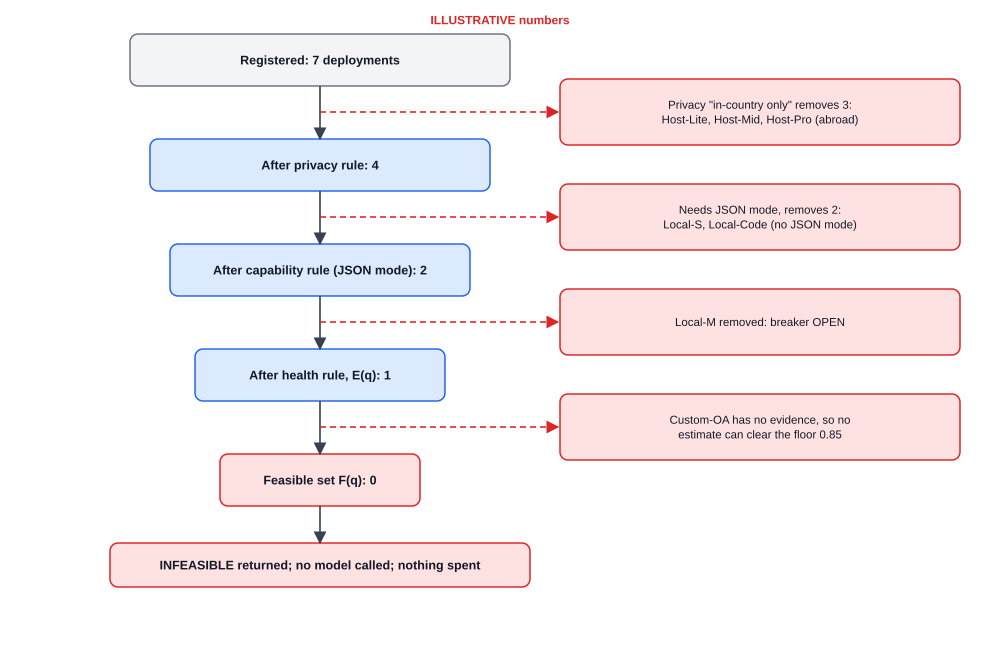

*Figure 11. Seven registered deployments. The privacy rule "in-country or on premises only" removes the three hosted models abroad. The capability rule (the request needs JSON mode) removes Local-S and Local-Code. The health rule removes Local-M (breaker open). Only Custom-OA remains, but it has no quality evidence, so no estimate can clear the 0.85 floor. The feasible set is empty and the request ends as an explicit infeasibility error; no model is called and nothing is spent.*

**The request.** Policy P-sensitive v1 (τ = 0.85, cap $0.010, deadline 10 s, data must stay on premises or in-country). The request asks for strict JSON, so JSON mode is a **hard capability requirement** read from the payload. The note is synthetic; the project does not process real personal data. **[Draft 3.6.7, 3.10]**

**Filter.** **[Draft FR-04]**

| Deployment | Result | Reason |
|---|---|---|
| Local-S | drop | Capability: no JSON mode |
| Local-M | drop | Health: breaker OPEN (it would have passed privacy and capability) |
| Local-Code | drop | Capability: no JSON mode |
| Host-Lite, Host-Mid, Host-Pro | drop | Privacy: run abroad |
| Custom-OA | pass | In-country, supports JSON mode, healthy |

E(q) = {Custom-OA}.

**Analyse and predict.** Task = extraction. Retrieval finds neighbours, but none of them has a Custom-OA score, so there is no vote and Custom-OA is flagged as insufficient evidence. With no estimate that clears τ = 0.85, **F(q) is empty**. **[Draft FR-07, FR-09]**

**Outcome.** The router returns an explicit infeasibility error, calls no model, spends nothing, and logs the exclusions without the note text. It does **not** quietly send the request to Host-Mid, because that would break the privacy rule. **[Draft 3.6.5, UC2]**

Example error body (invented; the field names and the idea of reason categories are **[Extension]**):

```
HTTP 4xx
{ "error": { "type": "infeasible",
             "message": "No deployment satisfies the declared policy.",
             "correlation_id": "c-0003",
             "reasons": { "privacy": 3, "capability": 2, "health": 1,
                          "insufficient_evidence": 1 } } }
```

How much detail to reveal to the client (counts, names, or only coarse reasons) is **[Open decision]** (R3). The full exclusion record stays in the admin log.

**What would fix it (for the administrator):** benchmark Custom-OA so it has evidence (section 7.5); wait for Local-M's breaker to recover; add another in-country JSON-capable model; or revise the policy (a new PolicyVersion, never a silent relaxation). **[Extension]** except that policy changes create a new version **[Draft Table 3.4]**.

---

### 5.5 What the three requests show

| Request | Outcome | Draft rule it demonstrates |
|---|---|---|
| 1 | Local-Code chosen at $0.00002 | Hard filters first; cheapest feasible; explicit local cost basis; insufficient evidence exposed (FR-04, FR-07, FR-08) |
| 2 | Fallback to Host-Mid after a timeout | Bounded fallback with rechecks; circuit breaker; uncertain spend stays reserved; no splice after delivery (FR-10, FR-12, FR-13, FR-14) |
| 3 | Explicit INFEASIBLE | No silent relaxation of a hard rule; no model called (FR-09, UC2) |

## 6. Failure and edge paths in one place

The rule behind all of them: **recovery is a new, constrained attempt**, not a continuation. Every new attempt re-checks hard filters, remaining budget and remaining deadline. No path silently relaxes a hard budget, capability or privacy rule. **[Draft 3.6.3, 3.6.5, FR-13]**

### 6.1 Failure table

| Situation | What the gateway does | What the client sees | Tag |
|---|---|---|---|
| Missing or wrong credential | Reject before any model work | Authentication error | **[Draft FR-02]** |
| Bad payload, oversized input, forbidden endpoint | Reject before any model work | Validation error | **[Draft FR-02; 3.6.7 tests]** |
| No model passes the hard filter | Stop. Record the exclusions. No model called | Explicit infeasibility error | **[Draft FR-09; UC2]** |
| Filter passes, but no model clears quality floor, cost cap and deadline (F empty) | Same: stop with INFEASIBLE under the declared policy | Explicit infeasibility error | **[Draft 3.6.5]** |
| Every deployment is unhealthy or breaker-open | Health is part of E(q), so E is empty and the request is infeasible. Whether this gets its own error text ("no healthy deployment") is a naming question | Explicit error | **[Draft 3.6.5 E(q)]**; error naming **[Open decision]** |
| Reservation fails (not enough permitted budget, or state changed) | Stop before dispatch. Nothing was spent | Budget or state error | **[Draft UC1 alt flow; ROUTE]** |
| Health changed between choosing and dispatching | Revalidate, or return an explicit error before dispatch | Retry on another model, or error | **[Draft 3.6.3]** |
| Timeout, rate limit (HTTP 429) or server error before any output reached the client | Record the failure, update the breaker, reconcile spend, re-check constraints, and make a new attempt on another eligible deployment if allowance, budget and deadline remain | Eventually a response, or an explicit execution error | **[Draft FR-13; UC3]**. Which error types count as "retryable" is **[Open decision]** (Draft 3.6.5: "set after the pilot") |
| Malformed model response | Treated as a failed attempt. It is a listed injected fault. Whether it is retried is a retry-eligibility rule | Response from fallback, or error | **[Draft Table 3.10]** for the fault; retry rule **[Open decision]** |
| Stream already started, then the model fails | **No splicing.** The gateway reports failure rather than join another model's output to the first | Error after partial output | **[Draft 3.6.5, FR-14]** |
| Call is unsafe to repeat (it may have caused a side effect) | Do not retry automatically, because a transport failure does not prove the action did not happen | Explicit error | **[Draft 3.6.7, FR-14]**. How the client declares a "safe-retry" contract is **[Open decision]**; a request flag or header is one **[Extension]** |
| Caller cancels | No further attempts. Any in-flight spend is reconciled or left reserved | Cancelled outcome | **[Draft 3.6.3, ROUTE]** |
| Attempt allowance used up | Stop. Retries cannot continue without limit | EXHAUSTED outcome | **[Draft 3.6.3, ROUTE]** |
| Deadline too close for the remaining attempts | L̂ ≤ D_rem fails, so F empties and the request ends as infeasible | Explicit error | **[Draft 3.6.5]** |
| Spend is uncertain (timeout, cut stream, missing usage field) | Keep the reservation until resolved, or charge a conservative amount | Nothing visible, but later requests see less remaining budget | **[Draft FR-10; 3.6.4]** |

### 6.2 Why "uncertain spend stays reserved" matters

If a provider times out, you do not know whether it generated (and billed) 5 tokens or 5,000. Releasing the money early would let the next attempt overspend. So the reservation stays until usage is resolved or conservatively charged. **[Draft FR-10, 3.6.4]** The cost is that a few failures can temporarily shrink the budget. Request 2 in section 5.3 shows this.

### 6.3 The circuit breaker

Figure 10 (section 5.3) draws these states.

A circuit breaker stops the gateway from hammering a deployment that is clearly failing. The draft defines it as "a controller that temporarily blocks calls to a deployment after qualifying failures and allows bounded recovery probes". **[Draft 1.11, FR-12]**

| State | Meaning | Calls allowed? | How it changes |
|---|---|---|---|
| **Closed** | Normal. Failures are counted | Yes | Enough qualifying failures -> **Open** |
| **Open** | Deployment is treated as unavailable and excluded from E(q) | No | After a cooldown -> **Half-open** |
| **Half-open** | Testing recovery | A small, bounded number of probe calls | Probe succeeds -> **Closed**. Probe fails -> **Open** again |

- The three state names and the idea of bounded probes: **[Draft FR-12, 1.11]**.
- The transition rules above are the standard pattern. **[Extension]**
- Failure counts, window, cooldown length and number of probes: **[Open decision]** ("set after the pilot", Draft 3.6.5).
- Each transition is stored as a HealthEvent with a `breaker_transition`. **[Draft Table 3.4]**
- Whether a probe uses a real client request or a synthetic ping is **[Open decision]**. A real request risks the client; a synthetic ping costs a little money. **[Extension]** commentary

### 6.4 Bounded retry and fallback

- Retry is allowed only for **eligible retryable failures**, and the controller rechecks budget, deadline and hard filters before each new attempt. **[Draft FR-13]**
- The attempt allowance is finite. Each pass through the loop uses one. **[Draft 3.6.3]**
- "Generic retry" is called a risk in the draft because repeating a call may spend budget again or repeat side effects. Hence "bounded, eligibility-respecting and every attempt counted". **[Draft 3.3.2]**
- Operational fallback (response to a failed execution) and quality cascade (response to a poor but completed answer) have different triggers and costs and are never mixed. **[Draft 3.6.5, FR-19]**

---

> **PART D. Whole-system use cases and flows**

## 7. Whole-system use cases and user flows

Sections 3 to 6 followed one setup and three requests. This section steps back: who uses the system, what each of them does, and how the pieces connect.

### 7.1 Actors and use cases

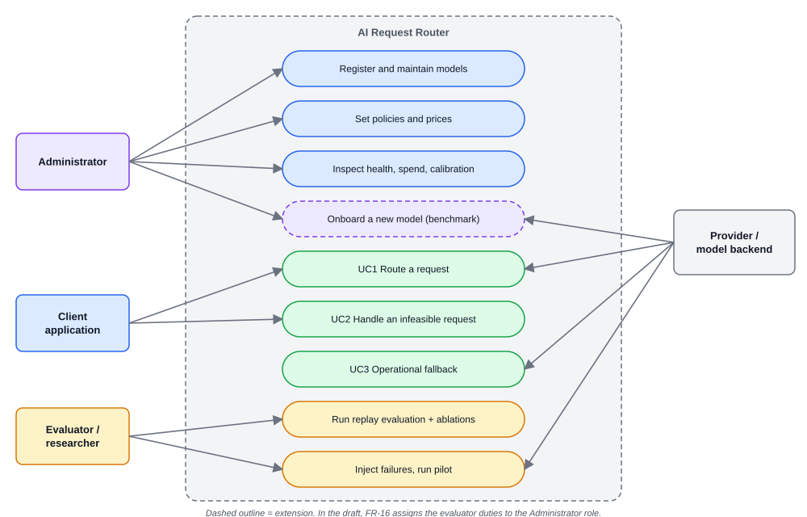

*Figure 12. Four actors and their use cases. The administrator registers and maintains models, sets policies and prices, inspects health, spend and calibration, and (as an extension) onboards new models. The client application routes requests (UC1) and receives infeasibility answers (UC2). The evaluator runs replay evaluations, ablations, a capped pilot and failure injection. The provider or model backend executes model calls (UC1) and causes the failures that trigger operational fallback (UC3). Dashed outline: extension.*

| Actor | Use cases | Tag |
|---|---|---|
| Client application | UC1 route a request; UC2 handle an infeasible request | **[Draft Table 3.3, Figure 3.2]** |
| Administrator | Register models and authorised deployments (FR-03); set policies and prices; inspect health, spend, calibration (FR-17); run evaluations (FR-16 is assigned to this role) | **[Draft 3.5.1]** |
| Provider / model backend | Execute model calls; fail in ways that trigger UC3 operational fallback | **[Draft Table 3.3]** |
| Evaluator / researcher | Run replay, ablations, the capped pilot and failure injection | **[Extension]** as a separate persona. In the draft the Administrator role owns FR-16 |
| Administrator (new-model onboarding) | Benchmark a newly added model | **[Extension]** |

### 7.2 Administrator flows

The administrator's flows are in section 3 and Figure 3. In daily use they reduce to six moves:

| Move | What changes | Where it is covered |
|---|---|---|
| Add a deployment | New Model/Deployment/PriceVersion rows; secret in the protected store | 3.1 to 3.3, Fig 3 |
| Change a price | A new PriceVersion; history untouched | 3.6, 4.2 |
| Change a policy | A new frozen PolicyVersion | 3.7, 4.3 |
| Rotate a key | New secret under the same reference; test call | 3.6 |
| Disable or retire a deployment | Excluded from E(q); history kept | 3.6 |
| Inspect | Health, breaker states, reserved spend, aggregate quality, calibration, latency; no raw prompts or credentials by default | 7.6; **[Draft 3.6.6]** |

### 7.3 Client application flow

What a developer integrating the router does and sees: **[Draft FR-01, FR-02, 3.6.6]** for the interface and explicit errors; the guidance column is **[Extension]**.

1. Obtain a client credential from the administrator.
2. Point an OpenAI-compatible client at the gateway. Existing request and response code keeps working.
3. Optionally name a policy (quality floor, cost cap, deadline, privacy rule) or use the default.
4. Handle one of these outcomes, always with a correlation ID:

| Outcome | Meaning | Suggested client action |
|---|---|---|
| Response | A model completed the request | Use it |
| Validation or authentication error | Bad payload, limits, or credential; nothing was routed | Fix the request or credential |
| Infeasibility | No permitted deployment satisfies the policy; no model was called | Loosen the policy deliberately, or ask the administrator to add capacity |
| Budget error | Reservation failed; nothing was dispatched | Retry later or raise the cap |
| Execution error | A model failed and recovery was not allowed (not retryable, unsafe to repeat, or partial output already sent) | Treat as failed; do not assume partial text is complete |
| Exhausted or cancelled | Attempt allowance used up, or the caller cancelled | Retry as a new request if appropriate |

The error classes (validation, infeasibility, budget, execution) are in the draft **[Draft 3.6.6]**; EXHAUSTED and CANCELLED come from ROUTE **[Draft 3.6.5]**. Mapping them to HTTP status codes is **[Open decision]** (R3).

### 7.4 Evaluator and researcher flow (replay, pilot and failure injection)

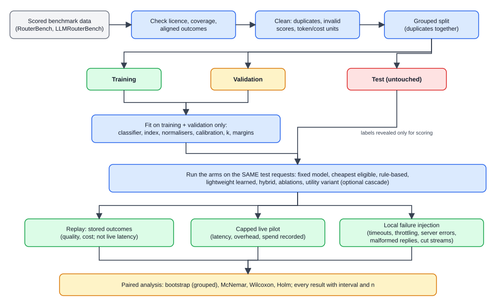

*Figure 14. Scored benchmark data is checked for licence, coverage and aligned outcomes, cleaned, and split with duplicates kept together into training, validation and an untouched test set. Everything is fitted on training plus validation only. Every arm then runs on the same test requests: replay (stored outcomes, no live latency), a capped live pilot, and local failure injection. A paired analysis with bootstrap, McNemar, Wilcoxon and Holm produces results with intervals and sample counts.* **[Draft 3.7, 3.9, Table 3.6, Figure 3.11]**

Steps, with the draft source for each:

1. **Inspect the data.** Release, revision, hashes, model IDs, prompting settings, label definitions, licence, coverage of aligned outcomes. **[Draft Table 3.6, 3.7]**
2. **Clean and split.** Remove duplicates and invalid scores; fix training, validation and test partitions before tuning, with related requests grouped. **[Draft Table 3.6]**
3. **Fit.** Classifier, index, normalisers and calibration use only training and validation. **[Draft Table 3.6]**
4. **Replay.** Run every arm on the same test requests using stored outcomes. Quality and cost only; replay cannot show current provider latency. **[Draft 3.9]**
5. **Capped live pilot.** A small number of real hosted calls with the provider and amount recorded first, to measure latency and gateway overhead. **[Draft 3.7, 3.9]**
6. **Failure injection** on local models. **[Draft 3.9, Table 3.10]**

| Injected fault | What it simulates | Expected router behaviour | Tag |
|---|---|---|---|
| Connection error | Backend unreachable | Failure recorded, breaker updated, bounded fallback if allowed | **[Draft 3.9]** |
| Throttling (429) | Rate limit | Same | **[Draft 3.9]** |
| Slow response / timeout | Overloaded backend | Attempt times out; spend uncertain stays reserved; fallback if deadline allows | **[Draft 3.9, FR-10]** |
| Server error (5xx) | Backend failure | Fallback | **[Draft Table 3.10]** |
| Malformed response | Bad payload | Counted as a failed attempt; retry rule to decide | **[Draft 3.9]**; rule **[Open decision]** |
| Interrupted stream | Connection drops after output began | After delivery began: explicit error, no splice. Before the first byte: fallback is possible | **[Draft FR-14]**; how this is counted against the 95% target is **[Open decision]** (R4) |

7. **Analyse and report.** Paired bootstrap on groups of related requests, McNemar for completion, Wilcoxon for cost and latency, Holm for multiple comparisons; every result with its interval and sample count. **[Draft 3.9]** Details are in section 11.

Pass criteria for reliability: at least 95% of eligible requests completed under each injected failure type, and zero unreported hard-constraint violations. **[Draft NFR-04, NFR-05]**

### 7.5 Adding a new model later (the cold-start question)

#### 7.5.1 The question

An administrator adds a brand-new model, hosted or local. The router has quality evidence only for models that were scored on the indexed prompts. Does the new model need to be benchmarked before the router can use it sensibly?

**Short answer:** it does not *have* to be benchmarked to be callable. It *does* need quality evidence before the **learned** router can select it with a quality estimate. Without that evidence, the router has no basis for Q̂ for that model. **[Extension]** (the draft's evaluated pool is fixed at three to four models with aligned outcomes, 3.7; adding models later is beyond the committed evaluation)

#### 7.5.2 The user's idea, and one correction

> Idea: benchmark the new model, send the results into the system, and let the system place them into the embedding space / HNSW index.

The first half is right and is the recommended path. The second half needs a correction:

- The index is over **requests**. The prompts are already embedded and indexed. A new model does **not** need a new embedding space and does **not** need the HNSW graph rebuilt.
- A new model adds a **new column** to the model x request outcome table: "how did model X score on prompts p1, p3, p7...". The index is untouched.
- At routing time the neighbour lookup is the same. The only change is that the lookup also reads the new model's column.

```
BEFORE                                 AFTER onboarding the new model D

 index (requests)   unchanged          index (requests)   unchanged  <-- no rebuild
 prompt | A | B | C                    prompt | A | B | C | D
 p1     | 1 | 1 | 1                    p1     | 1 | 1 | 1 | 1
 p3     | 0 | 1 | 1                    p3     | 0 | 1 | 1 | 0
 p4     | 0 | 0 | 1                    p4     | 0 | 0 | 1 | ?   <-- may be blank where
 p7     | 1 | 1 | 1                    p7     | 1 | 1 | 1 | 1       not benchmarked
```

There is one case where the index *does* change: if you add **new prompts** (for example, prompts from the client's own domain). Those prompts become new points in the index. HNSW supports adding points. Exact search simply includes them. But a new prompt then has scores only for the models you actually ran on it, which is thin evidence for the other models. So prefer running the new model on **existing** indexed prompts. **[Extension]**

#### 7.5.3 Options compared

| Option | What it means | Cost | Weakness | Verdict |
|---|---|---|---|---|
| **A. No benchmark** | Enable the model and route by rules or price only | None | No quality evidence. "Cheapest feasible" would send many requests to a model of unknown quality | Allowed only as excluded or flagged, never as a learned choice |
| **B. Benchmark on all indexed prompts** | Run the new model on everything in the index and score it | Highest | Too slow and expensive for a large index on laptops and a capped API budget | Ideal evidence, rarely affordable |
| **C. Benchmark on a calibration subset** | Run on a chosen subset of already-indexed prompts, score with the dataset's own procedure, store outcomes | Moderate and boundable | Neighbours without a score for the new model are skipped. Coverage across task types must be checked | **Recommended** |
| **D. Borrow evidence from a "similar" model** | Assume it behaves like a sibling (same family, same name) | None | Violates the draft's rule that differently quantised or differently hosted models are separate configurations that do not share quality labels | Rejected |
| **E. Learn online from live traffic** | Send some live traffic, observe outcomes, update | Spends real money on unlabelled traffic | Live outputs have no ground-truth score. It is bandit or reinforcement-learning territory, which the draft excludes (FR-20), and no online learning mechanism is approved | Out of scope for v1 |

All verdicts are **[Extension]** except the rules cited: separate configurations **[Draft 3.7]**, no RL **[Draft FR-20]**, logging is not online adaptation **[Draft 3.6.5]**.

#### 7.5.4 The recommended onboarding benchmark flow (Option C)

Everything below is **[Extension]** unless a draft source is shown. It reuses the draft's data model: the outcome table is EvaluationRecord, provenance is ExperimentRun, and the budget machinery is the same reservation system.

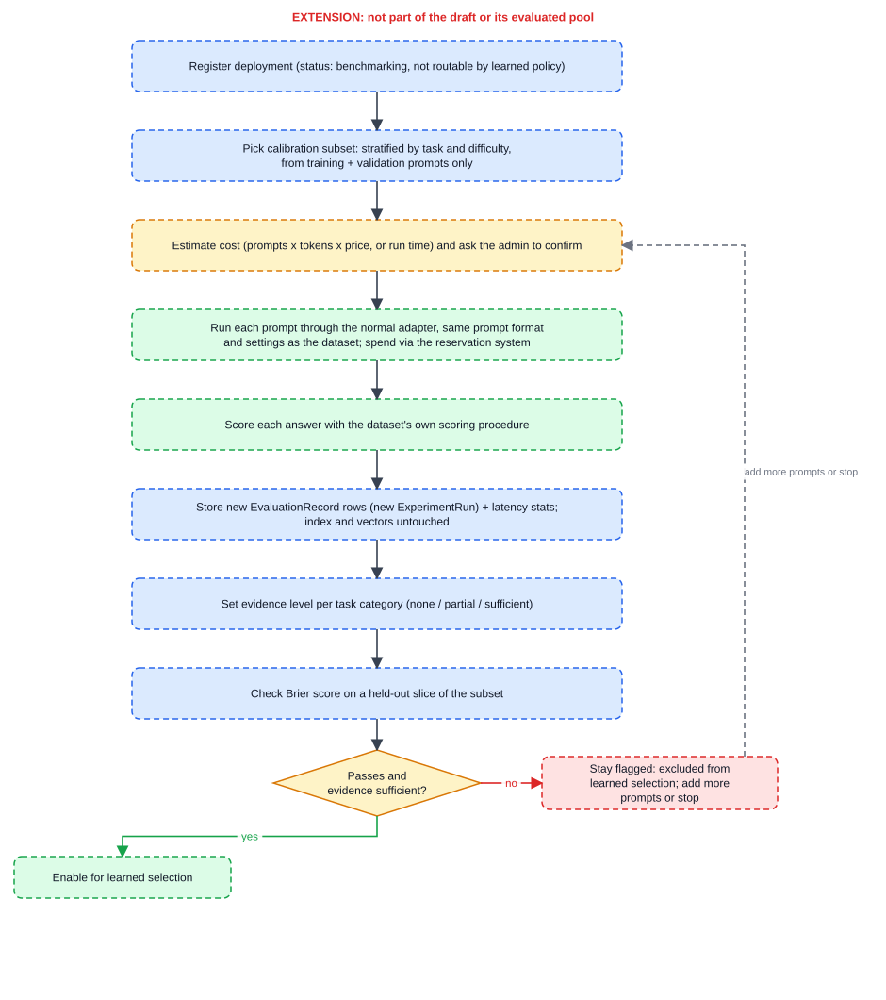

*Figure 13. Extension flow. Register the deployment as "benchmarking" so it is not routable by the learned policy; pick a stratified calibration subset of indexed prompts from training and validation only; estimate cost and ask the administrator to confirm; run each prompt through the normal adapter with the dataset's prompt format; score with the dataset's own procedure; store new outcome rows (index and vectors untouched); set an evidence level per task category; check the Brier score on a held-out slice. If it passes and evidence is sufficient, enable for learned selection; otherwise stay flagged and either add prompts or stop.*


1. **Register the deployment** as in section 3, but with status *benchmarking* so it is not selectable by the learned router yet.
2. **Pick the calibration subset.** A stratified sample of indexed prompts, balanced across task categories and difficulty, drawn from the training and validation partitions only. For an evaluation run, never from the test partition. **[Draft Table 3.6]** for the partition rule. Subset size and per-task minimums are **[Open decision]**.
3. **Show the estimated cost before running.** Number of prompts x average token counts (the outcome table stores token counts) x the new model's price. For a local model, estimated run time instead. Ask the administrator to confirm. A hosted benchmark spends from the capped budget through the **same reservation mechanism**, with its own benchmark budget. **[Draft 3.13 hard cap enforced in the gateway]**; a separate benchmark allowance is **[Open decision]**.
4. **Run each prompt through the normal adapter** with the same prompt format and generation settings the dataset used. Record those settings (the draft's provenance control: "model IDs, prompting settings and label definitions"). **[Draft Table 3.6]**
5. **Score each answer with the same procedure the dataset used** (for example exact match for multiple choice). The scoring must be comparable with the other models' scores. If a task needs a judge model or human grading, that is **[Open decision]**, and the draft's rule is not to fill gaps with unrelated numbers (3.7).
6. **Store the results** as new EvaluationRecord rows under a new ExperimentRun: (run, task_key, new model) -> score, token counts, cost basis reference. Also add measured latency to the deployment's latency history. **[Draft Table 3.4]** for the tables.
7. **Set an evidence level** for the new model, per task category: *none*, *partial*, *sufficient* (for example by how many scored neighbours a typical prompt in that category would find). Cut-offs are **[Open decision]**.
8. **Check calibration on a held-out slice** of the benchmarked prompts (Brier score against the constant-probability predictor, as in NFR-06). If it fails, keep the model flagged. **[Draft NFR-06]** as the standard; applying it per new model is **[Extension]**.
9. **Enable for learned selection** where evidence is sufficient. Record versions and dates.

#### 7.5.5 What happens before benchmarking finishes

The model must not silently receive learned traffic. Choices:

| Behaviour | What it means | Tag |
|---|---|---|
| **Excluded from learned selection** | Not a candidate for the hybrid. Visible in the admin view as "no evidence" | **[Extension]**; recommended default |
| **Flagged as insufficient evidence** | The predictor exposes the lack of evidence, as FR-07 requires | **[Draft FR-07]** |
| **Explicit-use only** | A client may request the model by name; the hard filters and budget rules still apply | **[Extension]** |
| **Limited exploration** | A small share of traffic is sent to it to gather evidence | **[Extension]**, not recommended in v1. It needs judged outcomes and approaches the bandit and RL territory the draft excludes |

Also: an unevidenced model is excluded as a **fallback** target unless a policy explicitly allows it. Fallback re-applies the same constraints as first selection. **[Draft FR-13]** for the re-application; the exclusion rule is **[Extension]**.

#### 7.5.6 What it costs

- **Hosted model:** spend is roughly (number of benchmark prompts) x (average tokens) x price. It must fit the hard cap. The draft's pilot budget is up to US$20 for all hosted calls. **[Draft Table 3.13]** How much of it, if any, can go on onboarding is **[Open decision]**.
- **Local model:** cost is time. The draft's hardware is two RTX 4070 laptops with 8 GB of GPU memory, and thermal throttling is a listed risk that distorts *timing* (not scores). **[Draft 1.8, 3.8, 3.11]**
- **Both:** the scoring step needs an automatic scoring procedure. Without one, no new evidence can be created. **[Extension]**

#### 7.5.7 Separate configurations, versioning and re-benchmarking

| Event | Quality evidence | Cost evidence | Tag |
|---|---|---|---|
| **A quantised local model and a similarly named hosted model** | **Separate.** They do not share quality labels | Separate | **[Draft 3.7, 3.11]** |
| **New model revision** (a pinned model definition changed) | New model row, new benchmark. Old scores belong to the old revision | New price version if applicable | **[Draft Table 3.4]** for pinned revision; re-benchmark rule **[Extension]** |
| **Different quantisation or serving settings** | Treat as a new configuration, new benchmark | Cost basis may change | **[Draft 3.7]** |
| **Price change** | Unchanged | New PriceVersion. No quality re-benchmark needed | **[Draft 3.6.4]** |
| **Hosted provider changes behaviour silently under the same name** | May drift. A small spot-check on a few prompts, compared with stored scores, can warn | Unchanged | **[Extension]**. The draft names provider change as a risk and mitigates with pinned versions and recorded dates (3.11) |
| **Local hardware change** | Quality unchanged | Latency stats and cost basis change, so refresh them | **[Extension]** |

#### 7.5.8 When no aligned scored outputs exist

If the chosen models do not have aligned scored outputs on the same prompts, the draft says: record the limitation and do not fill the gap with unrelated benchmark averages. **[Draft 3.7, 1.8, 3.11 first risk]** For a *new* model there is nothing aligned yet. The onboarding benchmark above is exactly the act of **creating** aligned outcomes, on the same prompts and with the same scoring. **[Extension]**

#### 7.5.9 An honest scope note for the defence

The proposal's *evaluation* uses a fixed pool of three to four models whose aligned outputs are confirmed (3.7). **[Draft 3.7]** Runtime onboarding of arbitrary new models is a natural **product** feature, but it is beyond the committed evaluation. Present it as a designed extension that the data model already supports, not as an evaluated result.

---


#### 7.5.10 Back to the seven-model example

In the setup of section 4, Custom-OA is exactly this case: registered, healthy and in-country, but with no outcome column. That is why Request 3 ended as infeasible. If Custom-OA were benchmarked on extraction prompts and passed the calibration check, Request 3 would get a Q̂ for it. Whether that Q̂ clears the 0.85 floor is for the data to decide; if it does not, the request correctly stays infeasible. Local-Code is the partial case: its estimate is available for code and maths prompts (Request 1) and flagged for summarisation (Request 2). **[Extension; illustrative]**

### 7.6 Monitoring and calibration

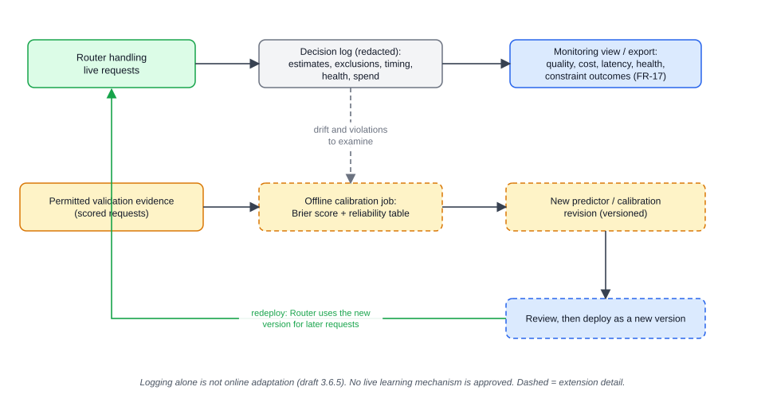

*Figure 15. The router handling live requests writes a redacted decision log (estimates, exclusions, timing, health, spend). A monitoring view or export summarises it. Separately, an offline calibration job uses permitted validation evidence (and examines drift and violations seen in the log) to compute Brier score and a reliability table, and may produce a new, versioned predictor or calibration revision. A person reviews it, and it is deployed as a new version that the router uses for later requests. There is no automatic online update.*

**What is recorded.** Per request: the decision (candidates, exclusions with reasons, frozen Q̂, Ĉ and L̂), every attempt with timing, usage state and known cost, reservations and their reconciliation state, and health events. No raw prompt text and no credentials. **[Draft Table 3.4, FR-15, 3.6.4]**

**What the administrator sees.** The active model pool, deployment health and breaker state, reserved spend, aggregate quality and calibration, and latency, with units and sample counts. A read-only export may come before a fuller dashboard (FR-17 is a Should). **[Draft 3.6.6, FR-17]**

**Calibration.** Monitoring feeds an *offline* calibration process. Logging alone is not described as online adaptation, and no live learning mechanism has been approved. **[Draft 3.6.5; hybrid design record]**

1. Collect permitted validation evidence (scored requests that are not test-partition outcomes). **[Draft 3.5.3, Table 3.6]**
2. Compute the reliability table and Brier score against the constant-probability predictor. **[Draft Table 3.9, NFR-06]**
3. If the estimates are off, refit the calibration (method is **[Open decision]**, section 13 P6).
4. Record the new predictor revision (it is stored with every `Estimate`). **[Draft Table 3.4 `predictor_revision`]**
5. Review, then deploy as a new version. The review and redeploy steps are **[Extension]**.

**Drift watch.** The log lets the team compare predicted quality, cost and latency with what was observed, and count violations of hard constraints (predicted feasibility versus actual violations are reported separately). **[Draft Table 3.9]** A scheduled drift report is **[Extension]**.

> **PART E. Reference and defence**

## 8. The hybrid predictor in depth

### 8.1 The question the predictor answers

For request *q* and candidate model *m*:

**Q̂(m, q) = f(task, difficulty, similarity, model)** **[Draft 3.6.5]**

"Roughly how well will model *m* do on a prompt like this one?" It uses four ingredients:

| Ingredient | Plain meaning | Where it comes from |
|---|---|---|
| **task** | What kind of job this is (maths, coding, summarising, extraction...) | Task classifier **[Draft FR-05]** |
| **difficulty** | How hard it is | A feature from the analysis step **[Draft 3.6.5]**; how it is produced is **[Open decision]** |
| **similarity** | How this model did on *similar past prompts* | Embedding retrieval plus the outcome table **[Draft FR-06; 1.11 "embedding-derived evidence"]** |
| **model** | Which model's performance we are asking about | Model identity as a feature, or one predictor per model. The exact estimator is **[Open decision]** |

The draft is careful about one point: task, difficulty and similarity are **correlated predictive features, not independent proof of quality**. Their contribution is tested by ablation (remove one, re-measure). **[Draft 3.6.5; hybrid design record]**

### 8.2 What exactly is embedded: requests, not models

An **embedding** turns a prompt into a list of numbers (a vector), so that prompts with similar meaning land close together. A sentence-transformers model does this. **[Draft Table 3.7; FR-06]**

The vectors are for **requests (prompts)**. Models are *not* embedded. A model's "profile" is the pattern of its scores across prompts, held in a table. This is the single most important design idea to be able to explain:

```
   EMBEDDING SPACE (one point per REQUEST)          OUTCOME TABLE (model x request)
   --------------------------------------           ------------------------------
        .p7      .p3                                task_key | model A | model B | model C
     .p1    * q (new prompt)                        ---------+---------+---------+--------
        .p4        .p9                              p1       |   1     |   1     |   1
                                                    p3       |   0     |   1     |   1
   index answers: "which stored prompts             p4       |   0     |   0     |   1
   are nearest to q?"  ->  p4, p1, p3, p7           p7       |   1     |   1     |   1
                                                    ...      |  score  |  score  |  score
   Then LOOK UP those rows in the outcome table
   and read each model's column.
```

Two separate structures, joined by the prompt ID:

1. **The index** stores, per indexed request: an ID (task_key), its vector, and (our suggestion) its task label, difficulty label and split partition. **[Extension]** for the exact per-request fields. The draft requires the index to be built "only from permitted historical records" (3.6.1) and the split to be fixed (Table 3.6).
2. **The outcome table** is EvaluationRecord: for each (run, task, model) a score, token counts and a cost-basis reference. **[Draft Table 3.4]**

What the index returns for a query: the IDs of the nearest *k* indexed requests, with a similarity (or distance) for each. It does not return scores. The scores come from the join. **[Extension]** for the mechanics.

### 8.3 Where the stored data comes from

In version one, the indexed history is **already-scored benchmark data** (RouterBench and LLMRouterBench), after licence and coverage checks. **[Draft 1.5, 3.7]** Live traffic is logged but does **not** flow back into the index by itself: "logging alone is not described as online adaptation", and monitoring feeds an *offline* calibration process. **[Draft 3.6.5]** Whether and how live outcomes ever enter the index is a later scope decision. **[Open decision]**

### 8.4 How neighbour votes become an estimate

Think of asking the nearest past prompts to "vote" on how each model did.

**Step A. Retrieve.** Embed q. Ask the index for the k nearest indexed prompts.

**Step B. Look up per-model outcomes.** For each model m, read m's score on each neighbour that has one. A neighbour with no score for m is skipped for m. This matters in section 7.5.

**Step C. Similarity-weighted vote.** Closer neighbours count more:

```
Q_knn(m, q) = sum_i  w_i * score(m, p_i)   /   sum_i  w_i
              where w_i is the similarity of q to neighbour p_i
```

If scores are 0 or 1 (right or wrong) this is a weighted success rate. **[Extension]** The weighting scheme (plain similarity, a sharpened version, or equal weights) and the value of k are tuned on validation data. **[Draft Table 3.7 "index type and k chosen on validation data"]**

**Step D. Combine with other features.** Raw votes alone are noisy. The estimator f takes: the vote Q_knn, how similar the neighbours actually were (mean or max similarity), how many neighbours had a score for m (the "effective" count), the task label, the difficulty, and the model identity. A small scikit-learn model (for example logistic regression or a gradient-boosted tree) turns them into one number. **[Extension]** for these particular inputs and model types; "scikit-learn" and "lightweight" are **[Draft Table 3.7]**; the exact estimator is **[Open decision]**.

**A subtle trap.** When training that small model, each training prompt must not find *itself* (or its duplicates) as a neighbour. Otherwise its own answer leaks into its own feature and the model looks better than it is. Exclude the prompt and its whole duplicate group when computing its training features. **[Extension]**, following the draft's grouped-split rule (Table 3.6: "group related requests and keep duplicates in one partition").

### 8.5 How the system knows what kind of task a prompt is

Two small, cheap analyses run before prediction. **[Draft FR-05, 3.6.5]**

| Output | What it is | Possible approach | Tag |
|---|---|---|---|
| **Task category** | A label such as maths, code, summarisation, Q and A | Classifier trained on benchmark prompts with their task labels. Its input can be the same sentence embedding already computed for retrieval, so it adds little cost | scikit-learn classifier **[Draft Table 3.7]**; reuse of the embedding **[Extension]**; label set **[Open decision]** |
| **Capability requirements** | Needs a tool call, structured output, long context, an image | Partly read straight off the payload (rules), partly predicted from text. Rules win: the classifier **never weakens an explicit client restriction** | **[Draft 3.6.5]** for the "never weakens" rule; split between rules and prediction **[Extension]** |
| **Difficulty** | How likely the request is to defeat models | One option: define it from the outcome table (for example, 1 minus the average score across models on similar training prompts) and train a regressor to predict it from the embedding | **[Extension]**; label definition **[Open decision]** |

The classifier does not decide which model to use. It only produces features and capability needs.

### 8.6 Calibration: making the number mean something

A raw model score such as 0.8 is not automatically "an 80% chance of success". The draft says a score will not be called a probability unless its label definition and calibration justify it. **[Draft 3.6.5]**

- **Reliability table:** group predictions into bins (0 to 0.1, 0.1 to 0.2 ...), then compare the average predicted value with the actual success rate in each bin. If the 0.8 bin succeeds 80% of the time, the number is honest. **[Draft Table 3.9]**
- **Brier score:** the average of (predicted probability minus actual outcome 0 or 1) squared. Lower is better. **[Draft Table 3.9, NFR-06]**
- **Target:** Brier score below that of a **constant-probability predictor** (one that always predicts the overall success rate), on held-out requests. **[Draft NFR-06, Table 3.10]**
- For continuous scores the draft promises "a declared measure". **[Draft Table 3.9]**
- **How** to calibrate (a Platt-style sigmoid, isotonic regression, or none) is **[Open decision]**. Fitting only on training and validation partitions is **[Draft Table 3.6]**.
- Calibration is an offline step, fed by permitted validation evidence, not by uncontrolled updates from test outcomes. **[Draft 3.5.3]**

### 8.7 "Insufficient evidence" (FR-07)

FR-07 says the predictor must *expose cases with insufficient evidence*. **[Draft FR-07]** The point: the system should be able to say "I do not know" instead of inventing a confident number.

Triggers the team might use (all thresholds are **[Open decision]**):

| Trigger | Example | Tag |
|---|---|---|
| Too few scored neighbours for model m | Only 2 of the k neighbours have a score for m | **[Extension]** |
| Neighbours are not really similar | Best similarity is low: the prompt is unlike anything indexed | **[Extension]** |
| Model m has little or no outcome data overall | A newly added model (section 7.5) | **[Extension]** |

What the selector does with a flagged estimate is **[Open decision]**. A conservative option: treat that model as *not eligible for learned selection* for this request, record why, and let non-learned rules decide only if policy permits. **[Extension]** The draft does require the flag to be visible. **[Draft FR-07]**

### 8.8 Leakage control

**Leakage** means the system sees, during routing, information about the answer it is being graded on. That would make results look better than they are. The draft's controls: **[Draft 1.5, Table 3.6, 3.7]**

| Control | In plain words |
|---|---|
| Split before tuning | Training, validation and test partitions are fixed before any tuning |
| Group related prompts | Duplicates and near-duplicates stay together in one partition |
| Fit only on train and validation | The classifier, the index, the normalisers and the calibration are fit only on those partitions |
| Test outcomes stay out of retrieval | "Evaluated outcomes are kept out of the retrieval index used to route those requests". Labels are revealed only for scoring |
| Untouched test set | A tuning pilot is kept separate from the test partition. Any retuning after inspecting test results is labelled exploratory |
| Own split | A benchmark's own split does not automatically become the study's split |

---

## 9. Choosing the final model

### 9.1 The idea in one line

Among the models that are allowed and predicted good enough, send the request to the **cheapest**.

### 9.2 The formulas

All from **[Draft 3.6.5]**:

- E(q): deployments passing capability, context, privacy, health and preliminary affordability.
- B_rem: remaining permitted budget. D_rem: remaining deadline. τ: minimum predicted quality.
- Feasible set: **F(q) = { m in E(q) : Q̂(m,q) ≥ τ, Ĉ(m,q) ≤ B_rem, L̂(m,q) ≤ D_rem }**
- Choice: **m\* = argmin over m in F(q) of Ĉ(m,q)**
- Tie-break: lower predicted latency, then a stable deployment identifier, so runs are reproducible.

### 9.3 Where Ĉ and L̂ come from

- **Ĉ (expected cost)** = input tokens x input rate + expected output tokens x output rate, using the current PriceVersion and, for a local model, its explicit cost basis. The Request row holds a token estimate. **[Extension]** for the arithmetic; **[Draft Table 3.4]** for the stored fields. How "expected output length" is estimated is **[Open decision]**. The token counts stored in the outcome table are one possible source. **[Extension]**
- **L̂ (predicted latency)** comes from the deployment's latency history. **[Draft 3.4.1]** The exact estimator (for example a rolling percentile) is **[Open decision]**.

### 9.4 Expected cost versus reserved cost

Ranking uses the *expected* cost. But before calling, the accountant reserves a **conservative** amount based on input and output caps. If the number of chargeable tokens cannot be bounded, a hard budget requires a conservative bound or rejection. **[Draft 3.6.5, FR-10]** In short: rank on the likely cost, protect the budget with the worst case.

### 9.5 The weighted-utility comparator

U(m,q) = α·Q̂ − β·C̃ − γ·L̃, where C̃ and L̃ are normalised cost and latency. The scaling constants and weights α, β, γ are chosen on validation data only. It is evaluated **only as a comparator** (an evaluation arm called "Utility variant"), still obeys every hard restriction, and does not replace the cheapest-feasible rule. **[Draft 3.6.5, Table 3.8]** Why include it: reviewers will ask "why not combine everything into one score?", and this arm answers with data. **[Extension]** (framing only)

### 9.6 What if nothing is feasible?

The first version rejects with an explicit error. Later versions may relax an explicitly *soft* preference or ask the caller for permission to exceed a limit. No path silently relaxes a hard budget, capability or privacy rule. **[Draft 3.6.5, UC2]**

### 9.7 Predicted is not observed

A model predicted to be good enough may still fail on this prompt, and predicted latency may be wrong. The draft says these violations are **measured**, not assumed away. **[Draft 3.6.5; Table 3.9 "Constraint violations separates predicted feasibility from actual violations"]**

---

## 10. Every algorithm and technique

"Rough cost" is about how the work scales and which part of the budget it uses, not measured timings. Real timings come from the overhead tests (NFR-03: p95 gateway overhead at most 100 ms). **[Draft NFR-03]**

| # | Technique | Plain intuition | Input -> output | Rough cost | Tag |
|---|---|---|---|---|---|
| 1 | **Auth and validation** | Check who is calling and that the request is sane | Request -> accept or error | Negligible | **[Draft FR-02]** |
| 2 | **Deterministic hard filters** | Cross out models that physically or legally cannot do the job. Pure rules, no learning | Request + registry + health -> E(q) | A loop over a handful of deployments | **[Draft FR-04, 3.6.5]** |
| 3 | **Sentence embedding** (sentence-transformers) | A small neural network that turns text into a vector so similar meanings are close | Prompt text -> vector | One forward pass per request. On laptop hardware likely the largest part of gateway overhead. Must be measured | Technique **[Draft Table 3.7]**; "likely largest" is **[Extension]** |
| 4 | **Task classifier** (scikit-learn) | A small supervised model that labels the task type | Embedding (or features) -> label | Tiny: a matrix multiply or a few trees | **[Draft FR-05, Table 3.7]**; label set **[Open decision]** |
| 5 | **Difficulty estimate** | Guess how hard the prompt is | Embedding -> number | Tiny | Feature **[Draft 3.6.5]**; method **[Open decision]** |
| 6 | **Exact k-NN** | Compare the query with *every* stored vector and keep the k closest | Query vector -> k IDs + similarities | Grows linearly with the number of indexed prompts times the vector size. Exact and simple | **[Draft Table 3.7]** (k-NN index); "exact" is one candidate, **[Open decision]** |
| 7 | **Approximate index (HNSW)** | Build a layered "small-world" graph of vectors, then hop through it toward the query. Skips most comparisons and may miss a true neighbour occasionally | Query vector -> approximate k IDs | Search grows roughly with the log of index size. Costs: building the graph, extra memory, tuning knobs (graph connectivity, build effort, search effort) | **[Extension]** candidate. The draft says only that "index type and k [are] chosen on validation data". HNSW is **not** committed |
| 8 | **Similarity-weighted voting** | Nearer past prompts count more when averaging per-model scores | k neighbours + their model scores -> Q_knn per model | Tiny | **[Extension]**; estimator **[Open decision]** |
| 9 | **Estimator f** (scikit-learn) | Combine vote, similarity strength, evidence count, task, difficulty, model into one quality estimate | Features -> Q̂ | Tiny at inference; fitted offline | **[Draft 3.6.5, Table 3.7]**; form **[Open decision]** |
| 10 | **Calibration** | Re-map scores so "0.8" really means about 80% | Raw Q̂ -> calibrated Q̂ | Tiny; fitted offline on validation | Measured by Brier and reliability table **[Draft Table 3.9]**; method **[Open decision]** |
| 11 | **Insufficient-evidence rule** | Say "unknown" when neighbours are few or far | Evidence counts and similarities -> flag | Tiny | **[Draft FR-07]**; thresholds **[Open decision]** |
| 12 | **Constrained cheapest-feasible selection** | Keep the models that pass every limit, then take the cheapest | Estimates + limits -> m* | Sort a few items | **[Draft 3.6.5, FR-08]** |
| 13 | **Deterministic tie-break** | Same input should give the same choice | Tied candidates -> one | Negligible | **[Draft 3.6.5]** |
| 14 | **Weighted utility** | One blended score of quality, cost, latency | Estimates + weights -> U | Negligible | **[Draft 3.6.5]**, comparator only |
| 15 | **Budget reservation and reconciliation** | Hold the money before the call; settle after. Uncertain charges stay held | Attempt -> reservation row -> final cost | A database transaction per attempt | **[Draft FR-10, 3.6.4]** |
| 16 | **Health tracking** | Remember recent failures and slowness per deployment | Attempt outcomes -> health state | Tiny | **[Draft FR-12]** |
| 17 | **Circuit breaker** (closed, open, half-open) | Stop calling something that keeps failing, then cautiously test | Failure events -> state | Tiny | **[Draft FR-12, 1.11]**; thresholds **[Open decision]** |
| 18 | **Bounded retry and fallback** | If it fails, try a different permitted model, but only a limited number of times and only if safe | Failed attempt -> new attempt or error | One extra model call per fallback, charged | **[Draft FR-13, FR-14]** |
| 19 | **Grouped, leakage-controlled split** | Keep near-duplicates on the same side of the train and test wall | Dataset -> partitions | Offline | **[Draft Table 3.6]** |
| 20 | **Failure injection** | Break local models on purpose (timeouts, throttling, slow or malformed replies, cut streams) and see if requests still finish | Fault script -> completion rate | Offline test harness | **[Draft 3.9, Table 3.10]** |
| 21 | **Evaluation statistics** | Paired bootstrap, McNemar, Wilcoxon, Holm, Brier, reliability table. See section 11 | Per-request paired results -> intervals and p-values | Offline | **[Draft 3.9]** |
| 22 | **Quality cascade** (optional) | Answer, judge the answer, escalate if poor | Completed response -> verifier -> maybe re-ask | Extra verifier and generation calls, counted separately | **[Draft FR-19, 3.6.5]** optional experiment |

### Exact k-NN versus HNSW, in plain words

- **Exact:** like checking every card in a box. Always right, slow only when the box is huge. Easy to test, so it suits the embeddings-off ablation and early development. **[Extension]** reasoning
- **HNSW:** like asking a well-connected friend who knows someone who knows someone near what you want. Much faster on big collections, may occasionally miss a true neighbour, needs tuning and extra memory. **[Extension]**
- The indexed set size is not known until the data is inspected, so whether HNSW is worth it is **[Open decision]**. The draft commits only to "a k-NN index" whose type and k are chosen on validation data. **[Draft Table 3.7]**
- A fair way to decide: measure whether approximate search changes routing quality (recall of neighbours, then final quality) and overhead. Pick the simpler one if they tie. **[Extension]**
- If the embedding model changes, every stored vector must be recomputed and the index rebuilt, because vectors from different models are not comparable. **[Extension]** (general property of embeddings)

---

## 11. How the evaluation will prove (or disprove) it

### 11.1 The main claim, in plain words

"The hybrid router gives answers nearly as good as always using the best single model, but costs at least a fifth less, adds under 100 ms, and keeps working when providers fail, without ever breaking a hard rule." A simpler router matching the hybrid is an acceptable, reportable result. **[Draft 1.3, 3.14]**

### 11.2 Targets (committed numbers, fixed before results)

| ID | Target | Source |
|---|---|---|
| NFR-01 | Quality within **2 percentage points** of the best single model; lower limit of a one-sided 95% interval above −2 points | **[Draft Table 3.2]** |
| NFR-02 | Cost per completed request **at least 20% lower** than the best-single-model reference | **[Draft Table 3.2]** |
| NFR-03 | p95 gateway overhead **at most 100 ms** (routing and selection, excluding generation) on paired direct and gateway calls | **[Draft Table 3.2]** |
| NFR-04 | **At least 95%** of eligible requests completed under each injected failure type | **[Draft Table 3.2]** |
| NFR-05 | **Zero unreported hard-constraint violations**; concurrency and reservation assertions pass | **[Draft Table 3.2]** |
| NFR-06 | Brier score below a constant-probability predictor on held-out requests | **[Draft Table 3.2]** |
| NFR-09 | Independent rerun reproduces quality within 1 point and cost within 5% | **[Draft Table 3.2]** |

Targets may be revised after a pilot only with a recorded reason and before test results are examined. **[Draft 1.3, 3.5.2]** The interval level, primary latency measure, sample sizes and stopping rules are fixed after the pilot, before analysis. **[Draft 3.9]**

### 11.3 The arms (what it is compared with)

| Arm | What it does | Tag |
|---|---|---|
| Fixed model | Send everything to one model (the best on validation data is the reference) | **[Draft Table 3.8]** |
| Cheapest eligible | Cheapest model after the hard filters, no quality prediction | **[Draft Table 3.8]** |
| Rule-based task routing | Fixed task-to-model table from training evidence | **[Draft Table 3.8]** |
| Lightweight learned predictor | Predict suitability from lightweight features, no retrieval | **[Draft Table 3.8]** |
| **Hybrid** | Classification plus embedding evidence plus constrained selection | **[Draft Table 3.8]** |
| Component ablations | Remove embeddings; remove task and difficulty features; optionally retrieval-only | **[Draft Table 3.8]** |
| Utility variant | Weighted utility under the same hard rules | **[Draft Table 3.8]** |
| Optional cascade | Escalate poor completed answers; verifier calls charged separately | **[Draft Table 3.8]** |

All arms share the same eligible candidates, request caps, adapters and accounting. Ablations change only the named component. **[Draft 3.9]**

### 11.4 Replay versus live

- **Replay:** use stored scored outputs to estimate quality and cost trade-offs cheaply. It cannot show current provider latency. **[Draft 3.9]**
- **Capped live pilot:** a small number of real hosted calls to measure latency, gateway overhead and fallback behaviour. The provider and amount are recorded first. **[Draft 3.7, 3.9]**
- **Local failure injection:** deliberately cause timeouts, throttling, server errors, malformed responses and cut streams on local models. **[Draft Table 3.10]**
- Replay and live results are reported separately. **[Draft 1.8, 3.9]**

### 11.5 The statistics

| Method | Used for | Why | Source |
|---|---|---|---|
| Paired comparison | All arms | The same requests are scored under every arm, so differences are paired | **[Draft 3.9]** |
| Paired bootstrap interval (resampling groups of related requests) | Quality difference ΔQ and non-inferiority | Related prompts are not independent | **[Draft 3.9]** |
| Non-inferiority hypothesis H0: ΔQ ≤ −δ, H1: ΔQ > −δ, δ = 2 points | Quality claim | "Not significantly worse" is not the same as "equivalent" | **[Draft 3.9]** |
| McNemar's test | Paired yes-or-no outcomes (for example completed or not) | Suitable for paired binary data | **[Draft 3.9]** |
| Wilcoxon signed-rank | Paired cost and latency differences | These are rarely normally distributed | **[Draft 3.9]** |
| Holm adjustment | Multiple comparisons | Controls false positives | **[Draft 3.9]** |
| Brier score and reliability table | Calibration | See 8.6 | **[Draft Table 3.9]** |

Timeouts and rejected requests stay in the denominators. Results are shown per domain and in aggregate. Negative and inconclusive results are kept. Post-test retuning is labelled exploratory. **[Draft 3.9]**

---

## 12. Anticipated defence questions

Short, honest answers. Tags mark what you may state as committed.

**Q1. Explain the problem in plain language.**
Developers who use several AI models either hard-wire one model or pay for the best one all the time. Models differ in price, speed and ability, and providers fail. The router picks, per request, a model that is allowed and good enough at the lowest cost, and recovers safely when calls fail. **[Draft 1.1, 1.2]**

**Q2. And in programming terms?**
Constrained selection over a small set of deployments: filter by hard predicates, estimate quality with a learned and calibrated model, choose the argmin of expected cost over the feasible set, then run the call under a transactional spend ledger with circuit breakers and bounded retries. **[Draft 3.6.5]**

**Q3. How is this different from OpenRouter, LiteLLM or Portkey?**
Those products already offer one endpoint, per-prompt routing or fallback, and the draft claims no novelty there. The project's contribution is a specified constrained policy (hard budget and privacy rules kept during fallback), a hybrid suitability estimator tested against simpler baselines with ablations, and a separately evaluated recovery mechanism. Table 2.2 uses "?" where the checked documentation did not establish a feature. That is not evidence the feature is absent, and the table's information is grey literature that will be rechecked. **[Draft 2.5, 2.7]**

**Q4. Why not just always use the best model, or always the cheapest?**
Those are baselines in the evaluation (fixed model, cheapest eligible). The project does not assume they lose. If they match the hybrid, that is a reportable result. **[Draft 2.3.2, 3.14]**

**Q5. Why a hybrid? Why not only a classifier, or only embeddings?**
Because it is not known whether the combination justifies its overhead. Ablations remove each part on identical splits to measure the contribution. **[Draft 2.7, Table 3.8]**

**Q6. What if the prompt is unlike anything in the index?**
Neighbours would be far or few, and the estimate would be flagged as insufficient evidence (FR-07), so the system should not present a confident number. What the selector does with the flag is still to be decided. **[Draft FR-07]**; handling **[Open decision]**

**Q7. Is the quality score a real probability?**
Not unless calibration shows it. The draft says a score is not called a probability without label definition and calibration. The evaluation reports a Brier score and a reliability table. **[Draft 3.6.5, Table 3.9, NFR-06]**

**Q8. How do you stop the system cheating on the test set?**
Splits fixed before tuning, grouped duplicates, fitting only on train and validation, and test outcomes kept out of the retrieval index for the requests being routed. **[Draft Table 3.6]**

**Q9. What if a model is new or its price changes?**
Price change: a new price version, no re-benchmark. New model: benchmark it on a subset of the already-indexed prompts and add a column to the outcome table. Until then it is excluded or flagged. The index itself does not change. The onboarding flow is a designed extension, not part of the evaluated pool. **[Draft 3.6.4]** for prices; onboarding **[Extension]** (section 7.5)

**Q10. What can go wrong, and what is the mitigation?**
From the draft's risk table: **[Draft Table 3.11]**

| Risk | Mitigation in the draft |
|---|---|
| No aligned scored outputs for chosen models | Check coverage in Phase 1; pick models from the aligned subset; record the limitation |
| Local model too big or too slow | Profile both laptops; use a smaller quantised model as a separate configuration |
| Hosted spend exceeds budget | Hard cap enforced in the gateway; replay for most experiments |
| Dataset licence blocks use or sharing | Clear licences first; share only configurations and aggregates |
| Provider changes API, price or availability | Pin versions, record dates, isolate adapters |
| Laptop thermal throttling distorts timing | Fixed power mode, repeated runs, recorded temperatures |
| Hybrid shows no gain | Report as a valid finding; ablations and baselines are planned |
| Scope creep | Freeze requirements after Sprint 2 |
| Team workload and exams | Two-week sprints with slack, named owners and backups |

**Q11. Could it work in other environments (other models, languages, companies)?**
The findings will apply to the models, workloads and deployments tested; no claim covers all tasks and languages. **[Draft 1.6, 1.7]** The *design* is portable: a different pool needs new aligned outcomes, which is the onboarding benchmark of section 7.5. **[Extension]**

**Q12. Does it learn from live traffic?**
No. Logging is not online adaptation. Monitoring feeds an offline calibration process, and no live learning mechanism has been approved. **[Draft 3.6.5]**

**Q13. Why not reinforcement learning or response fusion?**
They are excluded from the first version. **[Draft FR-20, 1.7]** (The draft states the exclusion; the reasons you give in the defence, such as time and evaluability, are your own framing.)

**Q14. What stops a malicious prompt or a malicious endpoint?**
Input text is untrusted data: instructions inside a request cannot change permissions, budget accounting, secret access or retry policy. Endpoints are administrator-controlled and checked for SSRF, with only explicitly authorised local endpoints. Keys stay out of responses, prompts and logs. **[Draft 3.6.7]**

**Q15. Why one application and PostgreSQL?**
The first version is kept small and testable, each module can be switched off for ablation, and PostgreSQL gives transactions for concurrent budget reservations. **[Draft 3.4.2, 3.6.1, Table 3.7]**

**Q16. Isn't the gateway itself a slowdown?**
It adds overhead (embedding, classification, search, selection), and the target is p95 at most 100 ms, measured on paired direct and gateway calls. Whether it meets the target is not yet known. **[Draft NFR-03]**

**Q17. What is the Nigerian relevance?**
Dollar-priced services make cost control matter more when the naira moves, and rules on sending personal data abroad make "where does this request go" a policy question. Local models and privacy filters give teams a way to keep some traffic local. The draft is explicit that it does not measure Nigerian teams' spending. **[Draft 1.1]**

**Q18. What exactly will you show as proof?**
Paired comparisons against four baselines and ablations, with intervals and sample counts, against the numeric targets; calibration reports; failure-injection completion rates; measured overhead. Not a promise that the hybrid wins. **[Draft 3.9, Table 3.10]**

**Q19. Why exact k-NN or HNSW?**
Not decided. Index type and k are chosen on validation data. HNSW is a candidate that would only be adopted if it keeps quality while cutting overhead. **[Draft Table 3.7]**; HNSW **[Extension]**

**Q20. What does the draft not tell us yet?**
See section 13. It is fine to say so openly in the defence.

---

## 13. Open decisions: options, my recommendations and how to decide

The draft leaves many choices open on purpose ("chosen on validation data", "set after the pilot"). This section goes through each one with the options you can consider, **my own recommendation**, why, and what to look at to settle it. Each recommendation is an **[Extension]**: it is my suggestion, not something the draft says. The decision itself stays an **[Open decision]** until the team records it.

### 13.1 How to approach any open decision

1. **Sort it into one of three kinds.**
   - *Measurable on validation data* (k, calibration method, thresholds): run a small experiment and let the validation partition decide. Never use the test partition. **[Draft Table 3.6]**
   - *Policy or design choice* (error codes, secret store, privacy attribute): pick the simplest option that satisfies the draft, test it with a few scenario cases, and write down why.
   - *Needs someone's sign-off* (supervisor, licence terms, budget): ask early, in writing. The hybrid direction itself is recorded as owner-selected with supervisor approval unconfirmed (D01).
2. **Prefer the simpler option when results tie.** The draft already says a simpler method matching the hybrid is an acceptable finding, so the same rule is a good tiebreaker for every internal choice. **[Draft 1.3, 3.14]**
3. **Fix the metric before you look.** Decide what "better" means (Brier score, quality, overhead) and the validation procedure first, then compare options.
4. **Record it.** Write each decision in your `decisions/` folder as a short note: question, options, choice, reason, date, version. The draft requires changes made after inspecting test results to be labelled exploratory, so dates matter. **[Draft 3.1, 3.9]**
5. **Freeze before the test set is touched.** Everything in the "must decide before the test partition" group below is fixed, with a recorded reason, before the held-out analysis. **[Draft 1.3, 3.5.2, 3.9]**

### 13.2 When to decide each one (suggested, by sprint)

Sprint names and periods are from the draft's work plan. **[Draft Table 3.12]** Assigning decisions to sprints is my suggestion. **[Extension]**

| Sprint (period) | Decide | Items below |
|---|---|---|
| 1 Requirements and protocol (Nov to Dec 2026) | Evaluated pool; task families; quality score and margin protocol; budget split | P8, P2, S1, S4 |
| 2 Gateway core (Dec 2026 to Jan 2027) | Secret store; interface for "let the router choose"; privacy attribute; error codes; registry extras | A1, A4, S3, R3, A3 |
| 3 Adapters and baselines (Jan to Feb 2027) | Local cost basis; safe-retry rule | A2, R2 |
| 4 Features (Feb 2027) | Embedding model, k, weighting; index type and storage; difficulty definition | P4, P5, P3 |
| 5 Predictor and selector (Mar 2027) | Estimator; calibration; insufficient-evidence rule; output-length and latency estimators; utility weights | P1, P6, P7, P9, S2 |
| 6 Reliability (Mar to Apr 2027) | Retry set, allowance, breaker thresholds, probes, timeouts; held-spend rule; counting interrupted streams | R1, R5, R4 |
| 7 to 8 (Apr to May 2027) | Whether and how to ship the onboarding benchmark | N1 to N4 |
| Before the test partition is analysed | Interval level, primary latency measure, sample sizes, stopping rules | S1 and the analysis plan **[Draft 3.9]** |

### 13.3 Index of decisions

| ID | Open decision | Kind |
|---|---|---|
| P1 | Form of the estimator f | measurable |
| P2 | Task label set | design + data |
| P3 | Difficulty definition | measurable |
| P4 | Embedding model, k, similarity weighting | measurable |
| P5 | Index type (exact or HNSW) and where vectors live | measurable + design |
| P6 | Calibration method and continuous-score measure | measurable |
| P7 | Insufficient-evidence thresholds and handling | measurable |
| P8 | Which 3 to 4 models form the evaluated pool | needs sign-off |
| P9 | Estimating output length and latency | measurable |
| P10 | Whether live outcomes ever enter the index | design |
| S1 | Primary quality score and justifying the 2-point margin | needs sign-off |
| S2 | Utility comparator weights and normalisation | measurable |
| S3 | Privacy attribute on deployments; who may loosen policy | design |
| S4 | Per-request cap versus the overall hosted cap | design + budget |
| R1 | Retryable failures, allowance, breaker thresholds, probes, timeouts | measurable |
| R2 | How a call is declared safe to retry | design |
| R3 | Error codes and what the client is told | design |
| R4 | Counting interrupted streams against the 95% target | needs sign-off |
| R5 | How a held (uncertain) reservation is resolved | design |
| A1 | Where secrets are stored | design |
| A2 | Local cost basis method | design + data |
| A3 | Registration test call, active health probes, wizard, retire semantics | design |
| A4 | How a client asks the router to choose, and names a policy | design |
| N1 | Whether new-model onboarding is built | needs sign-off |
| N2 | Calibration subset size and scoring of judge-needed tasks | measurable |
| N3 | Budget share for onboarding benchmarks | needs sign-off |
| N4 | Evidence thresholds and whether exploration is allowed | design |

---

### 13.4 Predictor and data

#### P1. Form of the estimator f
- **What is open:** "one estimator with query and model features, or a small set of per-model predictors; exact estimator remains to be decided." **[Draft 3.6.5; hybrid design record]**
- **Options:** (a) one shared model with the model identity as a feature (inputs: neighbour vote, similarity strength, number of scored neighbours, task, difficulty, model); (b) one small model per deployment; (c) no learned f at all: use the calibrated neighbour vote only.
- **My recommendation:** build (c) first as a reference, then (a) with **logistic regression**; move to gradient-boosted trees only if validation Brier score improves clearly.
- **Why:** with only three or four models and modest data, (b) splits the data thin and (a) shares strength across models. Logistic regression is fast, gives probabilities, and is easy to explain in a defence. Option (c) gives you a free ablation rung.
- **How to decide:** fit each on the training partition; compare Brier score and log-loss on validation; choose the simplest option within noise of the best. Decide in Sprint 5.

#### P2. Task label set
- **What is open:** the categories the classifier predicts. **[Draft FR-05]** names classification but not the labels.
- **Options:** (a) the benchmark's own task or dataset labels; (b) a handful of coarse families you define (for example maths, code, knowledge Q and A, summarisation, extraction and formatting, reasoning, chat); (c) clusters of embeddings with no names.
- **My recommendation:** (b), built by mapping the benchmark's task IDs into about five to eight families.
- **Why:** the labels come free from the data, are easy to explain, and the rule-based baseline (a task-to-model table) needs the same labels. Unnamed clusters are hard to defend and hard to debug.
- **How to decide:** after the Sprint 1 data inspection, count prompts per family. Merge any family with too little data to score models reliably. Keep families few enough that each has a usable sample.

#### P3. Difficulty definition
- **What is open:** how the "difficulty" feature is produced. **[Draft 3.6.5]**
- **Options:** (a) derive it from the outcome table (for example 1 minus the average score across candidate models on that prompt) and train a regressor to predict it from the embedding; (b) hand-made signals such as prompt length or number of steps; (c) leave it out at first and test it as an ablation.
- **My recommendation:** (a), with (c) kept as the ablation arm.
- **Why:** it is grounded in real outcomes and costs no extra labelling. Take care that it is computed from training data only and that a prompt is never its own neighbour.
- **How to decide:** the ablation (remove task and difficulty features, **[Draft Table 3.8]**) shows whether it helps. If it adds nothing, drop it and report that.

#### P4. Embedding model, k and similarity weighting
- **What is open:** "exact models chosen after testing"; "index type and k chosen on validation data". **[Draft Table 3.7]**
- **Options:** model: a small general-purpose sentence-embedding model (for example a MiniLM-class model), a larger one, or a multilingual one. k: try a small grid (for example 5, 10, 20, 50). Weighting: plain similarity, a sharpened (softmax-style) similarity, or equal weights.
- **My recommendation:** start with a small, widely used model, k chosen from the grid on validation, and plain similarity weighting; try one larger model only if retrieval quality looks poor.
- **Why:** embedding time is part of the 100 ms p95 overhead target and shares two 8 GB laptops with local inference. **[Draft NFR-03, 1.8]** Do not claim support for Nigerian languages or other languages unless tested; the draft makes no claim across all languages. **[Draft 1.7]**
- **How to decide:** for each candidate, measure grouped-split validation Brier score and routing quality, plus the time per embedding on your laptops. Choose the smallest model that is not clearly worse.

#### P5. Index type (exact or HNSW) and where vectors live
- **What is open:** the draft commits to "a k-NN index" only. HNSW is a candidate, not a commitment. **[Draft Table 3.7]**
- **Options:** (a) exact search over a matrix held in memory (NumPy or scikit-learn); (b) a library with an HNSW index; (c) vectors inside PostgreSQL with a vector extension (exact or HNSW); (d) a separate vector database.
- **My recommendation:** (a) first, loaded from a file produced by the offline job, with its version recorded in the experiment run. Adopt HNSW only if measured search time is a noticeable share of your 100 ms budget at your real index size.
- **Why:** no new service (the draft keeps extra infrastructure out of the core), exact search is the reference you need anyway to test an approximate index, and the index is built offline. **[Draft 3.8]**
- **How to decide:** once you know the number of indexed prompts and the vector size, time exact search (p95). If it is small against the budget, stop. If not, measure HNSW's neighbour recall against exact and then its effect on final quality and overhead; adopt it only if quality is unchanged. Remember to re-embed and rebuild if the embedding model changes.

#### P6. Calibration method and the continuous-score measure
- **What is open:** how to calibrate and what "declared measure" to use for continuous scores. **[Draft Table 3.9]**
- **Options:** none; Platt scaling (a sigmoid fitted on scores); isotonic regression; for continuous scores, either threshold them into success or report a calibration error on the raw scale.
- **My recommendation:** define success as a binary event (score at or above the dataset's pass mark) wherever datasets allow, calibrate with **Platt scaling**, and consider isotonic only if validation data is large.
- **Why:** Platt has two parameters and is safe on small samples; isotonic can overfit small validation sets. Binary success keeps the draft's Brier score and reliability table well defined. **[Draft NFR-06]**
- **How to decide:** fit on validation with cross-validation; compare Brier score with and without calibration and against the constant-probability predictor; keep a reliability plot for the report.

#### P7. Insufficient-evidence thresholds and handling
- **What is open:** FR-07 requires exposing the cases; the triggers and the response are not set. **[Draft FR-07]**
- **Options for triggers:** too few scored neighbours for a model; best similarity below a floor; both. **Options for handling:** exclude the model from learned selection; fall back to a task-family prior for that model; fall back to a non-learned rule.
- **My recommendation:** use both triggers with thresholds read off the validation distribution (for example a percentile of observed similarity); handle by falling back to the family prior if that family has enough evidence, otherwise exclude the model from learned selection. Always log the flag.
- **Why:** it never trusts a thin estimate and it keeps coverage high. Silent fallback to an unlabelled guess would hide the problem.
- **How to decide:** on validation, plot error against the share of requests kept as the thresholds tighten; pick the knee where error on kept requests stops improving much. Report the share flagged.

#### P8. The evaluated pool (3 to 4 models)
- **What is open:** names wait for confirmed aligned scored outputs. **[Draft 3.7, risk table 3.11]**
- **Options:** (A) all models taken from the benchmark data; (B) a mix: benchmark-covered hosted models plus one or two small local models that you score yourselves on the same prompts; (C) score everything yourselves on a small set. (These are the options in your D05 note.)
- **My recommendation:** (B): one local small model (Ollama), one cheap or mid-tier hosted model, one frontier hosted model, plus a fourth only if time and budget allow.
- **Why:** it matches the draft's small, mid-tier and frontier spread, keeps hosted spend inside the cap, and still gives a genuine local deployment for failure injection. **[Draft 3.7, 3.13]**
- **How to decide:** in Phase 1, inspect which models share scored outputs on the same prompts, check licences, and confirm the local model fits an 8 GB GPU. Freeze identifiers and versions before any experiment. Do not fill missing outcomes with unrelated benchmark averages. **[Draft 3.7]**

#### P9. Estimating output length and latency
- **What is open:** how expected output tokens (for Ĉ) and L̂ are estimated. **[Draft 3.4.1, 3.6.5]**
- **Options:** output length: per-model, per-task-family average from the outcome table; a small regression; or just the cap. Latency: fixed per-model constants measured in profiling; rolling percentiles per deployment; or a model of latency versus output length.
- **My recommendation:** expected output = median tokens per (model, task family) from stored token counts, with the cap used only for the reservation; latency = constants measured in Sprint 2 profiling, then a rolling percentile per deployment once live data exists, using a high percentile (p95) for the deadline test and the median for tie-breaks.
- **Why:** it uses data you already store, keeps the budget safe, and makes deadline checks conservative.
- **How to decide:** in the pilot, compare predicted and observed latency and cost; report the violation rate (predicted feasible but actually missed). **[Draft Table 3.9]**

#### P10. Whether live outcomes ever enter the index
- **What is open:** the draft says no live learning mechanism is approved. **[Draft 3.6.5]**
- **Options:** never (version one); an offline batch process with a scoring step and review; online updates.
- **My recommendation:** never in version one; list it as future work.
- **Why:** live answers have no ground-truth score, and feeding them back risks leaking test information and breaking the split protocol.
- **How to decide:** revisit after the evaluation if time remains, and only with a labelled scoring method.

### 13.5 Policy and selection

#### S1. Primary quality score and justifying the 2-point margin
- **What is open:** the draft fixes δ = 2 percentage points and says the primary score and the justification are settled before test outcomes are seen. **[Draft 3.9, NFR-01]**
- **Options for the score:** a macro-average of each dataset's native score over task families with declared weights; a single pass-or-fail threshold; a judge-model score.
- **My recommendation:** macro-average of the dataset-native scores over task families.
- **Why:** it stops a large dataset from dominating, and avoids introducing a judge model that adds its own noise.
- **How to decide (power check):** on the pilot or validation data, compute the bootstrap interval half-width for the best single model's quality at your sample size. If that half-width is already near 2 points, the test cannot show non-inferiority; get more data, or widen the margin with a recorded reason before the test is analysed. **[Draft 3.5.2]** Put the choice and date in the analysis plan (Appendix I).

#### S2. Utility comparator weights and normalisation
- **What is open:** scaling and weights α, β, γ, chosen on validation only. **[Draft 3.6.5]**
- **Options:** min-max scaling over the pool; scaling by a validation percentile; fixed α = 1 with a sweep over β and γ.
- **My recommendation:** scale cost and latency by a high validation percentile, fix α = 1, sweep a small grid for β and γ, and report the whole quality-cost frontier, not one point.
- **Why:** it is only a comparator arm, so a small, transparent grid is enough. A frontier is harder to accuse of tuning.
- **How to decide:** validation only; check how stable the choices are across the grid.

#### S3. Privacy attribute on deployments, and who may loosen policy
- **What is open:** the filter excludes privacy-policy violations (FR-04) but Table 3.4 has no column for it. **[Draft FR-04, Table 3.4]**
- **Options:** (a) one boolean "data stays local"; (b) an enumerated location (on premises, in-country, abroad) plus an allowed-locations list in the policy; (c) detailed provider flags (retention, training use).
- **My recommendation:** (b). A client policy may only **tighten** (intersect with) the administrator's allowed list.
- **Why:** simple, testable, and it maps to the cross-border transfer concern without claiming legal compliance. **[Draft 3.6.7]** says compliance is not claimed.
- **How to decide:** write five scenario tests (including "client asks for abroad but the admin forbids it"); get the supervisor's view; avoid legal conclusions in the report.

#### S4. Per-request cap versus the overall hosted cap
- **What is open:** the policy has a cost cap; the budget table has a hard hosted-call cap of up to US$20. **[Draft Table 3.4, 3.13]**
- **Options:** per-request cap only; a per-client daily cap; a global hard cap; nested caps (request, then client, then global).
- **My recommendation:** nested, with the **global hard cap checked first**, then the policy's per-request cap, inside the same transactional reservation.
- **Why:** the global cap is what protects the real money; the per-request cap protects against one runaway request. The ledger is already transactional. **[Draft 3.6.4]**
- **How to decide:** estimate pilot spend from replay token counts (requests x average cost), double it for safety, leave part of the cap unspent, and decide how much (if any) the onboarding benchmark may use (see N3).

### 13.6 Reliability

#### R1. Retry set, allowance, breaker thresholds, probes and timeouts
- **What is open:** "retry eligibility, attempt count, cooldown and circuit-breaker thresholds will be set after the pilot." **[Draft 3.6.5]**
- **Options:** *retryable set:* strict (connection error, timeout, 429, 5xx) or also malformed responses. *Allowance:* 2 or 3 attempts. *Breaker trigger:* consecutive failures or failure rate in a window. *Cooldown:* fixed or growing. *Probes:* real client requests or tiny synthetic pings. *Attempt timeout:* a fixed value, or a share of the remaining deadline.
- **My recommendation (starting values to tune):** retry connection errors, timeouts, 429 and 5xx, never 4xx client errors; allow a malformed response one retry on a different deployment; allowance 3 (the original plus two fallbacks); open a breaker after three consecutive failures; cooldown starting at about 30 s and doubling to a cap; one synthetic probe in half-open; attempt timeout = the smaller of a per-deployment p99-based value and the remaining deadline minus a safety margin.
- **Why:** consecutive failures are the simplest to test. A synthetic probe avoids risking a client's request. These numbers are my starting points, not findings.
- **How to decide:** run the failure-injection suite across a few settings, watching completion rate (target at least 95% **[Draft NFR-04]**), extra cost and extra latency. Choose the cheapest setting that meets the target; freeze it before the test run.

#### R2. How a call is declared safe to retry
- **What is open:** the draft requires an explicit safe-retry contract for side-effect calls but not the mechanism. **[Draft 3.6.7, FR-14]**
- **Options:** a request flag or header; a default derived from the request (plain text with no tools is safe, tool calls are not); both.
- **My recommendation:** both. Default safe for plain text generation with no tools; default unsafe whenever tools or function calls are present, unless the client sets an explicit flag.
- **Why:** conservative by default, and clients that know better can opt in.
- **How to decide:** write scenario tests for each case; confirm in review with the supervisor.

#### R3. Error codes and what the client is told
- **What is open:** error classes exist in the draft; their codes and detail do not. **[Draft 3.6.6]**
- **Options:** a coarse set of types with standard HTTP statuses; very detailed reasons; reasons for admins only.
- **My recommendation:** machine-readable types (validation, authentication, infeasible, budget, execution, exhausted, cancelled), a standard HTTP status for each, and always the correlation ID. Treat "no healthy deployment" as infeasible with a health reason. Give clients coarse reason categories only; keep full exclusion detail in the admin log.
- **Why:** avoids leaking your pool or other clients' information, and stays easy to document.
- **How to decide:** document the table, then test every error path against it as part of the API contract tests. **[Draft Table 3.5]**

#### R4. Counting interrupted streams against the 95% target
- **What is open:** NFR-04 says at least 95% of eligible requests complete under each injected failure type, yet the draft forbids splicing once output has begun. **[Draft NFR-04, FR-14]** An interruption after the first byte therefore cannot complete by design.
- **Options:** (a) count all interrupted streams as failures; (b) split the injection into failures before the first byte (recoverable) and after (not recoverable by design) and apply the 95% target only to the recoverable kind, reporting the other honestly; (c) redefine "completed".
- **My recommendation:** (b), written into the analysis plan **before** any experiment run.
- **Why:** it matches the draft's own rule, keeps denominators honest (the draft keeps rejected and timed-out requests in the denominator), and cannot be accused of moving the goalposts if recorded in advance. **[Draft 3.9]**
- **How to decide:** raise it with the supervisor; record the definition and date.

#### R5. How a held (uncertain) reservation is resolved
- **What is open:** the draft says uncertain usage stays reserved "until resolved or conservatively charged"; it does not say when. **[Draft 3.6.4, FR-10]**
- **Options:** release when the provider's usage report arrives; charge the reserved amount after a fixed waiting time; resolve manually; a mix.
- **My recommendation:** use the provider's usage record where one exists; otherwise conservatively charge after a fixed waiting time; allow an administrator override.
- **Why:** never frees money early, and still cannot lock the budget forever.
- **How to decide:** in the pilot, see how long usage reports take to appear and how often timeouts actually billed.

### 13.7 Administration and security

#### A1. Where secrets are stored
- **What is open:** "a protected store"; which one is not stated. **[Draft 3.6.4, 3.6.7]**
- **Options:** environment variables or Docker or compose secrets referenced by name; an encrypted file or table with a master key from the environment; an operating-system keyring; an external secret manager.
- **My recommendation:** secrets supplied through deployment configuration (environment variables or compose secrets), referenced by name from the Deployment row. The key is entered by the operator at deploy time, not through a screen.
- **Why:** simplest, nothing sensitive in the database or logs, and enough for a capped pilot. The trade-off: adding a key then means a configuration change, so section 3's "enter the API key" step becomes a deployment step. If you want to enter keys in the admin interface, an encrypted store with a master key is the next step up.
- **How to decide:** list who needs to rotate keys and how often; run the secret-in-logs test. **[Draft NFR-07]**

#### A2. Local cost basis method
- **What is open:** the draft requires an explicit basis for local cost, never silently zero. **[Draft Table 3.9]**
- **Options:** electricity only (power draw x time x tariff); electricity plus amortised hardware; a shadow price equal to a comparable hosted small model; an explicit "zero by policy" with a recorded reason.
- **My recommendation:** electricity plus simple hardware depreciation per million tokens, using measured tokens per second and power draw, stored with its parameters in `cost_basis`. Then run the key comparisons again at half, normal and double the basis, and at zero, and show whether the conclusions change.
- **Why:** it is explicit and defensible, and the sensitivity check answers the obvious criticism that the basis was chosen to make local models win.
- **How to decide:** measure your laptops during Sprint 2 profiling; state your tariff assumption in the report.

#### A3. Registration test call, active health probes, wizard and retire semantics
- **What is open:** none of these appear in the draft. **[Extension today]**
- **Options:** include or skip each.
- **My recommendation:** include the **registration test call** (cheap, catches mistakes) and **retire-instead-of-delete** (needed so foreign keys and history stay valid); skip the **wizard** and **scheduled active probes** in version one (use probes only in the half-open state).
- **Why:** FR-17 is only a Should and the risk table warns about scope creep; freeze requirements after Sprint 2. **[Draft FR-17, Table 3.11]**
- **How to decide:** only add the skipped items if the Must requirements are green and time remains.

#### A4. How a client asks the router to choose, and names a policy
- **What is open:** the interface is OpenAI-compatible, but how routing is requested is not stated. **[Draft FR-01]**
- **Options:** a reserved model name such as "router-auto"; a header or body field; a default policy per API key.
- **My recommendation:** a reserved model name plus an optional policy reference, with a default policy per API key.
- **Why:** existing OpenAI-style clients work unchanged and administrators control the default.
- **How to decide:** try it with one real client library and record the exact request shape in the API document.

### 13.8 New-model onboarding

These four depend on whether you decide to build onboarding at all. All onboarding is an **[Extension]**.

#### N1. Whether to build onboarding
- **Options:** document only; a command-line benchmark script; a full administrator wizard.
- **My recommendation:** document it as a designed extension, and ship a **script** that reuses your evaluation harness (which already creates outcome rows for the pool models).
- **Why:** almost no extra build, it demonstrates that the design generalises, and it gives you a strong defence answer.
- **How to decide:** after Sprint 5, if the evaluation harness can already write outcome rows for an arbitrary deployment, wrap it; otherwise leave it as documented future work.

#### N2. Subset size, and tasks that need a judge
- **Options:** a fixed share of the index; a fixed number per task family; a sizing rule based on the interval you want.
- **My recommendation:** size each task family by the interval half-width you want on the new model's success rate. At worst case (success near 50%), the half-width is about 1.96 x the square root of 0.25/n: 100 prompts gives roughly ±10 points, and about 400 gives roughly ±5. Choose what the budget allows. For tasks that need a judge, leave them out and say so rather than guessing a score.
- **Why:** it ties the cost to the precision you can defend. **[Draft 3.7]** says not to fill gaps with unrelated numbers.
- **How to decide:** compute it from your intended interval and the per-prompt cost from stored token counts.

#### N3. Budget share for onboarding
- **Options:** take it from the US$20 pilot cap; give it a separate small cap; benchmark local models only.
- **My recommendation:** treat onboarding of hosted models as outside the version-one evaluation budget; local models cost time, not dollars.
- **Why:** keeps the capped pilot clean. **[Draft 3.13]**
- **How to decide:** put it in the Phase 1 budget plan next to the pilot estimate (S4).

#### N4. Evidence thresholds and exploration
- **Options:** reuse the insufficient-evidence rule (P7) per task family; add a separate "sufficient evidence" bar; allow a small exploration share of traffic.
- **My recommendation:** reuse the P7 rule per task family; no exploration in version one.
- **Why:** one rule to explain, and exploration needs judged outcomes and approaches the bandit territory the draft excludes. **[Draft FR-20]**
- **How to decide:** revisit only if the project is extended.

### 13.9 Decisions that need the supervisor

P8 (pool), S1 (score and margin), R4 (how interrupted streams are counted), N1 and N3 (scope and budget), plus anything touching the dataset licences (Appendix G) and the hybrid direction itself, whose supervisor approval is recorded as unconfirmed (D01). Ask for these in writing, early, and record the answers.

## 14. Requirement map

| Requirement | One-line meaning | Where to read it |
|---|---|---|
| FR-01 | OpenAI-compatible interface with explicit errors | 5.2, 7.3 |
| FR-02 | Authenticate, validate payload, endpoint, limits | 3.4, 5.1 |
| FR-03 | Admin registers models, capabilities, context windows, authorised deployments | 3, 4.1 |
| FR-04 | Filter: capability, context, privacy, availability, affordability | 5.2 to 5.4, 6.1 |
| FR-05 | Classify task and capability needs | 8.5 |
| FR-06 | Retrieve permitted neighbours; embeddings-off ablation | 5.2, 8.2 to 8.4 |
| FR-07 | Model-specific suitability; expose insufficient evidence | 5.2, 8.4, 8.7 |
| FR-08 | Apply quality, cost, deadline; choose cheapest feasible | 5.2, 9 |
| FR-09 | Explicit infeasibility outcome | 5.4, 6.1, 9.6 |
| FR-10 | Reserve before attempt; reconcile; uncertain stays reserved | 5.3, 6.2, 9.4 |
| FR-11 | One hosted adapter and at least one local engine | 3.1 to 3.3 |
| FR-12 | Health tracking; closed, open, half-open | 5.3, 6.3 |
| FR-13 | Bounded fallback with rechecks | 5.3, 6.4 |
| FR-14 | No stream splicing; no unsafe retry | 5.3, 6.1 |
| FR-15 | Monitoring records, minimal sensitive content | 2, 5.2, 7.6 |
| FR-16 | Baselines, ablations, calibration, fault tests | 7.4, 11 |
| FR-17 | Monitoring view or export | 7.6 |
| FR-18 | Documented deployment | not covered here |
| FR-19 | Optional quality cascade | 1, 6.4, 11.3 |
| FR-20 | No RL or response fusion | 1, 12 |

---

*End of walkthrough. Status: design-stage proposal. No result, benchmark or measurement exists yet.*
