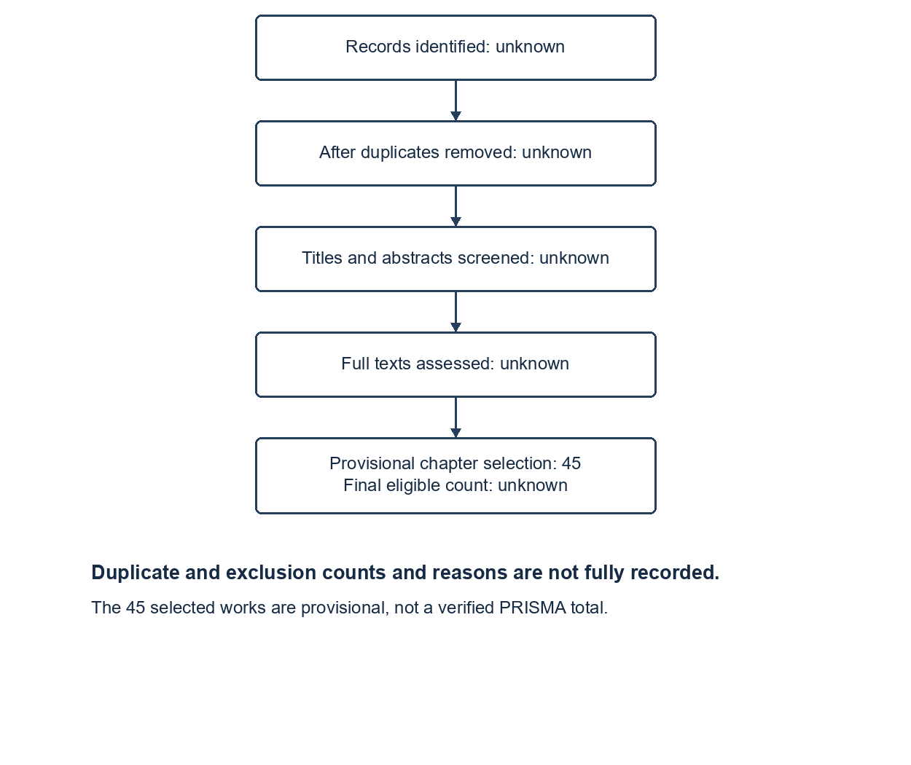

Status: DRAFT
Depends on: D04; D08; D11; D12
Sources: chapter sources and topic search logs; limitations/L03 and L07
Open items: verification, screening counts and final Word assembly

## 2.1 Review Methodology

This chapter uses a structured thematic review of the literature on model selection, serving and evaluation. It is not a completed systematic review: the historical searches overlap and do not preserve a complete deduplicated export. Table 2.1 reports what the records support, and Figure 2.2 identifies missing screening counts rather than reconstructing them by guesswork.

**Table 2.1: Literature search strategy**

| Item | Recorded procedure |
|---|---|
| Discovery sources | arXiv search and web searches, including searches restricted to ACL Anthology, OpenReview, ACM, IEEE Xplore and PMLR domains; proceedings and publisher pages were consulted for individual records. Direct access to some services was blocked or rate-limited. Google Scholar and Scopus searches are not evidenced. |
| Recorded Boolean string | arXiv abstract search, all dates: `"LLM routing" OR "model routing" OR "query routing"` (31 October 2026). The topic 01 log records 327 results and approximately 75 titles screened; these are local search counts, not chapter-wide counts. |
| Other recorded queries | `"model routing" OR "query routing" cost-aware router 2025 2026 NeurIPS ICLR ACL accepted`; other topic-level strings and dates appear in the linked [topic search logs](../07-appendices/A-literature-search-log.md). Exact syntax and filters were not preserved consistently. |
| Period and criteria | The historical collection covers 2020–31 October 2026. Relevance to routing, model suitability, cost, latency, reliability or evaluation and traceable source identity governed selection; duplicates and unrelated token-level mixture-of-experts routing were excluded. Numerical claims require a source/version check. |
| Selection and exclusions | The existing chapter identifies 45 scholarly works; publication status and final eligibility require review. The 90 paper files in the wider collection are not the number retrieved. Global identification, deduplication, screening and full-text assessment counts and reason-specific exclusions are not recoverable from the current register. |
| Evidence policy | Related-work inclusion for final submission must be restricted to verified peer-reviewed journal and conference papers. The present draft retains marked preprints as provisional context and must replace or remove them before that requirement can be claimed. Product documentation is used only for the existing-system comparison. |

**Figure 2.2: PRISMA-style study selection (incomplete)**

All 45 selected works are dated 2022–2026 in the existing table; by publication year, 45/45 fall within the five calendar years 2022–2026. This is not verification that all 45 are peer reviewed, nor that each has been reviewed in depth. Publication metadata and full-text extraction remain incomplete; the peer-reviewed-only requirement and final inclusion count therefore remain open. The team must record any new search prospectively and reconcile duplicate and exclusion counts before completing the figure.
