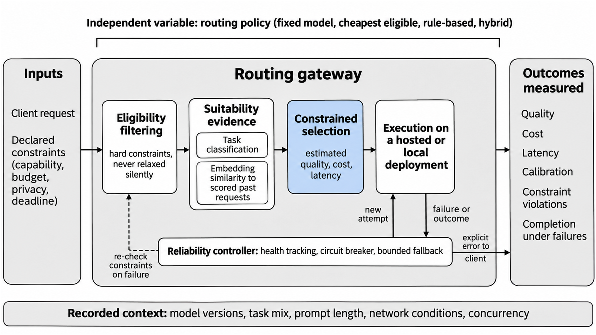

Status: DRAFT
Depends on: D04; D08; D11; D12
Sources: chapter sources and topic search logs; limitations/L03 and L07
Open items: verification, screening counts and final Word assembly

## 2.2 Conceptual and Theoretical Framework

### 2.2.1 Prompt-aware model routing

Prompt-aware routing chooses a model for a request using information available about the prompt. A rule, a learned score or a model-specific performance estimate can guide the choice. Routing before generation differs from a cascade, which may call another model after inspecting an earlier answer, and that extra call changes both cost and latency. FrugalGPT illustrates cascading, while Hybrid LLM and RouteLLM study selection before generation (L. Chen et al., 2024; Ding et al., 2024; Ong et al., 2025).

### 2.2.2 Hybrid suitability estimation

The proposed suitability estimator will combine task classification with embedding-derived evidence from previously evaluated requests. CSCR maps prompts and models into a shared representation, whereas EmbedLLM learns representations from model performance on questions (Shirkavand et al., 2025; Zhuang et al., 2025). Neither result proves that the proposed combination is better, so an ablation of each component will test its contribution.

### 2.2.3 Constrained routing and reliability

The selection problem has more than one objective: a response must be useful, but its cost and delay also matter. In the proposed gateway, hard eligibility rules will first exclude deployments that fail capability, privacy, budget or availability requirements. The selector will compare the remaining candidates on estimated quality, cost and latency, and the same restrictions must hold during fallback. Reliability and gateway overhead therefore belong in the evaluation alongside selection quality.

Design science provides a useful research lens: it links the creation of an artefact to its evaluation against a problem and stated requirements (Hevner et al., 2004). Here the artefact is the proposed gateway, and the evaluation will examine both its routing decisions and its operational behaviour. Chapter Three describes the method and acceptance criteria. Figure 2.1 shows the framework.

**Figure 2.1: Conceptual framework of the study. Task classification and comparison with evaluated requests inform suitability; health tracking and bounded fallback operate around execution; evaluation compares quality, cost, latency, policy compliance and reliability.**
