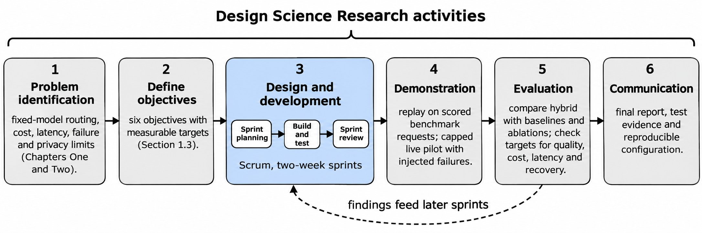

Status: DRAFT
Depends on: D01–D12; Chapter 1 objectives
Sources: Proposal_Working_Draft_v2.docx (Chapter 3); _meta/hybrid-design.md
Open items: See _meta/placeholders.md

## 3.1 Research and Development Methodology

Two separate decisions are made here: how the study will produce credible findings (the research design) and how the team will organise the building work (the development model).

**Research design.** The project will follow Design Science Research, because it builds an artefact, the routing gateway, to address a real problem and then evaluates the artefact against stated objectives (Hevner et al., 2004; Peffers et al., 2007). The evaluation inside it is a controlled experiment: the hybrid policy is compared with simpler policies on the same requests, candidate models and scoring rules, with hypotheses and tests set out in Section 3.9. Figure 3.1 maps the six design science activities to the project.

**Figure 3.1: Design science activities applied to the project.**

**Development model.** The team will use Scrum with two-week sprints. This model was chosen for a reason specific to the project: the routing thresholds, features and fallback limits can only be tuned once scored benchmark data and live timing are available, so early working versions are needed and some requirements will change after the first results. The project supervisor, Dr. Emmanuel Aderemi Tunbosun, will act as product owner and approve the backlog priorities. The team leader will act as Scrum master. The sprint backlog will be kept in GitHub Projects, the code in one GitHub repository with pull-request reviews, and each sprint will end with a review of a working increment against the requirements. Each increment will keep the same external request interface, so that baseline and hybrid policies differ only in the routing mechanism and not in unrelated interface changes.

The sprints fall into five phases, planned as follows. Dates are planned, not committed, and will be reviewed with the supervisor. Section 3.12 gives the sprint plan.

- Phase 1, requirements and protocol (November to December 2026): define request policies, datasets, baseline comparisons and spending controls.
- Phase 2, baselines and gateway (December 2026 to February 2027): build request validation, the deployment registry, model adapters and the fixed-model, cheapest-eligible and rule-based policies.
- Phase 3, predictor and selector (February to March 2027): add task classification, retrieval of similar scored requests, suitability prediction and constrained selection.
- Phase 4, reliability (March to April 2027): add health tracking, circuit breakers, bounded retries and cost reconciliation, and deploy the gateway in a documented environment.
- Phase 5, evaluation and reporting (April to May 2027): run held-out replay and a capped live pilot and report the results with uncertainty. The report is due in June 2027.

Failed hypotheses, poor calibration and an infeasible model pool will be reported as findings. Changes made after the test results have been inspected will be labelled exploratory, and any confirmatory repeat will need a new untouched test set.
