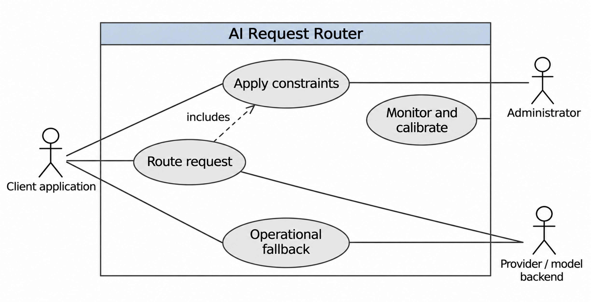

Status: DRAFT
Depends on: D01–D12; Chapter 1 objectives
Sources: Proposal_Working_Draft_v2.docx (Chapter 3); _meta/hybrid-design.md
Open items: See _meta/placeholders.md

## 3.5 Requirements Specification

### 3.5.1 Functional Requirements

Table 3.1 lists the functional requirements with identifiers and MoSCoW priorities (Must, Should, Could, Won’t). The identifiers are reused in the test cases of Chapter Four and Appendix D.

**Table 3.1: Functional requirements**

| ID | Requirement | Actor | Priority |
|---|---|---|---|
| FR-01 | The gateway shall expose an OpenAI-compatible request and response interface with explicit errors. | Client application | Must |
| FR-02 | The gateway shall authenticate clients and validate payload, endpoint and request limits. | Client application | Must |
| FR-03 | The administrator shall register model versions, capabilities, context windows and authorised deployments. | Administrator | Must |
| FR-04 | The filter shall exclude unsupported capabilities, excessive context, privacy-policy violations, unavailable deployments and unaffordable attempts. | Client application | Must |
| FR-05 | The analyser shall classify the task and capability requirements before dispatch. | Client application | Must |
| FR-06 | The feature pipeline shall retrieve permitted historical neighbours and support an embeddings-disabled ablation. | Administrator | Should |
| FR-07 | The predictor shall estimate model-specific suitability and expose cases with insufficient evidence. | Client application | Must |
| FR-08 | The selector shall apply predicted quality, cost and deadline constraints and choose the cheapest feasible candidate. | Client application | Must |
| FR-09 | The gateway shall return an explicit infeasibility outcome when no permitted candidate remains. | Client application | Must |
| FR-10 | The accountant shall reserve permitted spend before each attempt and reconcile known or uncertain usage without releasing uncertain charges early. | Administrator | Must |
| FR-11 | Adapters shall support one hosted API and at least one local engine. | Provider / model backend | Must |
| FR-12 | The controller shall track deployment health and closed, open and half-open circuit-breaker states. | Administrator | Must |
| FR-13 | The controller shall perform bounded fallback only for eligible retryable failures, rechecking budget, deadline and hard filters. | Provider / model backend | Must |
| FR-14 | Recovery shall not splice streams across models or repeat side effects whose safe retry is unknown. | Client application | Must |
| FR-15 | Monitoring shall record decisions, attempts, usage and timing while minimising sensitive content. | Administrator | Must |
| FR-16 | The evaluator shall run shared baselines, component ablations, calibration and fault tests with versioned configurations. | Administrator | Must |
| FR-17 | A monitoring view or export shall show aggregate quality, cost, latency, health and constraint outcomes. | Administrator | Should |
| FR-18 | The gateway shall be deployed in a documented environment, with configuration and installation instructions, accessible to authorised testers. | Administrator | Must |
| FR-19 | A separately labelled quality-cascade experiment may escalate completed but inadequate responses. | Administrator | Could |
| FR-20 | Reinforcement learning and response fusion shall be excluded from the first version. | Administrator | Won’t |

### 3.5.2 Non-Functional Requirements

Table 3.2 states each quality requirement with a measure and a target. Targets are fixed now, before any results exist. They may be revised after a pilot only with a recorded reason and before the test results are examined. No target allows a hard restriction to be ignored.

**Table 3.2: Non-functional requirements**

| ID | Category | Requirement | Measure and target |
|---|---|---|---|
| NFR-01 | Quality | Preserve quality relative to the best single model chosen on validation data. | Hybrid quality within 2 percentage points of the best single model; lower limit of a one-sided 95% interval above −2 points. |
| NFR-02 | Efficiency | Reduce inference spending without hiding router and retry costs. | At least 20% lower cost per completed request than the best-single-model reference. |
| NFR-03 | Efficiency | Keep gateway overhead small. | p95 gateway overhead (routing and selection, excluding model generation) of at most 100 ms on paired direct and gateway calls. |
| NFR-04 | Reliability | Complete eligible requests under injected failures. | At least 95% of eligible requests completed under each injected failure type. |
| NFR-05 | Correctness | Preserve constraints and account for concurrent attempts. | Zero unreported hard-constraint violations; all concurrency and reservation assertions pass. |
| NFR-06 | Calibration | Quantify how reliable the confidence estimates are. | Brier score below that of a constant-probability predictor on held-out requests. |
| NFR-07 | Security and privacy | Restrict access and avoid logging sensitive prompts or keys. | All negative authentication, endpoint-policy and redaction tests pass; no secret found in sampled logs. |
| NFR-08 | Maintainability | Trace requirements to repeatable tests. | 100% of Must requirements traced to at least one test; at least 70% line coverage of the selector and execution controller. |
| NFR-09 | Reproducibility | Reproduce reports from versioned inputs and configuration. | An independent rerun reproduces quality within 1 percentage point and cost within 5%. |
| NFR-10 | Usability and accessibility | Make operator errors and status understandable. | Keyboard navigation, labelled controls and plain-language errors confirmed on every operator screen by scenario walkthrough. |

### 3.5.3 Use Case Model

Figure 3.2 shows the actors and use cases. The client application provides the request and policy, the administrator configures and inspects routing, and the provider or model backend executes model calls. Calibration uses permitted validation evidence and not uncontrolled updates from test outcomes.

**Figure 3.2: Use cases and external actors.**

Table 3.3 describes the three most important use cases.

**Table 3.3: Use case descriptions**

| Item | UC1: Route a request | UC2: Handle an infeasible request | UC3: Operational fallback |
|---|---|---|---|
| Actor | Client application | Client application | Provider / model backend; reliability controller |
| Preconditions | Client is authenticated; models and policy are registered. | Request is valid but declared constraints cannot all be met. | An attempt has been dispatched and has failed. |
| Main flow | 1. Client sends request and policy. 2. Gateway filters, classifies and predicts. 3. Selector chooses the cheapest feasible deployment. 4. Spend is reserved and the request executes. 5. Usage is reconciled and the response is returned. | 1. Filters leave no eligible candidate, or none is feasible. 2. Gateway rejects with an explicit infeasibility error. 3. Event is recorded without raw prompt text. | 1. Failure is recorded and breaker state updated. 2. Uncertain spend is reconciled. 3. Constraints and remaining budget and deadline are rechecked. 4. A new permitted attempt is made. |
| Alternative flows | Reservation fails: budget error before dispatch. Caller cancels: no further attempts. | Soft preference may later be relaxed under an explicit policy. | Retry unsafe, attempts used up or no feasible candidate: explicit failure with no relaxation of hard constraints. |
| Postconditions | Decision, attempt and cost recorded; response or error returned. | No model called; client informed why. | Attempts bounded; outcome and extra cost recorded. |
