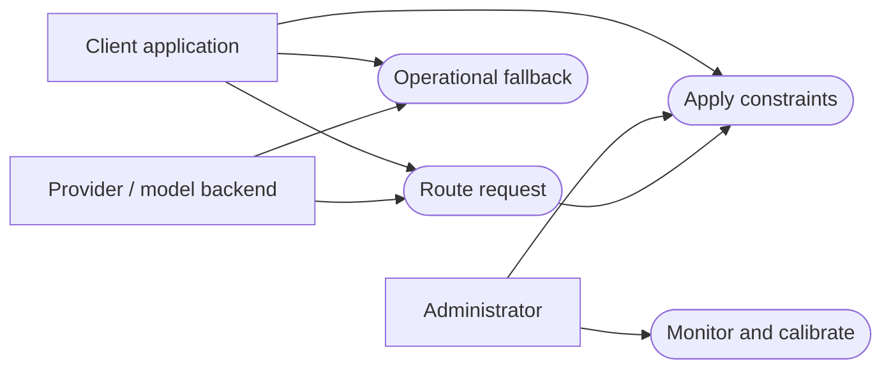

Status: DRAFT
Depends on: D01–D12; Chapter 1 objectives
Sources: _meta/hybrid-design.md; _meta/history/ch3-methodology-design.md; _meta/decisions-applied.md
Open items: See _meta/placeholders.md

## 3.5 Requirements Specification

### 3.5.1 Functional Requirements

**Table 3.1: Functional requirements**

| ID | Requirement | Actor | Must, Should, Could, Won’t (MoSCoW) priority |
|---|---|---|---|
| FR-01 | The gateway will expose an OpenAI-compatible request/response interface and explicit errors. | Client application | Must |
| FR-02 | The gateway will authenticate clients and validate payload, endpoint and request limits. | Client application | Must |
| FR-03 | The administrator will register model versions, capabilities, context windows and authorised deployments. | Administrator | Must |
| FR-04 | The filter will exclude unsupported capabilities, excessive context, privacy-policy violations, unavailable deployments and unaffordable attempts. | Client application | Must |
| FR-05 | The analyser will classify task and capability requirements before dispatch. | Client application | Must |
| FR-06 | The feature pipeline will retrieve permitted historical neighbours and support an embeddings-disabled ablation. | Administrator | Should |
| FR-07 | The predictor will estimate model-specific suitability and expose insufficient-evidence cases. | Client application | Must |
| FR-08 | The selector will apply predicted quality, cost and deadline constraints and choose the cheapest feasible candidate. | Client application | Must |
| FR-09 | The gateway will return an explicit infeasibility outcome when no permitted candidate remains. | Client application | Must |
| FR-10 | The accountant will reserve permitted spend before attempts and reconcile known or uncertain usage without releasing uncertain charges prematurely. | Administrator | Must |
| FR-11 | Adapters will support the selected hosted API and at least one local engine. | Provider/model backend | Must |
| FR-12 | The controller will track deployment health and closed/open/half-open circuit-breaker states. | Administrator | Must |
| FR-13 | The controller will perform bounded fallback only for eligible retryable failures, rechecking budget, deadline and hard filters. | Provider/model backend | Must |
| FR-14 | Recovery will not silently splice streams across models or repeat side effects whose safe retry is unknown. | Client application | Must |
| FR-15 | Monitoring will record decisions, attempts, usage and timing with sensitive-content minimisation. | Administrator | Must |
| FR-16 | The evaluator will run shared baselines, component ablations, calibration and fault tests with versioned configurations. | Administrator | Must |
| FR-17 | A dashboard/export will show aggregate quality, cost, latency, health and constraint outcomes. | Administrator | Should |
| FR-18 | A separately labelled quality-cascade experiment may escalate completed inadequate responses. | Administrator | Could |
| FR-19 | Live RL/POMDP and response fusion will be excluded initially. | Administrator | Won't initially |

### 3.5.2 Non-Functional Requirements

**Table 3.2: Non-functional requirements**

| ID | Category | Requirement | Measure/target |
|---|---|---|---|
| NFR-01 | Quality | Preserve quality relative to the best single model selected on validation data. | Quality difference and interval against justified margin δ, [PROVISIONAL: revise after pilot]; TODO: δ. |
| NFR-02 | Efficiency | Reduce inference spending without hiding router/retry costs. | Cost per offered and successfully completed request versus reference, [PROVISIONAL: revise after pilot]; TODO: reduction. |
| NFR-03 | Efficiency | Reduce latency and measure gateway overhead. | p50/p95 TTFT, completion time and paired direct/gateway overhead, [PROVISIONAL: revise after pilot]; TODO: reduction/overhead limit. |
| NFR-04 | Reliability | Complete eligible requests under injected failures. | Completed/eligible offered requests by fault type and recovery interval, [PROVISIONAL: revise after pilot]; TODO: threshold. |
| NFR-05 | Correctness | Preserve constraints and account for concurrent attempts. | Violation count/rate, reservation/reconciliation assertions, [PROVISIONAL: revise after pilot]; TODO: acceptance criterion. |
| NFR-06 | Calibration | Quantify confidence reliability. | Reliability bins and Brier score for binary success, or declared score-calibration measure, [PROVISIONAL: revise after pilot]; TODO: criterion. |
| NFR-07 | Security/privacy | Restrict access and avoid sensitive prompt/key logging. | Negative authentication, endpoint-policy and redaction tests, [PROVISIONAL: revise after pilot]; TODO: acceptance criterion. |
| NFR-08 | Maintainability | Trace requirements to repeatable tests. | Traceability completeness and test/coverage report, [PROVISIONAL: revise after pilot]; TODO: coverage target. |
| NFR-09 | Reproducibility | Reproduce reports from versioned inputs/configuration. | Independent rerun agreement within declared tolerance, [PROVISIONAL: revise after pilot]; TODO: tolerance. |
| NFR-10 | Usability/accessibility | Make operator errors and status understandable. | Keyboard navigation, labelled controls, readable status and scenario walkthrough outcomes, [PROVISIONAL: revise after pilot]; TODO: criterion. |

Provisional measures will not permit hard restrictions to be ignored during design. Thresholds for empirical acceptance will be frozen before test inspection; mandatory constraints will remain mandatory.

### 3.5.3 Use Case Model

**Figure 3.1: Use cases and external actors.** The arrows will show participation, not inheritance or execution order.

The client will provide the request and policy, the administrator will configure and inspect routing, and the backend will execute model calls. Calibration will use permitted validation evidence, not uncontrolled updates from test outcomes.

**Image prompt for Codex:** Draw a UML use case diagram on white. Put the AI Request Router system boundary in the centre, with ellipses Route request, Apply constraints, Operational fallback, Monitor and calibrate. Put client application left, administrator upper right and provider/model backend lower right. Connect actors as in Figure 3.1. Use black text and labelled, undecorated shapes.
