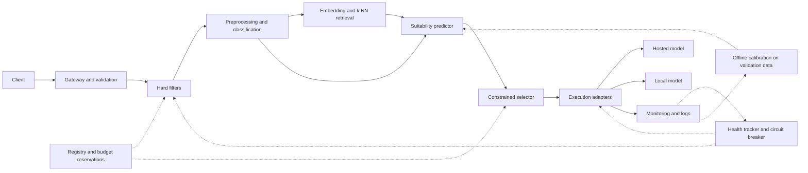
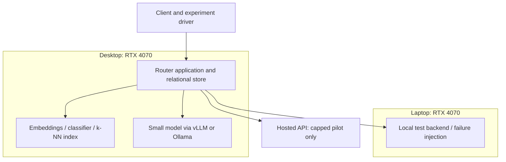

Status: DRAFT
Depends on: D01–D12; Chapter 1 objectives
Sources: _meta/hybrid-design.md; _meta/history/ch3-methodology-design.md; _meta/decisions-applied.md
Open items: See _meta/placeholders.md

### 3.6.1 Architecture

The gateway will contain logical modules rather than requiring separate microservices. Preprocessing will validate declared requirements and classify task/capability features. The retrieval path will use embeddings and a k-nearest-neighbour (k-NN) index built only from permitted historical records. The suitability predictor will estimate quality; the selector will assess feasibility and rank candidates; the execution controller will own attempts and recovery.

**Figure 3.2: Logical architecture of the hybrid router.** Solid arrows will describe the request path; dotted arrows will show evidence and state dependencies.

**Image prompt for Codex:** Draw Figure 3.2 as a clean left-to-right architecture on white. Group gateway, filters, classifier, embedding/k-NN, predictor, selector and execution adapters inside one Router application box. Put registry/budget below selection, health/circuit breaker beside execution, monitoring beneath all modules, and hosted/local backends right. Distinguish request arrows from dotted state arrows; no decorative art.

**Figure 3.3: Proposed development and evaluation deployment.** The diagram will assign roles without assuming simultaneous model residency or equal VRAM.

**Image prompt for Codex:** Draw two labelled machine boxes, RTX 4070 desktop left and RTX 4070 laptop right, with the router and feature pipeline on desktop and a local test backend on laptop. Above them put client/experiment driver; outside the local boundary put a hosted API with Capped pilot label. State VRAM and operating system pending measurement. Clean white background, clear labels, no cloud clip art.

Allocation will remain provisional until profiling. GPU memory contention between embeddings and local inference will be measured. Live GPU/queue telemetry, Redis/Prometheus and managed-session components will remain unresolved earlier proposals.
