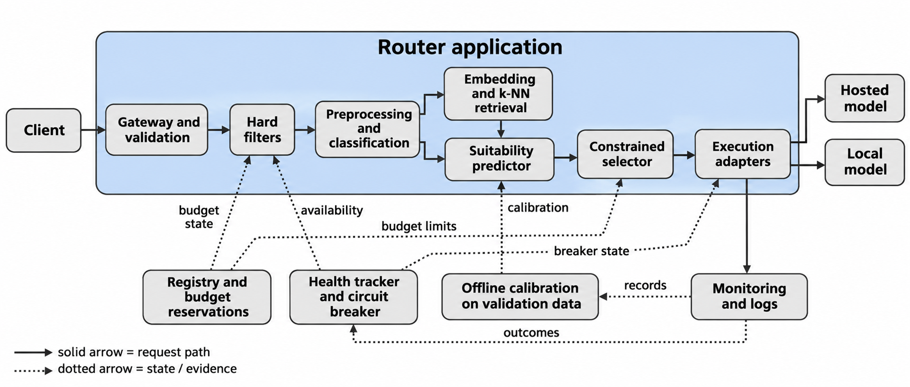
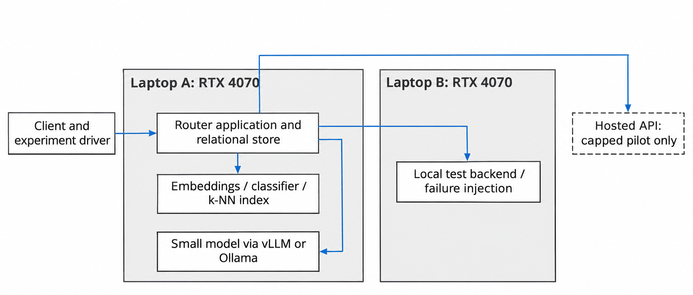

Status: DRAFT
Depends on: D01–D12; Chapter 1 objectives
Sources: Proposal_Working_Draft_v2.docx (Chapter 3); _meta/hybrid-design.md
Open items: See _meta/placeholders.md

### 3.6.1 System Architecture

The gateway will be one application made of logical modules, not separate services. Preprocessing validates the declared requirements and classifies the task and capability needs. The retrieval path uses embeddings and a k-nearest-neighbour (k-NN) index built only from permitted historical records. The suitability predictor estimates quality, the selector assesses feasibility and ranks candidates, and the execution controller owns attempts and recovery. A modular layout was chosen because it keeps the first version simple and lets each component be switched off for ablation tests.

**Figure 3.3: Logical architecture of the router. Solid arrows show the request path; dotted arrows show evidence and state dependencies.**

Figure 3.4 shows the planned development and evaluation deployment on the two laptops. The allocation is provisional until the machines are profiled, and it does not assume that models are loaded at the same time or that the two laptops have equal graphics memory. Memory contention between embeddings and local inference will be measured.

**Figure 3.4: Proposed development and evaluation deployment.**
