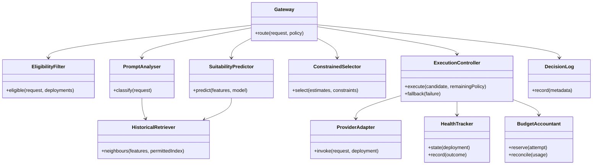

Status: DRAFT
Depends on: D01–D12; Chapter 1 objectives
Sources: _meta/hybrid-design.md; _meta/history/ch3-methodology-design.md; _meta/decisions-applied.md
Open items: See _meta/placeholders.md

### 3.6.2 Class Diagram

**Figure 3.4: Proposed domain responsibilities.** Classes will describe interfaces and ownership, not implemented code.

The selector will not call providers or mutate health state. The execution controller will recheck policy and reserve budget before every attempt. The adapter will translate protocol differences and return explicit usage/error information. Separating these responsibilities will support ablations without duplicating recovery rules.
