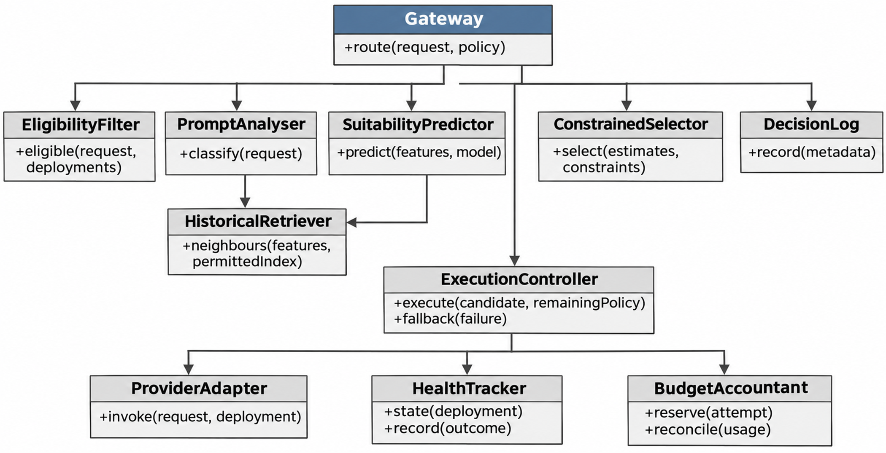

Status: DRAFT
Depends on: D01–D12; Chapter 1 objectives
Sources: Proposal_Working_Draft_v2.docx (Chapter 3); _meta/hybrid-design.md
Open items: See _meta/placeholders.md

### 3.6.2 Structural Design (Class Diagram)

Figure 3.5 shows the main classes and their responsibilities. The selector does not call providers or change health state. The execution controller rechecks policy and reserves budget before every attempt. The adapter translates protocol differences and returns explicit usage and error information. Keeping these responsibilities apart supports ablations without duplicating recovery rules.

**Figure 3.5: Proposed classes and responsibilities.**
