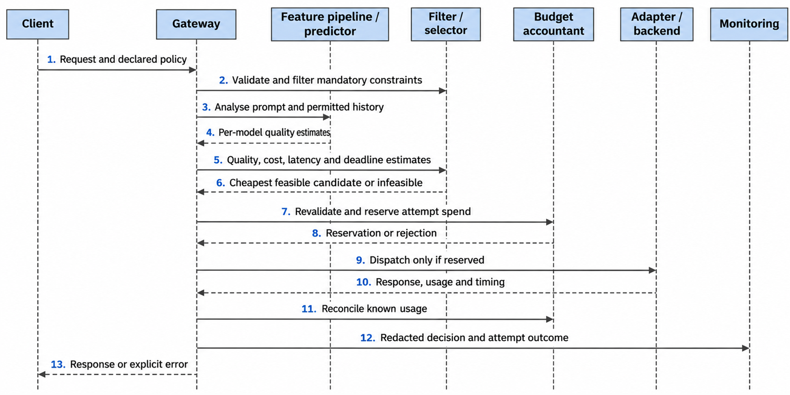
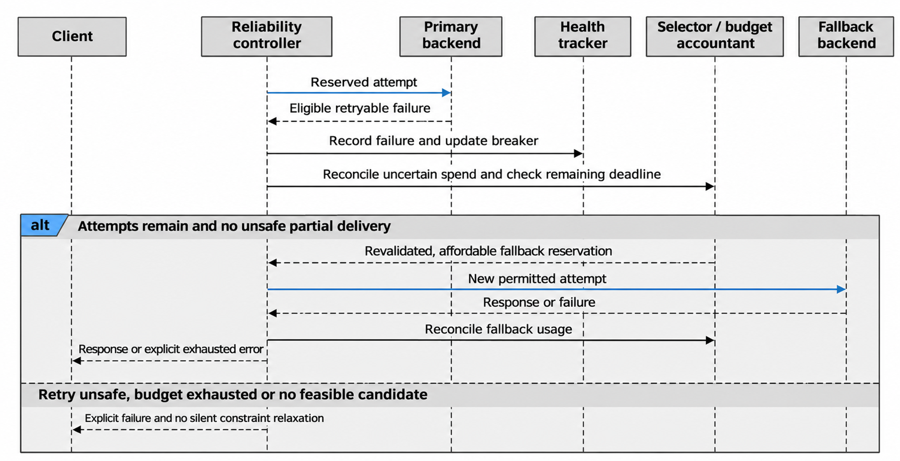
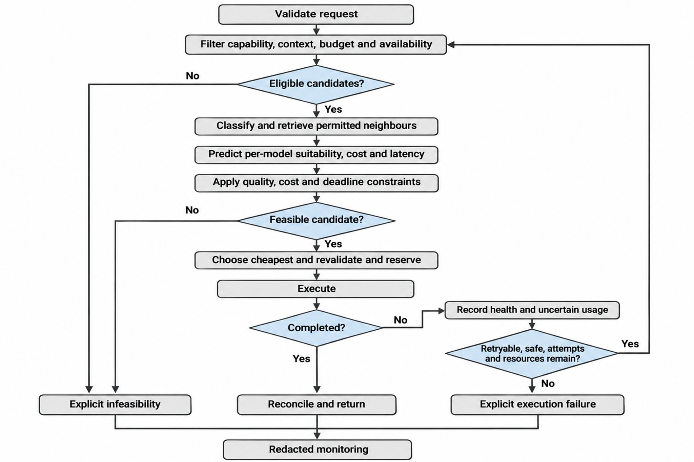

Status: DRAFT
Depends on: D01–D12; Chapter 1 objectives
Sources: Proposal_Working_Draft_v2.docx (Chapter 3); _meta/hybrid-design.md
Open items: See _meta/placeholders.md

### 3.6.3 Behavioural Design (Sequence and Activity Diagrams)

Figure 3.6 shows a normal request. Validation, filtering and budget reservation come before execution.

**Figure 3.6: Sequence diagram of a normal routing request.**

Figure 3.7 shows an execution failure and fallback. Recovery is a new constrained attempt, not the continuation of a stream that has already been delivered.

**Figure 3.7: Sequence diagram of an execution failure and operational fallback.**

Figure 3.8 shows the request activity flow. Infeasibility, where no permitted candidate exists, is distinguished from a provider failure. A failed reservation or a change in health state causes revalidation or an explicit error before dispatch. Every pass through the recovery loop uses up an attempt allowance, so retries cannot continue without limit, and cancellation by the caller ends further attempts.

**Figure 3.8: Activity flow of a request.**
