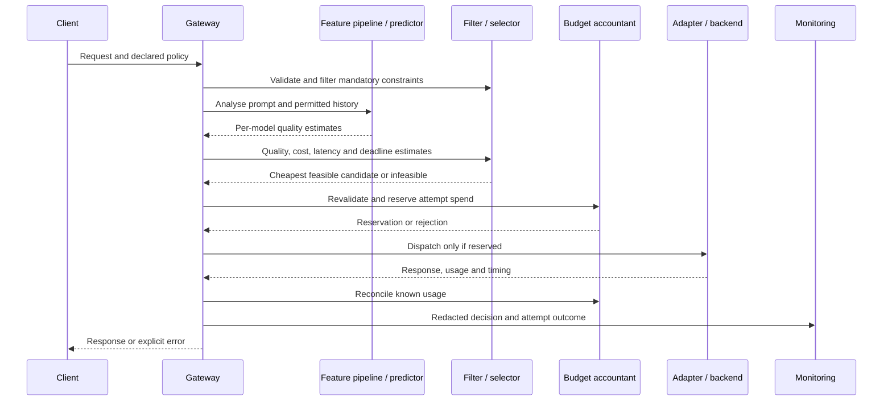
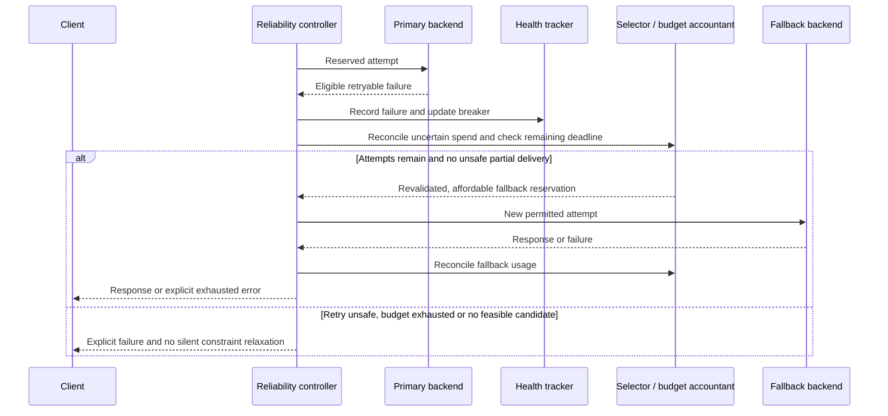
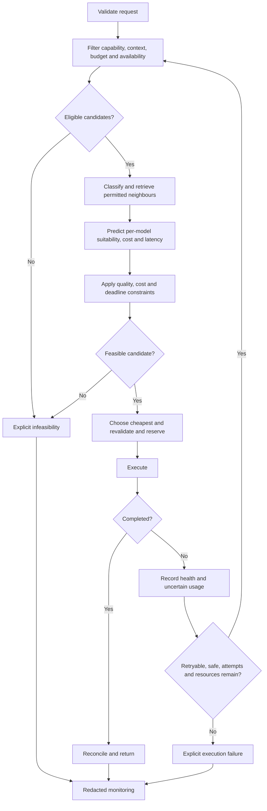

Status: DRAFT
Depends on: D01–D12; Chapter 1 objectives
Sources: _meta/hybrid-design.md; _meta/history/ch3-methodology-design.md; _meta/decisions-applied.md
Open items: See _meta/placeholders.md

### 3.6.3 Sequence and Activity Diagrams

**Figure 3.5: Normal routing request.** Validation and reservation will precede execution.

**Figure 3.6: Execution failure and operational fallback.** Recovery will be a new constrained attempt, not continuation of an already delivered stream.

**Figure 3.7: Request activity flow.** Infeasibility will be distinguished from provider failure.

A failed reservation or changed health state will cause revalidation or an explicit error before dispatch. Every pass through the recovery loop will consume an attempt allowance; it will not create an unbounded retry cycle. Caller cancellation will end further attempts.
