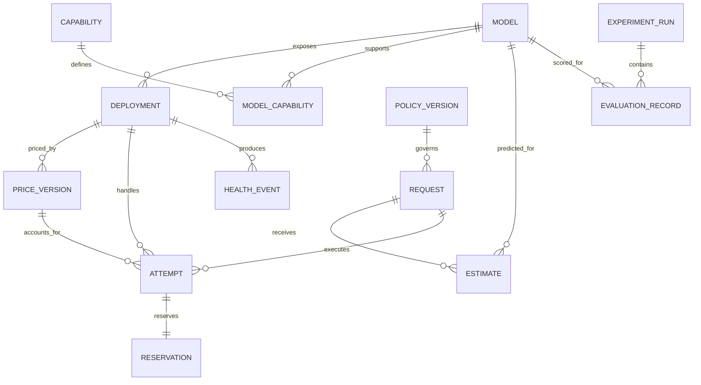

Status: DRAFT
Depends on: D01–D12; Appendix F
Sources: _meta/hybrid-design.md; _meta/history/ch3-methodology-design.md; _meta/decisions-applied.md
Open items: See _meta/placeholders.md

### 3.6.4 Database Design

The proposed relational schema will keep stable model metadata separate from deployments and attempt observations. Capabilities will be represented through a join table rather than a comma-separated field. A versioned price record will preserve the rate used for accounting rather than allowing current prices to overwrite historical costs.

**Figure 3.8: Proposed entity relationships.** Cardinalities will describe stored evidence; raw prompt text will not be required in the operational request table.

**Proposed third normal form (3NF) schema**

| Relation | Primary key | Other attributes and foreign keys | Functional dependency / normalisation rationale |
|---|---|---|---|
| Model | model_id | revision, context_limit, tokenizer_ref | Model ID will determine one pinned model definition. |
| Capability | capability_id | capability_name | One capability name per ID. |
| ModelCapability | model_id, capability_id | Both foreign keys | Composite key will record each supported capability once. |
| Deployment | deployment_id | model_id FK, authorised_endpoint_ref, engine | Endpoint metadata will depend on deployment, not request. |
| PriceVersion | price_id | deployment_id FK, effective_at, input_rate, output_rate, currency, cost_basis | Immutable price ID will determine the historical rate. |
| PolicyVersion | policy_id | quality_floor, cost_cap, deadline_rule, policy_revision | A frozen policy version will determine its parameters. |
| Request | request_id | policy_id FK, accepted_at, token_estimate, final_status | Request-specific facts only; no duplicated model metadata. |
| Estimate | request_id, model_id | Both FKs, quality_estimate, cost_estimate, latency_estimate, predictor_revision | Composite key will determine one frozen prediction per candidate for the request. |
| Attempt | attempt_id | request_id FK, deployment_id FK, price_id FK, ordinal, start_at, end_at, outcome, usage_state, known_cost | Attempt-specific execution facts; unique request/ordinal. |
| Reservation | attempt_id PK/FK | reserved_amount, reconciliation_state | At most one reservation per dispatched attempt; account changes will be transactional. |
| HealthEvent | event_id | deployment_id FK, observed_at, signal, breaker_transition | Each observed health event will be retained independently. |
| ExperimentRun | run_id | dataset_revision, split_manifest_ref, configuration_ref, seed_ref | Run-level provenance will not be repeated across scores. |
| EvaluationRecord | run_id, task_key, model_id | run/model FKs, score, token_counts, cost_basis_ref | Model outcome will be keyed by run, task and model; training access will be split-restricted. |

Each relation will have atomic fields and attributes dependent on its whole key, with descriptive facts about other entities held in their own relations. This will be the proposed 3NF rationale; constraints and migrations will be reviewed when implemented. Decimal/fixed-precision currency values and explicit units will avoid floating-point ledger drift. Concurrent reservations will be transactional. Unknown usage after timeout will remain encumbered until resolved or conservatively charged.

Database engine, retention duration and backup policy will remain TODO. Secrets will be referenced through a protected store and will not be stored in these relations as plaintext. Session and graph tables will not be presumed necessary while their scope remains unresolved.
