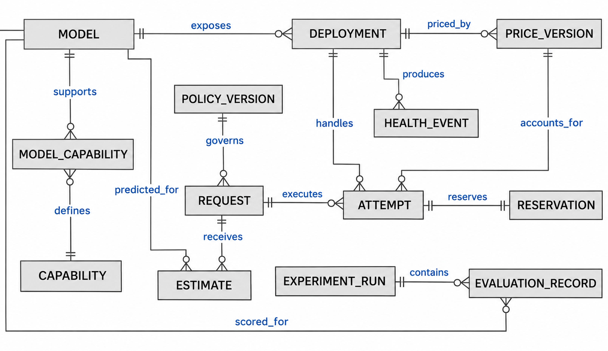

Status: DRAFT
Depends on: D01–D12; Chapter 1 objectives
Sources: Proposal_Working_Draft_v2.docx (Chapter 3); _meta/hybrid-design.md
Open items: See _meta/placeholders.md

### 3.6.4 Database Design

The relational schema will keep stable model metadata apart from deployments and attempt records. Capabilities are held in a join table, not in a comma-separated field. A versioned price record preserves the rate used for accounting, so current prices never overwrite historical costs. Raw prompt text is not required in the operational request table. Figure 3.9 shows the entities and Table 3.4 gives the relations in third normal form (3NF).

**Figure 3.9: Entity relationship diagram.**

**Table 3.4: Relational schema in third normal form**

| Relation | Primary key | Other attributes and foreign keys | Normalisation rationale |
|---|---|---|---|
| Model | model_id | revision, context_limit, tokenizer_ref | Model ID determines one pinned model definition. |
| Capability | capability_id | capability_name | One capability name per ID. |
| ModelCapability | model_id, capability_id | Both foreign keys | Composite key records each supported capability once. |
| Deployment | deployment_id | model_id (FK), authorised_endpoint_ref, engine | Endpoint metadata depends on the deployment, not the request. |
| PriceVersion | price_id | deployment_id (FK), effective_at, input_rate, output_rate, currency, cost_basis | Immutable price ID fixes the historical rate. |
| PolicyVersion | policy_id | quality_floor, cost_cap, deadline_rule, policy_revision | A frozen policy version determines its parameters. |
| Request | request_id | policy_id (FK), accepted_at, token_estimate, final_status | Request-specific facts only. |
| Estimate | request_id, model_id | quality_estimate, cost_estimate, latency_estimate, predictor_revision | One frozen prediction per candidate for each request. |
| Attempt | attempt_id | request_id (FK), deployment_id (FK), price_id (FK), ordinal, start_at, end_at, outcome, usage_state, known_cost | Attempt-specific execution facts; request and ordinal are unique. |
| Reservation | attempt_id (PK, FK) | reserved_amount, reconciliation_state | At most one reservation per dispatched attempt. |
| HealthEvent | event_id | deployment_id (FK), observed_at, signal, breaker_transition | Each health event is kept on its own. |
| ExperimentRun | run_id | dataset_revision, split_manifest_ref, configuration_ref, seed_ref | Run-level provenance is not repeated across scores. |
| EvaluationRecord | run_id, task_key, model_id | score, token_counts, cost_basis_ref | Outcome keyed by run, task and model. |

Each relation has atomic fields and attributes that depend on the whole key, and facts about other entities are held in their own relations; this is the proposed 3NF rationale and will be reviewed when the schema is implemented. Currency values will use fixed-precision decimals with explicit units to avoid rounding drift in the ledger. Concurrent reservations will be transactional, and unknown usage after a timeout stays reserved until resolved or conservatively charged. Secrets are held in a protected store and are not stored in these tables.
