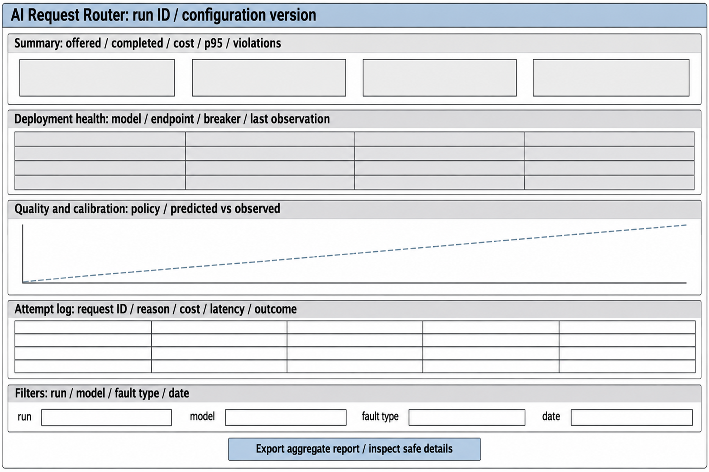

Status: DRAFT
Depends on: D01–D12; Chapter 1 objectives
Sources: Proposal_Working_Draft_v2.docx (Chapter 3); _meta/hybrid-design.md
Open items: See _meta/placeholders.md

### 3.6.6 User Interface Design

The client-facing interface is the request API. It returns a response or an explicit validation, infeasibility, budget or execution error, with a correlation identifier. Client applications do not need to know how the predictor works to submit a request. The administrator interface prioritises observation and safe configuration: it shows the active model pool, deployment health and circuit-breaker state, reserved spend, aggregate quality and calibration, and latency. It does not show raw prompts or credentials by default, and configuration changes need administrator rights and leave a versioned record. Figure 3.10 is the planned layout.

**Figure 3.10: Proposed operator dashboard wireframe.**

Labels and errors will be readable without relying on colour alone. Controls will support keyboard navigation, visible focus, descriptive labels and a clear empty and error state, and measured values will show units and sample counts. A read-only export may be built before a fuller dashboard, which matches the Should priority of requirement FR-17.
