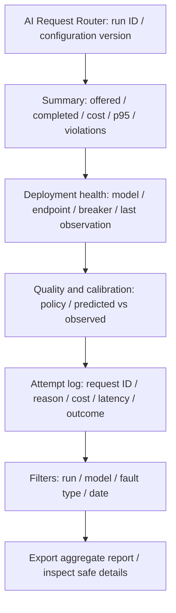

Status: DRAFT
Depends on: D01–D12; Appendix F
Sources: _meta/hybrid-design.md; _meta/history/ch3-methodology-design.md; _meta/decisions-applied.md
Open items: See _meta/placeholders.md

### 3.6.6 User Interface Design

The client-facing interface will be the request API. It will return a response or an explicit validation, infeasibility, budget or execution error, with a correlation identifier. The final request-policy fields and error schema will remain TODO. Client applications will not need to know internal predictor implementation details to submit a request.

The administrator interface will prioritise observation and safe configuration. It will show the active model pool, deployment health and breaker states, spending reservations, aggregate quality/calibration and latency measures. It will not show raw prompts or API credentials by default. Configuration changes will require administrator privileges and produce a versioned record.

**Figure 3.9: Proposed operator dashboard wireframe.** This will be a layout source, not a rendered product screenshot.

**Image prompt for Codex:** Draw a grayscale desktop dashboard wireframe on a white background. Top bar: AI Request Router, run ID, configuration version. Below: summary cards for offered/completed requests, cost, p95 and violations; deployment-health table; calibration plot placeholder; redacted attempt-log table; labelled filters and Export report button. Add keyboard-focus indication and text status labels; no decorative art or fabricated metrics.

Labels and errors will be readable without colour alone. Controls will support keyboard navigation, visible focus, descriptive labels and a clear empty/error state. Measured values will include units and sample counts. A read-only export may be used before a richer dashboard, subject to FR-17's Should priority.
