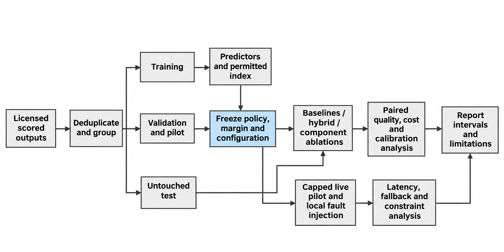

Status: DRAFT
Depends on: D01–D12; Chapter 1 objectives
Sources: Proposal_Working_Draft_v2.docx (Chapter 3); _meta/hybrid-design.md
Open items: See _meta/placeholders.md

## 3.9 Evaluation Plan

The evaluation answers the research questions of Section 1.4. Its primary comparison asks whether the hybrid keeps quality within a justified non-inferiority margin of the best single model chosen on validation data, while reducing cost and latency. The primary score and margin will be chosen and justified before the test outcomes are seen, and non-inferiority will not be inferred from a non-significant test of superiority. Table 3.8 defines the arms.

**Table 3.8: Evaluation arms**

| Arm | Definition |
|---|---|
| Fixed model | Route all comparable requests to each candidate in turn; the single-model reference is chosen on validation evidence only. |
| Cheapest eligible | Select the least expensive deployment after the shared hard filters, without learned suitability. |
| Rule-based task routing | A deterministic task-to-model rule defined from training evidence. |
| Lightweight learned predictor | Predict suitability from the chosen lightweight features, without historical retrieval. |
| Hybrid | Task classification and embedding-derived suitability features with constrained selection. |
| Component ablations | Remove embeddings; remove task and difficulty features; optionally retrieval-only suitability, all on identical splits. |
| Utility variant | Normalised weighted utility with the same hard restrictions; weights tuned on validation data only. |
| Optional cascade | Escalate completed inadequate answers; generation and verifier calls charged separately. |

Ablations change only the named component. All policies share the eligible candidates, request caps, adapters and accounting. An ablation with too little data will be labelled incomplete and will not be replaced by a different task set. Table 3.9 defines the metrics.

**Table 3.9: Evaluation metrics**

| Metric | Definition and reporting |
|---|---|
| Quality | Dataset-appropriate success or score on matched requests; per domain and in aggregate with declared weights. |
| Cost | Known spend plus router, verifier and retry costs on a declared basis, per offered and per successful request, with unresolved charges; local cost is not silently set to zero. |
| Latency | Router decision time, time to first token, end-to-end completion time, p50 and p95, including failures and deadlines. |
| Constraint violations | Count and rate by capability, context, budget, privacy and deadline; predicted feasibility is separated from actual violations. |
| Calibration | Reliability table and Brier score for binary success; a declared measure for continuous scores. |
| Fallback | Completed divided by eligible offered requests under each injected failure, with attempts and extra cost and latency. |
| Software evidence | Requirement coverage, unit and integration results, reproducible configuration and concurrency-accounting assertions. |

Table 3.10 sets out, for each objective, the method, the metric, the target and the baseline. It is the contract for Chapter Four: the targets are decided now, before any results exist, and every comparison has a baseline.

**Table 3.10: Evaluation plan by objective**

| Objective | Method | Metric | Target | Baseline |
|---|---|---|---|---|
| 1. Requirements | Requirements-to-test matrix reviewed with the supervisor | Share of Must requirements traced to a test | 100% | Not applicable |
| 2. Gateway | Unit, integration and API tests; deployment run by a second member | Tests passed; line coverage of core modules | All Must tests pass; at least 70% coverage | Not applicable |
| 3. Predictor (RQ3) | Ablation on held-out scored requests | Brier score; change when embeddings or task features are removed | Brier below a constant predictor; each component’s effect reported with an interval | Constant predictor; predictor without embeddings |
| 4. Selector (RQ4) | Replay of all arms on held-out requests | Quality; cost per completed request | Quality within 2 points of the best single model; cost at least 20% lower | Best single model; cheapest eligible; rule-based; lightweight learned |
| 5. Reliability (RQ5) | Local fault injection: timeouts, throttling, server errors, malformed responses, interrupted streams | Completion of eligible requests; constraint violations; extra cost and latency | At least 95% completed; zero unreported violations | Single attempt with no fallback |
| 6. Deployment and overhead (RQ6) | Paired direct and gateway calls at set concurrency; capped live pilot; independent rerun | p95 gateway overhead; reproducibility | At most 100 ms; rerun within 1 point of quality and 5% of cost | Direct call to the same deployment |

**Testing strategy.** Unit tests will check filtering, classification, estimation, selection and accounting. Integration tests will cover adapters, the database and the request path. System tests will run the deployed gateway under concurrent load and injected failures. Acceptance tests will check each requirement identifier against the traceability matrix in Appendix D. Local fault cases will include connection errors, throttling, slow responses, malformed responses and interrupted streams. No user-acceptance study is planned; the operator interface will be checked by scenario walkthroughs, and any such result will not be presented as a population usability finding.

Replay and live measurement. Offline replay uses stored outcomes to estimate the quality and cost trade-off and the predictor’s overhead, and it does not supply current provider latency. The capped live study will compare direct and gateway calls with matched payloads, warm and cold conditions, and recorded concurrency and network context. Operational recovery is reported separately from quality escalation after a completed answer.

**Hypotheses.** Let ΔQ be hybrid quality minus reference quality, and let δ be the non-inferiority margin, set at 2 percentage points. The quality hypotheses are H0: ΔQ ≤ −δ against H1: ΔQ > −δ. The cost hypotheses are H0: cost per completed request is less than 20% below the reference against H1: it is at least 20% below. The overhead hypotheses are H0: p95 gateway overhead exceeds 100 ms against H1: it is at most 100 ms. These targets are fixed now. The interval level, the primary latency measure, sample sizes and stopping rules will be fixed after the pilot and before the test results are analysed. These are plans, not claims of achieved statistical power.

**Statistical tests.** The same requests are scored under every arm, so the comparisons are paired. Quality non-inferiority will use a paired bootstrap interval for ΔQ that resamples groups of related requests. Paired yes-or-no outcomes, such as whether a request completed, will use McNemar’s test. Paired numeric differences in cost and latency, which are unlikely to be normally distributed, will use the Wilcoxon signed-rank test. Multiple comparisons will be adjusted with the Holm method, and every result will be reported with its interval and sample count.

Paired differences will use identical requests where possible, and uncertainty intervals will resample groups of related requests and not treat correlated copies as independent. Timeouts and rejected requests stay in the denominators of offered requests. Results will be shown per domain as well as in aggregate. Failed, inconclusive and negative results will be kept, and any retuning after test inspection will be labelled exploratory. Appendix I will hold the fixed analysis plan. Figure 3.11 shows the pipeline.

**Figure 3.11: Experiment and evaluation pipeline.**
