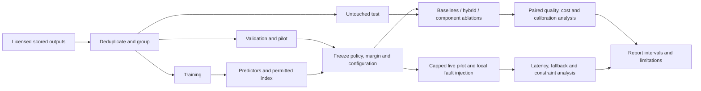

Status: DRAFT
Depends on: D01–D12; Appendix F
Sources: _meta/hybrid-design.md; _meta/history/ch3-methodology-design.md; _meta/decisions-applied.md
Open items: See _meta/placeholders.md

## 3.9 Evaluation Plan

The primary comparison will assess whether the hybrid preserves quality within a justified non-inferiority margin relative to the best single model selected on validation data, while reducing cost and latency. The team will choose and justify the primary score and margin before viewing test outcomes. Quality non-inferiority will not be inferred from a non-significant superiority test.

| Arm | Definition |
|---|---|
| Fixed model | Route all comparable requests to each candidate separately; choose the single-model reference using validation evidence only. |
| Cheapest eligible | Select the least expensive deployment after shared hard filters, without learned suitability. |
| Rule-based task routing | Use a deterministic task-to-model rule fitted/defined from training evidence. |
| Lightweight learned predictor | Predict suitability with the selected lightweight features, without historical retrieval. |
| Hybrid | Combine classification and embedding-derived suitability features with constrained selection. |
| Component ablations | Remove embeddings; remove task/difficulty features; optionally compare retrieval-only suitability using identical splits. |
| Utility variant | Normalised weighted utility with shared hard restrictions; tune weights on validation only. |
| Optional cascade | Escalate completed inadequate answers; charge all generation and verifier calls separately. |

Ablations will change the named component only. All policies will share eligible candidates, request caps, adapters and accounting. An ablation with insufficient data will be labelled incomplete rather than substituted with a different task set.

| Metric | Definition and reporting |
|---|---|
| Quality | Dataset-appropriate success/score on matched requests; per-domain and aggregate results with declared aggregation weights. |
| Cost | Total known spend plus router, verifier and retry costs under a declared basis; report both per offered and per successful request, and unresolved charges. Local cost will not be silently set to zero. |
| Latency | Router-decision time, time to first token (TTFT), end-to-end completion time, p50 and p95, including failures and deadline handling. |
| Constraint violations | Count and rate by capability, context, budget, privacy and deadline type; predicted feasibility distinguished from actual violations. |
| Calibration | Reliability table and Brier score for binary success labels; TODO: measure for continuous quality labels. |
| Fallback | Successful completion divided by eligible offered requests under each injected-failure scenario; report failures, attempts and extra cost/latency. |
| Software evidence | Requirement coverage, unit/integration outcomes, reproducible configuration and concurrency-accounting assertions. |

Offline replay will use stored outcomes to estimate quality/cost trade-offs and predictor overhead. It will not supply measured current provider latency. The capped live study will compare direct and gateway calls with matched payloads, warm/cold conditions, concurrency and network context recorded. Local fault cases will include connection errors, throttling, slow responses, malformed responses and interrupted streams. Operational recovery will remain distinct from completed-answer quality escalation.

Let ΔQ be hybrid quality minus reference quality, δ the justified non-inferiority margin, ΔC the cost difference and ΔL the latency difference. The quality hypotheses will be H0: ΔQ ≤ −δ and H1: ΔQ > −δ. Reduction hypotheses will use H0: ΔC ≥ 0 versus H1: ΔC < 0, and H0: ΔL ≥ 0 versus H1: ΔL < 0. Margins, reduction thresholds, primary latency endpoint, interval level and multiplicity handling will remain [PROVISIONAL: revise after pilot]. TODO: freeze these and the sample/stopping rules before test analysis. These will be plans, not claims of achieved statistical power.

Paired differences will use identical requests where possible; uncertainty intervals will resample independent task/request groups, not correlated copies as independent trials. Timeouts and rejected requests will remain in offered-request denominators. Per-domain reporting will expose aggregate trade-offs. Failed, inconclusive and negative results will be retained. Test-driven retuning will be labelled exploratory. Appendix F will hold the immutable analysis plan.

**Figure 3.10: Experiment and evaluation pipeline.**

The live pilot and confirmatory live measurements will be separated; the diagram's operational branch will use the frozen configuration for reported test comparisons.
