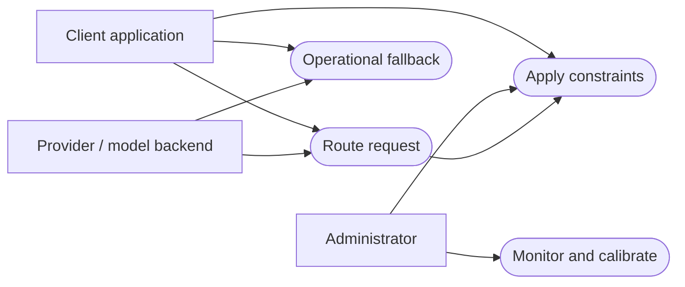
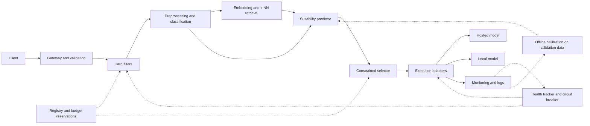
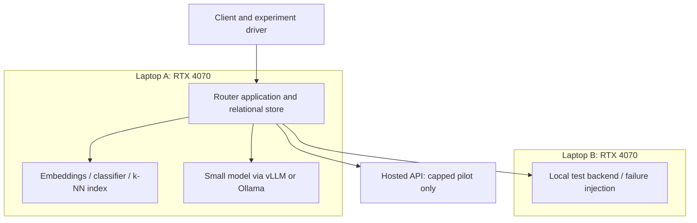
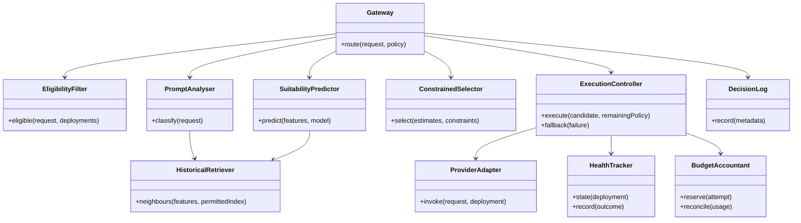
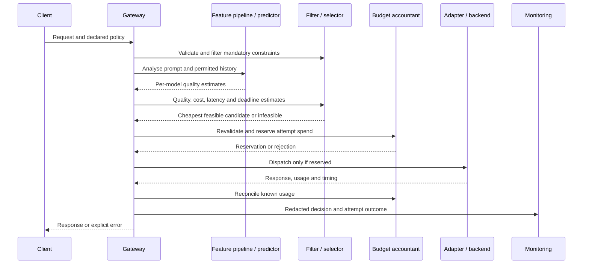
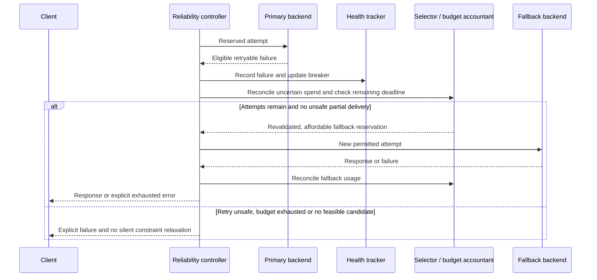
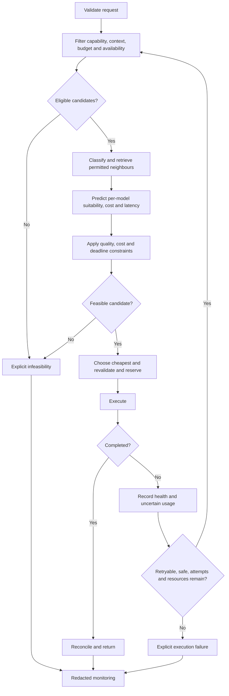
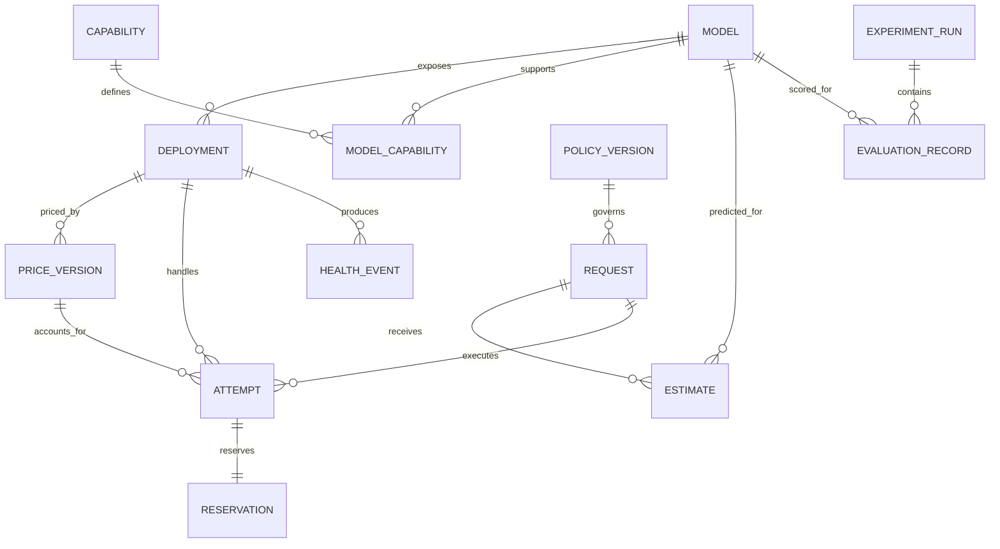
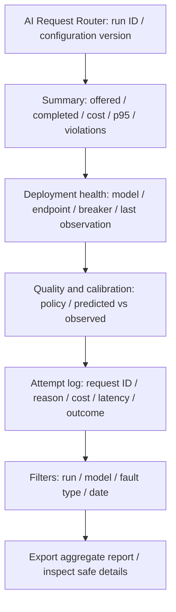
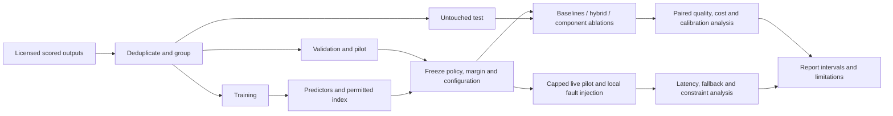

Status: SUPERSEDED (kept as editable sources)
Depends on: none
Sources: Mermaid blocks removed from the Chapter 3 section files on 2026-11-04
Open items: none; the Word draft uses the Codex-generated PNGs in this folder, with new figure numbers

# Mermaid sources of the earlier Chapter 3 diagrams

The Word draft now uses the PNG figures in this folder (Figures 3.1 to 3.11). The earlier numbering is kept below only so that the sources can be traced; do not paste these blocks into the report.

## From 3.5-requirements.md

**Figure 3.1: Use cases and external actors.** The arrows will show participation, not inheritance or execution order.

## From 3.6.1-architecture.md

**Figure 3.2: Logical architecture of the hybrid router.** Solid arrows will describe the request path; dotted arrows will show evidence and state dependencies.

## From 3.6.1-architecture.md

**Figure 3.3: Proposed development and evaluation deployment.** The diagram will assign roles without assuming simultaneous model residency or equal VRAM.

## From 3.6.2-class-diagram.md

**Figure 3.4: Proposed domain responsibilities.** Classes will describe interfaces and ownership, not implemented code.

## From 3.6.3-sequence-activity.md

**Figure 3.5: Normal routing request.** Validation and reservation will precede execution.

## From 3.6.3-sequence-activity.md

**Figure 3.6: Execution failure and operational fallback.** Recovery will be a new constrained attempt, not continuation of an already delivered stream.

## From 3.6.3-sequence-activity.md

**Figure 3.7: Request activity flow.** Infeasibility will be distinguished from provider failure.

## From 3.6.4-database.md

**Figure 3.8: Proposed entity relationships.** Cardinalities will describe stored evidence; raw prompt text will not be required in the operational request table.

## From 3.6.6-user-interface.md

**Figure 3.9: Proposed operator dashboard wireframe.** This will be a layout source, not a rendered product screenshot.

## From 3.9-evaluation-plan.md

**Figure 3.10: Experiment and evaluation pipeline.**

