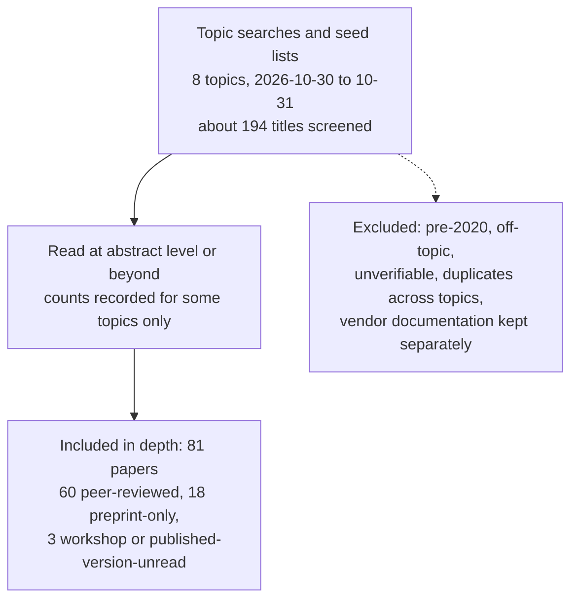
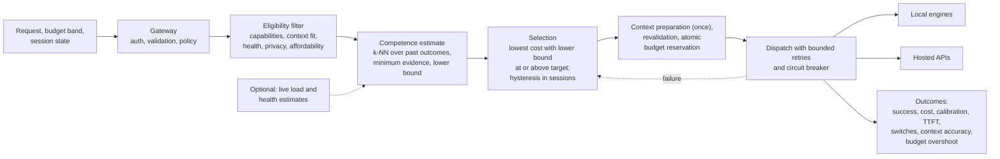

Status: DRAFT
Depends on: Superseded earlier design
Sources: Original draft preserved by git mv
Open items: Archived historical text; excluded from assembly and active placeholder register

# CHAPTER TWO: LITERATURE REVIEW (draft, filled from the literature review; reworked to follow the 26 Oct team guide)

**31 October 2026 update:** The owner selected a hybrid, constraint-aware design under D01. See [hybrid-design-direction.md](hybrid-design-direction.md) for the complete direction and decision status. It supersedes the earlier guide-governs assumption. Detailed sections below await reconciliation after D04, D05, D03 and D02; they must not be treated as the final agreed design.

**Drafting notes (delete before pasting)**

- Built from `literature-review/` (81 papers in 8 topics, grey-literature review of existing routers, `gaps-and-synthesis.md`). Citations are APA 7 author-date and every one has an entry in `literature-review/references.md` (checked by script, see `README.md`). Where two first authors share a surname in the same list, initials are added as APA 7 requires (for example S. Chen et al., 2024 and L. Chen et al., 2024).
- Template minimum: 25 works in depth (this draft has 81), at least 40 references, at least 70 percent from the last five years, mainly peer-reviewed. Template target length 15 to 25 pages. The prose below is a full first draft; trim to the page target.
- Vendor documentation (OpenRouter, LiteLLM, Portkey, TrueFoundry, Martian, vLLM Semantic Router, Not Diamond, Kong) is **grey literature fetched on 2026-10-31**, kept in `literature-review/competitors/`, and is cited in text as "vendor documentation" without APA entries. Re-fetch before submission (the proposal's own risk R-04).
- Several 2026 items are preprints. They are labelled as preprints in the text. Check their status before submission.
- `TODO:` and `ASSUMPTION:` mean the same as in the other drafts.
- **Governing design.** The 26 Oct team guide governs (`design-reconciliation.md`). The review's topics 01 to 08 were written for the 16 Oct live-load plan, so the gap analysis in Section 2.7 now has a primary track (past-performance retrieval, switching, context, budgets, failover, software-engineering evaluation) and a secondary track (live load).
- **Topics 09 and 10.** `literature-review/09-retrieval-knn-and-multiturn-routing/` had three paper files when this draft was written (EACL 2026 past-performance retrieval, MTRouter, VDAR-Router) but no overview and no entries in `references.md`; `10-context-and-memory/` did not exist. Their content is cited as `[CITE-09: ...]` and `[CITE-10: ...]` and must be converted to author-date citations once `references.md` is updated. Section 2.4.10 is a placeholder written from the team guide's own summary, not from reviewed papers.
- Citation form: the JAIR routing survey is cited as Varangot-Reille et al. (2026a) because the EACL paper by the same first author is 2026b once added.

---

This chapter reviews the literature on sending each request for a large language model (LLM) to the most suitable backend. Section 2.1 states how the literature was found. Section 2.2 gives the conceptual framework. Section 2.3 compares the techniques and technologies the router builds on. Section 2.4 reviews 81 studies in eight themes (routing algorithms, prompt difficulty, load balancing, cost reduction, latency, fallback, benchmarking, and system and gateway design) and adds two themes on past-performance retrieval with multi-turn routing, and on conversation context and memory, whose literature review is still in progress. Section 2.5 compares existing systems with the proposed router. Section 2.6 summarises every reviewed work in one table, Section 2.7 states the research gap and maps it to the objectives, and Section 2.8 summarises the chapter.

## 2.1 Review Methodology

The review was run by eight topic searches (one per reading-list topic) and a separate review of existing routers. Each topic search kept its own log (`literature-review/0X-*/00-overview.md`, search-log section). Table 2.1 combines them. **The searches were targeted, not a single systematic protocol**: each topic started from a supervisor-supplied list of papers, verified every one, and then ran a discovery search to add or replace papers. Counts below are therefore title-level screening counts as recorded by each searcher, not a PRISMA count from one database.

**Table 2.1: Literature search strategy**

| Item | Description |
|---|---|
| Databases and sources | arXiv (API, abstract pages and PDFs; used in all eight topics); ACL Anthology; PMLR, ICLR, NeurIPS, OpenReview and MLSys proceedings; USENIX conference pages; Crossref (used for DOI checks in topics 03, 05 and 08; found unusable in topic 02); general web search (used in all topics for discovery and venue checks); journal pages (JAIR, JSERD) and TMLR. IEEE Xplore and ACM Digital Library were reached only through web-search results or DOI redirects (the ACM page for one paper returned HTTP 403). The Semantic Scholar API, dblp and the arXiv API were blocked or rate-limited in some runs (topics 01 and 02) and were not relied on. **Google Scholar was not run by any worker**: topics 01, 06 and 08 say so, and none of the other logs records a Google Scholar search. |
| Search strings | Examples taken from the logs. Topic 01: "LLM routing" OR "model routing" OR "query routing" (arXiv abstract field). Topic 03: `all:"load balancing" AND all:LLM AND all:serving`; `all:"prefix cache" AND all:routing AND all:"LLM serving"`; `all:"multi-SLO" AND all:LLM AND all:serving`. Topic 05: `all:"time to first token" AND all:"LLM serving" AND all:latency`; `all:goodput AND all:"LLM serving" AND all:SLO`; `all:"tail latency" AND all:"LLM inference" AND all:queueing`. Topic 06: web-search strings on LLM failover, fault-tolerant serving, metastable failures, circuit-breaker evaluation and hedged requests. Topic 08: one discovery query on LLM inference gateways, plus metadata checks. Topics 02, 04 and 07 searched by title for each listed paper and then by phrase (for example "Fly-Swat or Cannon", "Language Model Cascades token-level uncertainty", "RouterBench"). The full strings are in each topic's overview. |
| Period covered | 2020 to 2026. Searches ran on 2026-10-30 and 2026-10-31. Earliest included paper: 2020 (1), then 2021 (1), 2022 (3), 2023 (10), 2024 (29), 2025 (23), 2026 (14). |
| Inclusion criteria | Published 2020 or later; relevant to one of the eight themes; metadata verifiable on a publisher, proceedings or arXiv page; full text read where obtainable; the peer-reviewed version preferred over the preprint. ASSUMPTION: English language. |
| Exclusion criteria | Published before 2020 (for example Ray, 2018; Dean and Barroso, 2013); unreachable or unverifiable papers (dropped and replaced); papers off-topic for the project (one RL fine-tuning paper dropped in topic 02); vendor documentation and blogs, which were kept apart as grey literature. |
| Studies retrieved / screened / included | **Included in depth: 81** (11 + 11 + 11 + 10 + 10 + 10 + 9 + 9 across the eight topics). **Screened by title: about 194** (about 75 + 14 + 25 + 14 + 30 + 17 + 9 + 10 by topic; "about" because topics 01, 03 and 05 recorded approximate distinct-title counts, and overlap between topics was not removed). **Retrieved hits:** only three topics kept hit counts (327 arXiv results in topic 01, 66 in topic 03 and 83 in topic 05, each with overlap between queries); the others did not, so no total of retrieved records is given. |

**Included studies by type and year.** Of the 81 papers, 60 are peer-reviewed at conferences or journals, 18 are preprints with no peer-reviewed venue found, and 3 are workshop papers or preprints whose published version was not read (a workshop paper, a workshop-poster benchmark and a preprint later published under another title). 79 of 81 (98%) were published between 2022 and 2026, and the other two are from 2020 and 2021. The template's 70 percent rule is therefore met on recency. Peer-reviewed share varies by theme: topic 03 (load balancing) is mostly preprints (7 of 11).

**Figure 2.1: PRISMA-style flow of the literature search.** Draw from the numbers above; ASSUMPTION: a three-box flow because the logs do not record screening exclusions at each stage. The figure must say it combines eight topic searches.

**Table 2.1b: Counts by theme**

| Theme (folder) | Papers included | Peer-reviewed | Preprint or other | Screened by title | Notes from the log |
|---|---|---|---|---|---|
| 2.4.1 Routing algorithms (01) | 11 | 10 | 1 | about 75 plus 10 seed papers | One discovery paper added (CSCR); abstract-only 2026 preprints listed as pointers |
| 2.4.2 Prompt difficulty (02) | 11 | 7 | 4 | 14 | 8 listed papers kept, 3 replacements added, 1 dropped, 2 found but not reviewed |
| 2.4.3 Load balancing (03) | 11 | 4 | 7 | about 25 | RouteBalance added as closest prior art |
| 2.4.4 Cost reduction (04) | 10 | 9 | 1 | 14 | 5 listed, 5 added |
| 2.4.5 Latency (05) | 10 | 8 | 2 | about 30 | All 10 listed papers kept |
| 2.4.6 Fallback (06) | 10 | 7 | 3 | 17 | 7 added; direct gateway-failover evidence is two preprints |
| 2.4.7 Benchmarking (07) | 9 | 8 | 1 | 9 | No discovery search; minimum met by the listed papers |
| 2.4.8 System and gateway (08) | 9 | 7 | 2 | 10 | One duplicate swapped out; single discovery query found no peer-reviewed gateway paper |

Topics 09 (retrieval, k-NN and multi-turn routing) and 10 (context and memory) were added after the eight searches above; their search logs were not available when this draft was written, so Table 2.1 and the counts cover the eight original topics only (81 papers). TODO: add their rows and counts from the topic overviews.

TODO: before submission, repeat the key strings on Google Scholar, Semantic Scholar, IEEE Xplore and the ACM Digital Library, and record dates and counts.

## 2.2 Conceptual and Theoretical Framework

**Key concepts.** *Model routing* is choosing, for each request, which model should answer it, as opposed to a cascade, where a cheaper model answers first and a stronger one is called only if the answer looks weak (L. Chen et al., 2024; Moslem & Kelleher, 2026; Varangot-Reille et al., 2026a). A *competence estimate* is an estimate, made before the call, of whether a particular model will succeed on a particular task; it is more useful than calling a prompt easy or hard, because difficulty is model-specific (Zhu et al., 2025). *Past-performance retrieval (k-NN)* estimates competence from the recorded outcomes of similar, already-scored tasks [CITE-09: Varangot-Reille et al., 2026 (EACL)]. *Calibration* asks whether predicted success rates match observed ones, and an *uncertainty lower bound* compares a margin-adjusted estimate, not the raw average, with the quality target (team guide). *Budget bands* are policy presets with request, session and project caps enforced before dispatch. *Hysteresis* is a rule that changes the model inside a session only when the expected benefit exceeds a threshold [CITE-09: Zhang et al., 2026 (MTRouter)]. *Context* is the earlier conversation a follow-up needs, and is not the model's internal cache [CITE-10]. *Latency* is measured as time to first token (TTFT) and time per output token, with tail percentiles and goodput as summary measures (Agrawal et al., 2024b; Zhong et al., 2024). *Fallback and circuit breaking* mean moving a request to another backend after a failure and pausing traffic to a backend that keeps failing (Pandey & Singh, 2026a; Huang et al., 2022). *Load awareness* (queue length, memory pressure, tokens per second) is an optional extension in the current design (Sun et al., 2024; Kossmann et al., 2024; Da & Kalyvianaki, 2026).

**Theoretical basis.** The project is a systems and decision problem, not a theory-testing study. Two formal views from the reviewed work are used. First, budget-constrained routing: choose the model that maximises quality minus a weighted cost under a budget, where the quality of the estimator dominates the result (Dekoninck et al., 2025; Varangot-Reille et al., 2026a). Second, past-performance retrieval, in which the competence estimate is a similarity-weighted average of neighbours' outcomes [CITE-09]. TODO-confirm-with-supervisor: whether the department expects a named theory; if not, state that the study rests on these two formal views and on Design Science Research (Chapter 3).

**Conceptual framework (Figure 2.2).** The independent variables are the routing method (static cheapest eligible, domain-average rule, k-NN; optionally a classifier), the switching policy (locked, free, hysteresis) and the context policy (full replay, bounded, retrieval; optionally graph). The router turns a request, a budget band and session state into a backend choice through hard eligibility filters, a competence estimate with an uncertainty lower bound, and a lowest-cost rule, then reserves budget and dispatches with bounded retries. The dependent variables are task success, total cost, calibration, TTFT and latency, model switches, context accuracy and evidence recall, and budget overshoot. Provider caching, cold starts and prices are extraneous variables that the evaluation records or controls.

ASSUMPTION: the framework is the drafter's reading of the team guide and the review. Redraw as a proper figure in the final report.

## 2.3 Enabling Technologies and Techniques

Each area compares the alternatives the reviewed literature offers on stated criteria, and states the choice for this project. The choices themselves come from the proposal [see `00-source-facts.md`]; the comparison supplies the justification the template asks for.

**Table 2.1c (techniques compared; renumber when assembling)**

| Area | Alternatives and what the literature reports | Criteria | Choice for this project and why | Main sources |
|---|---|---|---|---|
| Competence estimate | (a) k-NN over past per-model outcomes with frozen embeddings; (b) trained per-model success predictors or difficulty classifiers on small encoders; (c) hidden-state probes on the target LLM; (d) confidence after answering; (e) router networks trained on preference data; (f) offline difficulty measures | Needs model internals; cost per request; transfer to new models; label source; retraining | (a) as the primary method, with (b) as an optional comparator. k-NN needs no router training and accepts new models once they are run on stored history [CITE-09]; small-encoder predictors are the family cheap enough for a gateway (Šakota et al., 2024; Zotos et al., 2025; Shnitzer et al., 2023); probes need internals closed APIs do not give and transfer near chance across models (Zhu et al., 2025; Kadavath et al., 2022); confidence signals arrive after the call (Chuang et al., 2025; Xiong et al., 2024). | Šakota et al., 2024; Zotos et al., 2025; Shnitzer et al., 2023; Zhu et al., 2025; Kadavath et al., 2022; Chuang et al., 2025; Xiong et al., 2024; Ong et al., 2025; Ding et al., 2024; [CITE-09] |
| Uncertainty and calibration | Raw neighbour average; calibrated probability; margin-adjusted lower bound; isotonic or Platt-style recalibration | Over-confidence in sparse regions; benchmark label noise | Reliability table and Brier score on validation data, a minimum-evidence rule and a lower bound that shrinks with effective neighbours. Calibration degrades out of distribution (Kadavath et al., 2022), black-box confidence signals have AUROC of about 0.5 to 0.6 (Xiong et al., 2024), and benchmark labels are noisy (Zheng et al., 2023; Chiang et al., 2024). | Kadavath et al., 2022; Xiong et al., 2024; Zheng et al., 2023; Chiang et al., 2024; [CITE-09] |
| Selection and cost | Threshold on a quality gap; budget-constrained optimisation; assignment by integer program or greedy ratio; cascades; caching and prompt compression | Calls per request (latency); inspectability; need to retrain | The lowest expected cost among eligible deployments whose lower bound meets the target: one call per request (no cascade delay) with visible rules. Local-model cost reported separately; tokens per dollar from GPU price is one published estimate (Griggs et al., 2024). Caches and compression are orthogonal and not in the MVP. | Dekoninck et al., 2025; Ding et al., 2024; Ong et al., 2025; Šakota et al., 2024; Mohammadshahi et al., 2024; L. Chen et al., 2024; Aggarwal et al., 2024; Griggs et al., 2024; Bang, 2023; Gill et al., 2025 |
| Budget enforcement | Gateway budgets and rate limits in products; atomic reservation and reconciliation | Concurrency correctness; provider usage delay | Atomic reservation before dispatch with reconciliation, verified under 10 and 100 concurrent requests (E4). Evidence that gateway budgets hold under concurrency is engineering practice, not published in the reviewed papers (vendor documentation, Section 2.5). | Vendor documentation; Zhang et al., 2023; Ding et al., 2025 |
| Session switching and context | Locked model; per-turn routing; hysteresis; full replay, bounded, retrieval and graph context | Cache loss on switching; quality loss; context cost | Hysteresis with exceptions for failure and capability change, compared with locked and free switching (E2), and explicit bounded or retrieval context policies (E3). Switching loses prefix reuse (noted in [CITE-09: Zhang et al., 2026]); prefix sharing is studied at the serving level (Srivatsa et al., 2025). | [CITE-09]; [CITE-10]; Srivatsa et al., 2025; Kwon et al., 2023 |
| Failure handling | Bounded retries with jittered backoff; circuit breaker; load shedding; hedged requests; engine-level recovery | Evidence for LLM calls; retry storms; layer | Bounded retries on the next-ranked eligible deployment with a per-deployment circuit breaker; retries can sustain outages, so they are bounded and the fallback's headroom checked. Engine-level recovery protects one model; a gateway treats a backend as up, slow or down. No peer-reviewed 2020 or later work on hedging for LLM serving was found. | Huang et al., 2022; Pandey & Singh, 2026a, 2026b; Aderaldo & Mendonça, 2026; Yan et al., 2025; Miao et al., 2024; Strati et al., 2024; Fu et al., 2024 |
| Live-load signals (optional extension) | Request counts; memory- and token-based load; predicted finish time; in-flight tokens plus network delay; fused quality and load scores | Gateway-observable; staleness; gain over round-robin | Only if the extension is pursued: health, latency and queue estimates in the registry, vLLM `/metrics` when exposed. Request counts are the weakest signal (join-shortest-queue only 0.46% better than round-robin in Jain et al., 2024). | Jain et al., 2024; Sun et al., 2024; Kossmann et al., 2024; Qin et al., 2025; Toniolo et al., 2026; Xia et al., 2026; Da & Kalyvianaki, 2026 |
| Local engines and gateway architecture | vLLM, Ollama, LM Studio, llama.cpp; SGLang; model-less per-query selection; LLM-aware gateways; central controllers | Throughput and latency; exposed metrics; per-decision overhead; fault tolerance | One modular application with generic OpenAI-compatible adapters. INFaaS reports a 2.2 to 3.5 ms median selection overhead on a constant-time store (Romero et al., 2021); Clockwork and AlpaServe flag a central controller as a single point of failure (Gujarati et al., 2020; Z. Li et al., 2023). No peer-reviewed paper covers Ollama. | Romero et al., 2021; Shan et al., 2025; Gujarati et al., 2020; Z. Li et al., 2023; Kwon et al., 2023; Yu et al., 2022; Zheng et al., 2024; Miao et al., 2025 |
| Evaluation | Replay of stored outputs (RouterBench, RouterEval, LLMRouterBench, RouterArena); MT-Bench and Chatbot Arena for quality; paired intervals; fault injection | Quality labels; latency under load; failure injection; baselines | RouterBench and LLMRouterBench for E1, with best-single, always-strong, always-weak and rule baselines and several seeds, plus live tests for latency, budgets and faults, since no reviewed benchmark measures either. | Hu et al., 2024; Z. Huang et al., 2025; H. Li et al., 2026; Y. Lu et al., 2026; Zheng et al., 2023; Chiang et al., 2024 |

## 2.4 Review of Related Works

The eight themes follow the eight reading-list topics. Each theme states what the studies did, compares them, and ends with the limitation that leads to the gap in Section 2.7. A list of the paper files for each theme follows the text (for the team's use; delete when pasting).

### 2.4.1 Routing algorithms

Routing research started from ensembling. LLM-Blender (D. Jiang et al., 2023) showed that the best model changes with the input but paid for calling every model. Zooter (K. Lu et al., 2024), RouterDC (S. Chen et al., 2024) and Shnitzer et al. (2023) keep that diversity but call one model, with RouterDC measuring about six times faster inference than voting. Hybrid LLM (Ding et al., 2024) and RouteLLM (Ong et al., 2025) narrow the choice to a strong or weak model with a tunable threshold, while cascades such as FrugalGPT (L. Chen et al., 2024) and AutoMix (Aggarwal et al., 2024) spend extra calls and learn from a first answer. Cost-aware contrastive routing (Shirkavand et al., 2025) extends the embedding-based family. The papers differ most in where the quality label comes from: benchmark correctness (Shnitzer et al., 2023; S. Chen et al., 2024), BART-score gaps (Ding et al., 2024), reward-model scores (K. Lu et al., 2024), or human preferences (Ong et al., 2025).

Generalisation is the weak point. Shnitzer et al. (2023) measure 0.59 predictor accuracy out of distribution, and RouteLLM routers trained only on Arena data are near random on MMLU and GSM8K until augmented (Ong et al., 2025). Two surveys formalise budget-constrained routing and conclude that evaluations are not comparable across papers (Moslem & Kelleher, 2026; Varangot-Reille et al., 2026a). Unlike this project, none of the eleven studies uses queue depth, GPU load or backend health as a routing input: cost is a token price or call count, latency appears only as router overhead, and every experiment uses API prices or offline outputs. Several 2026 preprints begin to address capacity and latency (listed in the topic overview, read at abstract level only and not cited here). Retrieval-based estimation of a model's competence from similar past requests, which the current design uses, is reviewed in Section 2.4.9.

*Paper files (for the team; delete when pasting):* [Aggarwal et al. (2024)](../literature-review/01-routing-algorithms/aggarwal-2024-automix.md); [L. Chen et al. (2024)](../literature-review/01-routing-algorithms/chen-2024-frugalgpt.md); [S. Chen et al. (2024)](../literature-review/01-routing-algorithms/chen-2024-routerdc.md); [Ding et al. (2024)](../literature-review/01-routing-algorithms/ding-2024-hybrid-llm.md); [D. Jiang et al. (2023)](../literature-review/01-routing-algorithms/jiang-2023-llm-blender.md); [K. Lu et al. (2024)](../literature-review/01-routing-algorithms/lu-2024-zooter.md); [Moslem & Kelleher (2026)](../literature-review/01-routing-algorithms/moslem-2026-routing-cascading-survey.md); [Ong et al. (2025)](../literature-review/01-routing-algorithms/ong-2025-routellm.md); [Shirkavand et al. (2025)](../literature-review/01-routing-algorithms/shirkavand-2025-cscr.md); [Shnitzer et al. (2023)](../literature-review/01-routing-algorithms/shnitzer-2023-benchmark-routing.md); [Varangot-Reille et al. (2026a)](../literature-review/01-routing-algorithms/varangot-reille-2026-routing-survey.md)

### 2.4.2 Prompt difficulty

Difficulty predictors differ in where the signal comes from. Small-encoder predictors read the prompt before any model runs: Šakota et al. (2024) train a 66-million-parameter DistilBERT to predict per-model success, Zotos et al. (2025) use TF-IDF or BERT features, and Mohammadshahi et al. (2024) use a 7B decoder as encoder. Probes on the target model's hidden states (Kadavath et al., 2022; Zhu et al., 2025; Damani et al., 2025; Zhao et al., 2025) are accurate but need model internals that closed APIs do not expose (Zhu et al., 2025). Confidence after answering (Chuang et al., 2025; Xiong et al., 2024) behaves like a cascade, because the first attempt is already paid for. Offline measures (Mozafari et al., 2026; B. Li et al., 2024) suit labelling and analysis, not the request path.

Labels usually come from observed correctness of models rather than human annotation, and Kadavath et al. (2022) and Damani et al. (2025) use soft labels (success probability). Difficulty is model-specific: Zhu et al. (2025) report near-chance ROC-AUC (47.29 and 49.74) when a probe trained on one LLM is applied to another, and Xiong et al. (2024) report AUROC of about 0.5 to 0.6 for several black-box confidence signals. The strongest designs therefore predict per-model success rather than one global difficulty (Šakota et al., 2024; Damani et al., 2025). This matches the proposed classifier, which is a frozen embedding with a light head. The gap is that none of these predictors feeds a decision that also sees load or latency, and each is tied to a fixed model pool.

*Paper files (for the team; delete when pasting):* [Chuang et al. (2025)](../literature-review/02-prompt-difficulty/chuang-2025-confidence-tokens.md); [Damani et al. (2025)](../literature-review/02-prompt-difficulty/damani-2025-learning-how-hard-to-think.md); [Kadavath et al. (2022)](../literature-review/02-prompt-difficulty/kadavath-2022-know-what-they-know.md); [B. Li et al. (2024)](../literature-review/02-prompt-difficulty/li-2024-famicom.md); [Mohammadshahi et al. (2024)](../literature-review/02-prompt-difficulty/mohammadshahi-2024-routoo.md); [Mozafari et al. (2026)](../literature-review/02-prompt-difficulty/mozafari-2026-q-daps.md); [Šakota et al. (2024)](../literature-review/02-prompt-difficulty/sakota-2024-fly-swat-or-cannon.md); [Xiong et al. (2024)](../literature-review/02-prompt-difficulty/xiong-2024-llm-uncertainty-calibration.md); [Zhao et al. (2025)](../literature-review/02-prompt-difficulty/zhao-2025-reasoning-efficiency-difficulty.md); [Zhu et al. (2025)](../literature-review/02-prompt-difficulty/zhu-2025-llm-already-knows.md); [Zotos et al. (2025)](../literature-review/02-prompt-difficulty/zotos-2025-model-uncertainty-difficulty.md)

### 2.4.3 Load balancing

The studies differ most in what they count as "load". Request counts are the weakest signal: Jain et al. (2024) found join-shortest-queue only 0.46% better than round-robin, and Xia et al. (2026) showed a fixed cap on outstanding requests performs worse than checking for a waiting request. Stronger signals are memory- and token-based. Llumnix (Sun et al., 2024) counts queued demand as virtual KV-cache memory; Kossmann et al. (2024) use queued prefill tokens and free memory; Preble (Srivatsa et al., 2025) and CascadeInfer (Yuan et al., 2025) use token counts and sequence lengths; Mooncake (Qin et al., 2025) and SLOs-Serve (S. Chen et al., 2025) compare a predicted finish time with an SLO; GORGO (Toniolo et al., 2026) adds network delay and in-flight tokens to Prometheus-scraped metrics; and RouteBalance (Da & Kalyvianaki, 2026) combines queue depth, pending decode work and KV pressure with model choice.

Gains over round-robin range from 11% (Jain et al., 2024) to more than 20 times on prefill latency for bursty, variable-length traces (Sun et al., 2024), but shrink to roughly 1.0 to 1.5 times against stronger baselines (Kossmann et al., 2024) and 7 to 31% in GORGO (Toniolo et al., 2026). Almost no paper measures how stale the signals are; they only state refresh rates (10 Hz in Kossmann et al., 2024, 100 ms probes in Xia et al., 2026, and 30 s Prometheus scrapes in Toniolo et al., 2026), and Mooncake's extended study gives the one clear failure, where acting on lagged load made prefill and decode load oscillate (Qin et al., 2025). Unlike the router proposed here, nearly all of these papers balance replicas of one model with engine-level access such as migration, which a gateway in front of Ollama, vLLM or a hosted API does not have. Only RouteBalance combines model choice with load, and it is a 2026 preprint that does not cover hosted backends, per-request latency budgets or failover. Seven of the eleven papers are preprints.

*Paper files (for the team; delete when pasting):* [S. Chen et al. (2025)](../literature-review/03-load-balancing/chen-2025-slos-serve.md); [Da & Kalyvianaki (2026)](../literature-review/03-load-balancing/da-2026-routebalance.md); [Jain et al. (2024)](../literature-review/03-load-balancing/jain-2024-intelligent-router.md); [Kossmann et al. (2024)](../literature-review/03-load-balancing/kossmann-2024-gpu-half-empty.md); [Qin et al. (2025)](../literature-review/03-load-balancing/qin-2025-mooncake.md); [Srivatsa et al. (2025)](../literature-review/03-load-balancing/srivatsa-2025-preble.md); [Sun et al. (2024)](../literature-review/03-load-balancing/sun-2024-llumnix.md); [Toniolo et al. (2026)](../literature-review/03-load-balancing/toniolo-2026-gorgo.md); [Vestrum et al. (2026)](../literature-review/03-load-balancing/vestrum-2026-multi-tier-sla.md); [Xia et al. (2026)](../literature-review/03-load-balancing/xia-2026-skywalker.md); [Yuan et al. (2025)](../literature-review/03-load-balancing/yuan-2025-l4-cascadeinfer.md)

### 2.4.4 Cost reduction

Cost work moved from heuristics to principled selection. Yue et al. (2024) replace FrugalGPT's learned scorer with the consistency of sampled answers, Gupta et al. (2024) use token-level uncertainty, and Dekoninck et al. (2025) show that both are special cases of one cost-constrained optimisation in which estimator quality dominates the outcome. Ding et al. (2025) extend the choice from which model to how many samples, with a BERT-style predictor over eight models, and Narasimhan et al. (2025) fuse cascading with speculative decoding. Two further levers act on the price formula: LLMLingua and LongLLMLingua shorten the input (H. Jiang et al., 2023, 2024), and caches avoid the call altogether: EcoAssistant reuses earlier solutions (Zhang et al., 2023), GPTCache is the practical semantic cache (Bang, 2023) and MeanCache adds a precision-weighted evaluation and context handling (Gill et al., 2025). False hits are the key risk (39 of 876 hits wrong in Bang, 2023; 89 false hits per 700 unique queries in Gill et al., 2025).

None of the ten papers includes queueing, utilisation or contention in the selection rule. Self-hosted cost is missing or wrong: Zhang et al. (2023) cost a local Llama-2 model at zero, and Ding et al. (2025) price open models by API. Latency is a side effect, not a budget: cascades and best-of-n add calls and delay yet no objective includes a latency budget. The levers are also studied in isolation, so no paper evaluates caching, compression, routing and failover together. Unlike the proposed router, these methods assume a static per-model price and evaluate offline on 2023 to 2024 prices.

*Paper files (for the team; delete when pasting):* [Bang (2023)](../literature-review/04-cost-reduction/bang-2023-gptcache.md); [Dekoninck et al. (2025)](../literature-review/04-cost-reduction/dekoninck-2025-cascade-routing.md); [Ding et al. (2025)](../literature-review/04-cost-reduction/ding-2025-best-route.md); [Gill et al. (2025)](../literature-review/04-cost-reduction/gill-2025-meancache.md); [Gupta et al. (2024)](../literature-review/04-cost-reduction/gupta-2024-token-uncertainty-cascades.md); [H. Jiang et al. (2023)](../literature-review/04-cost-reduction/jiang-2023-llmlingua.md); [H. Jiang et al. (2024)](../literature-review/04-cost-reduction/jiang-2024-longllmlingua.md); [Narasimhan et al. (2025)](../literature-review/04-cost-reduction/narasimhan-2025-speculative-cascades.md); [Yue et al. (2024)](../literature-review/04-cost-reduction/yue-2024-mot-cascades.md); [Zhang et al. (2023)](../literature-review/04-cost-reduction/zhang-2023-ecoassistant.md)

### 2.4.5 Latency and speed

Serving papers define latency carefully, while routing papers treat it as a cost. Sarathi-Serve (Agrawal et al., 2024b) gives clear definitions of TTFT, time between tokens and capacity with an explicit stability condition. DistServe (Zhong et al., 2024) defines goodput as the highest per-GPU request rate at which a target share of requests meet both TTFT and TPOT targets, and supplies a queueing form in which average TTFT diverges as arrival rate times execution time approaches one. Etalon (Agrawal et al., 2024a) shows why averages mislead and measures hosted APIs from the outside, which is the router's view of a remote backend. Splitwise (Patel et al., 2024) requires P50, P90 and P99 targets to all be met, Orca (Yu et al., 2022) and vLLM (Kwon et al., 2023) use normalised latency, and Vidur (Agrawal et al., 2024c) is the only study of prediction error against load, finding predictions accurate up to about 85% of capacity and unreliable beyond. Near capacity, queueing dominates the tail: median TTFT rose from 2.2 s to 25.4 s when load went from 1.1 to 1.2 queries per second in POD-Attention (Kamath et al., 2025). Niyama (Goel et al., 2025) expresses budgets as deadlines, and speculative decoding changes TPOT with acceptance rate (Leviathan et al., 2023).

The papers disagree on the headline metric, so results are not comparable across them, and a Prometheus-based router sees bucketed histograms scraped every 15 to 30 seconds rather than the exact percentiles the papers use. Nothing here is designed for a gateway: each paper optimises inside an engine or cluster it controls, and none predicts a third-party backend's latency from client-side signals alone, except Etalon's black-box measurements, which characterise but do not predict.

*Paper files (for the team; delete when pasting):* [Agrawal et al. (2024a)](../literature-review/05-latency-and-speed/agrawal-2024-etalon.md); [Agrawal et al. (2024b)](../literature-review/05-latency-and-speed/agrawal-2024-sarathi-serve.md); [Agrawal et al. (2024c)](../literature-review/05-latency-and-speed/agrawal-2024-vidur.md); [Goel et al. (2025)](../literature-review/05-latency-and-speed/goel-2025-niyama.md); [Kamath et al. (2025)](../literature-review/05-latency-and-speed/kamath-2025-pod-attention.md); [Kwon et al. (2023)](../literature-review/05-latency-and-speed/kwon-2023-pagedattention.md); [Leviathan et al. (2023)](../literature-review/05-latency-and-speed/leviathan-2023-speculative-decoding.md); [Patel et al. (2024)](../literature-review/05-latency-and-speed/patel-2024-splitwise.md); [Yu et al. (2022)](../literature-review/05-latency-and-speed/yu-2022-orca.md); [Zhong et al. (2024)](../literature-review/05-latency-and-speed/zhong-2024-distserve.md)

### 2.4.6 Error handling and fallback

Direct evidence on gateway failover is thin. ContinuityBench and FailureAtlas (Pandey & Singh, 2026a, 2026b) study stateful failover across providers, but they are preprints from one vendor and should be treated as a single source. Yan et al. (2025) show from the provider side that the failures that matter often return a normal response: degraded latency accounts for 49.8% of Microsoft's GenAI incidents in their data and invalid output for 14.5%, so status-code health checks are insufficient. Retries cut both ways: Huang et al. (2022) find retries sustaining over half of the metastable outages they studied, ContinuityBench reproduces this against a rate-limited fallback, and Aderaldo and Mendonça (2026) show retry persistence raises success but the right backoff depends on the failure rate. The consistent advice is bounded retries with jittered backoff and load shedding.

Recovery inside the serving engine is a separate layer. SpotServe (Miao et al., 2024), DéjàVu (Strati et al., 2024), GhostServe (Jayakody et al., 2026) and ServerlessLLM (Fu et al., 2024) keep the same model alive by moving or checkpointing the KV cache, cutting recovery from minutes to seconds, but none protects against a provider outage or a rate limit. SkyServe (Mao et al., 2025) and SpotServe mix preemptible and on-demand capacity, which is the same pattern as self-hosted first with a hosted API behind it, and report cost reductions of 43% to 54% from it. Unlike the router proposed here, no reviewed work selects the failover target by predicted quality, cost and live load, tests circuit-breaker settings for multi-second, token-priced LLM calls, or handles mid-stream failure at gateway level. Circuit-breaker and fallback features exist in products (Portkey and others, vendor documentation) long before any peer-reviewed evaluation.

*Paper files (for the team; delete when pasting):* [Aderaldo & Mendonça (2026)](../literature-review/06-error-handling-fallback/aderaldo-2026-resiliencebench-operator.md); [Fu et al. (2024)](../literature-review/06-error-handling-fallback/fu-2024-serverlessllm.md); [L. Huang et al. (2022)](../literature-review/06-error-handling-fallback/huang-2022-metastable-failures.md); [Jayakody et al. (2026)](../literature-review/06-error-handling-fallback/jayakody-2026-ghostserve.md); [Mao et al. (2025)](../literature-review/06-error-handling-fallback/mao-2025-skyserve.md); [Miao et al. (2024)](../literature-review/06-error-handling-fallback/miao-2024-spotserve.md); [Pandey & Singh (2026)](../literature-review/06-error-handling-fallback/pandey-2026-continuitybench.md); [Pandey & Singh (2026b)](../literature-review/06-error-handling-fallback/pandey-2026-failureatlas.md); [Strati et al. (2024)](../literature-review/06-error-handling-fallback/strati-2024-dejavu.md); [Yan et al. (2025)](../literature-review/06-error-handling-fallback/yan-2025-genai-incidents.md)

### 2.4.7 Testing and benchmarking

The benchmarks converge on one record: a row per (prompt, model) with a quality score and a cost. RouterBench (Hu et al., 2024) reduces a router to a point on the cost-quality plane and reports a summary score; RouterEval (Z. Huang et al., 2025) varies pool size; FusionFactory (Feng et al., 2026) adds a judge score; EmbedLLM (Zhuang et al., 2025) uses a binary model-by-question matrix; LLMRouterBench (H. Li et al., 2026) adds gains, distance to the oracle and Pareto distance; and RouterArena (Y. Lu et al., 2026) adds robustness and the router's own latency. A recurring finding is that simple baselines are hard to beat: RouterBench found its learned routers barely above a trivial one, and LLMRouterBench found many routers, including commercial ones, not reliably better than the best single model. Always-strong and best-single baselines are therefore essential controls.

Quality labels vary in cleanliness. MT-Bench (Zheng et al., 2023) shows GPT-4 agrees with experts 85% of the time but has position and verbosity bias, and Chatbot Arena (Chiang et al., 2024) shows crowd-expert agreement of 72 to 83%. HELM (Liang et al., 2023) argued earlier for reporting efficiency next to accuracy. Latency is the weakest dimension: RouterBench lists it as future work, EmbedLLM and RouterArena measure only the router's own overhead, and LLMRouterBench estimates model latency from tokens. Unlike the evaluation planned here, none of the nine benchmarks measures latency under load, injects failures, or reports how judge noise affects router training.

*Paper files (for the team; delete when pasting):* [Chiang et al. (2024)](../literature-review/07-testing-and-benchmarking/chiang-2024-chatbot-arena.md); [Feng et al. (2026)](../literature-review/07-testing-and-benchmarking/feng-2026-fusionfactory.md); [Hu et al. (2024)](../literature-review/07-testing-and-benchmarking/hu-2024-routerbench.md); [Z. Huang et al. (2025)](../literature-review/07-testing-and-benchmarking/huang-2025-routereval.md); [H. Li et al. (2026)](../literature-review/07-testing-and-benchmarking/li-2026-llmrouterbench.md); [Liang et al. (2023)](../literature-review/07-testing-and-benchmarking/liang-2023-helm.md); [Y. Lu et al. (2026)](../literature-review/07-testing-and-benchmarking/lu-2026-routerarena.md); [Zheng et al. (2023)](../literature-review/07-testing-and-benchmarking/zheng-2023-mt-bench-llm-judge.md); [Zhuang et al. (2025)](../literature-review/07-testing-and-benchmarking/zhuang-2025-embedllm.md)

### 2.4.8 System design and gateway

Peer-reviewed system work addresses components of a gateway, not the gateway itself. Three layers recur and are rarely joined: engines (SGLang, Zheng et al., 2024; the serving survey, Miao et al., 2025), multi-model clusters (AlpaServe, Z. Li et al., 2023; MuxServe, Duan et al., 2024; S-LoRA, Sheng et al., 2024; Clockwork, Gujarati et al., 2020), and request routing (INFaaS, Romero et al., 2021; AIBrix, Shan et al., 2025). INFaaS is the closest precedent: the caller states latency and accuracy needs and the system picks a model variant per query from a dynamic state machine, with a Redis metadata store, a replicated controller and a median selection overhead of 2.2 to 3.5 ms; but it serves image models with fixed accuracy. Clockwork runs a request only if its predicted completion meets the deadline, and AlpaServe and Clockwork both state that their central controller is a single point of failure and leave fault tolerance open. AIBrix (a preprint) describes an LLM-aware Envoy-based gateway with least-request, least-latency and prefix-aware policies among instances of one model. Mélange (Griggs et al., 2024, a preprint) defines tokens per dollar from on-demand GPU prices, which offers one published way to price self-hosted tokens.

Nearly every paper assumes the caller names the model. Across these papers, "gateway" appears only in AIBrix; "circuit breaker" appears only there too, as a criticism of another tool; and Prometheus and Ollama appear in none, while Redis is used by INFaaS alone. Gateway design is therefore documented mostly in engineering documentation, not in the literature, and the router's architecture is an engineering synthesis supported by these papers component by component. Hosted-plus-self-hosted routing and Prometheus-fed routing are not covered; gateway overhead is rarely measured.

*Paper files (for the team; delete when pasting):* [Shan et al. (2025)](../literature-review/08-system-design-gateway/aibrix-2025-llm-inference-infrastructure.md); [Duan et al. (2024)](../literature-review/08-system-design-gateway/duan-2024-muxserve.md); [Griggs et al. (2024)](../literature-review/08-system-design-gateway/griggs-2024-melange.md); [Gujarati et al. (2020)](../literature-review/08-system-design-gateway/gujarati-2020-clockwork.md); [Z. Li et al. (2023)](../literature-review/08-system-design-gateway/li-2023-alpaserve.md); [Miao et al. (2025)](../literature-review/08-system-design-gateway/miao-2025-llm-serving-survey.md); [Romero et al. (2021)](../literature-review/08-system-design-gateway/romero-2021-infaas.md); [Sheng et al. (2024)](../literature-review/08-system-design-gateway/sheng-2024-slora.md); [Zheng et al. (2024)](../literature-review/08-system-design-gateway/zheng-2024-sglang.md)

### 2.4.9 Past-performance retrieval, k-NN and multi-turn routing

*Status: written from the three paper files in `literature-review/09-retrieval-knn-and-multiturn-routing/`, which have no topic overview and no `references.md` entries yet. Convert each `[CITE-09]` to an author-date citation when the entries exist; the figures below are as recorded in those files.*

Past-performance retrieval estimates a model's score on a new request from the recorded scores of similar past requests, so no router has to be trained and a new model only has to be run on the stored history. The EACL 2026 student-workshop paper [CITE-09: Varangot-Reille et al., 2026 (EACL)] compares a learned ContextualRouter with plain k-NN averaging over the same neighbours and finds that k-NN matches or beats it on performance estimation and ranking. It works with as little as 1% of the historical data, shows no significant gain beyond k = 40 (k from 10 to 80 was tested) and is barely sensitive to embedding size; smaller k gave better cost-performance, while larger k raised peak performance because large, expensive models dominate a wide neighbourhood. The authors note flawed benchmark labels and that shared question formats make retrieval easy; the review file records no calibration, intervals or minimum-evidence rule, and the queries are single-turn. VDAR-Router [CITE-09: Tang et al., 2026, preprint] retrieves neighbours by an LLM-written difficulty analysis rather than raw text and reports the best combined reward on RouterBench and LLMRouterBench, but its analysis step costs 1.43 of 1.46 seconds of routing latency per query, against about 25 ms for embedding and retrieval, and it uses one seed and no calibration. This is consistent with earlier benchmark findings that learned routers are hard to separate from simple baselines (Hu et al., 2024; H. Li et al., 2026) and with per-model success predictors on small encoders (Šakota et al., 2024; Zotos et al., 2025).

For multi-turn use, MTRouter [CITE-09: Zhang et al., 2026 (ACL 2026)] chooses a model at each turn of a tool-using agent episode from a history-model joint embedding and a small network trained on logged trajectories. It reports an average score of 53.8 against 48.4 for GPT-5 at 58.7% lower cost on ScienceWorld, and it stays with the same model after an error 90.2% of the time against 38.3% for a reactive baseline. Unlike the router planned here, it learns from costly trajectory logs, has no explicit hysteresis or cache-aware switching cost, evaluates agent tasks rather than chat sessions, and notes without measuring that switching loses prefix reuse. Prefix sharing is a serving-level concern (Srivatsa et al., 2025). The gap carried to Section 2.7 is that no reviewed work checks the calibration of retrieved competence estimates, specifies a minimum-evidence rule or a lower bound, or measures hysteresis with cache accounting on chat sessions.

*Paper files (for the team; delete when pasting):* [Varangot-Reille et al. (2026, EACL)](../literature-review/09-retrieval-knn-and-multiturn-routing/varangot-reille-2026-contextualrouter.md); [Zhang et al. (2026, MTRouter)](../literature-review/09-retrieval-knn-and-multiturn-routing/zhang-2026-mtrouter.md); [Tang et al. (2026, VDAR-Router)](../literature-review/09-retrieval-knn-and-multiturn-routing/tang-2026-vdar-router.md)

### 2.4.10 Conversation context and memory

*Status: placeholder. `literature-review/10-context-and-memory/` did not exist when this draft was written. The paragraph below is a working summary taken from the team guide (section 4), which says its relevance summaries were not re-read against full texts; none of it is a reviewed finding. Replace with a synthesis of the topic 10 papers and cite them as author-date.*

The team guide names a benchmark of long-term chat memory [CITE-10: LongMemEval; Wu et al., 2025; ICLR 2025] covering extraction, multi-session and temporal reasoning, fact updates and abstention, and names temporal knowledge-graph memory (Graphiti, open-source documentation; the Zep paper, arXiv:2501.13956) as a candidate for retaining changing relationships with timestamps and provenance [CITE-10: LongMemEval; Zep and Graphiti; further topic 10 papers]. Its caveats are that memory-benchmark accuracy is not gateway throughput or router cost, that software documentation is not independent proof, and that a hand-built graph is only an optimistic reference. Serving-level KV reuse is reviewed elsewhere in this chapter: prefix caching and radix-tree KV reuse show 52.4% to 74.1% cache hit rates in a production chat service (Zheng et al., 2024), prefix-aware scheduling is studied by Srivatsa et al. (2025), and KV-cache-centric architectures by Qin et al. (2025); the guide's point is that a different model generally cannot reuse another model's KV cache, so context must be rebuilt as text. The gap carried to Section 2.7 is a measured comparison of full replay, bounded history, retrieval and optional graph context after a model switch.

*Paper files:* none yet (topic 10 folder not found).

## 2.5 Review of Existing Systems

The template asks for three to five existing applications compared with the proposed system. Table 2.2 compares five: four products or open-source projects and one research prototype. Portkey (circuit breaker and conditional routing), TrueFoundry (load balancing with latency windows), Martian (hosted gateway; routing method not published), Kong AI Proxy Advanced and Cloudflare AI Gateway were also reviewed and are summarised in `literature-review/competitors/`. All product facts are from vendor documentation fetched on 2026-10-31 (grey literature). "n.d." means the pages read do not say; it does not mean the feature is absent.

- **OpenRouter** offers one API to many hosted providers with fallbacks. Provider routing is per named model; its Auto Router picks a model per prompt from task type and community spend share, not from live backend load. Latency and throughput statistics are over recent minutes, and its routing pages cover provider keys, not self-hosted GPUs.
- **LiteLLM** has a Router that balances across deployments of a named model with latency-based, least-busy and usage-based strategies (the usage-based strategy is documented as not recommended for production), and an Auto Router (beta, v2 announced 13 July 2026) that sorts a request into a complexity tier by heuristics, an LLM classifier or an adaptive bandit. The Auto Router does not use load to choose the tier. LiteLLM supports self-hosted vLLM deployments.
- **vLLM Semantic Router** is an open-source project (Apache-2.0) with a companion preprint that does per-prompt selection over signals and decisions, with self-hosted vLLM backends, runtime TPOT and TTFT percentiles and weighted failover. Queue and GPU signals and per-request latency budgets are not documented in the pages read.
- **Not Diamond** is a closed service that predicts the best model per query with a pre-trained or custom-trained router (method not published); it has a latency-oriented trade-off mode but no per-request budget, and the router itself is hosted.
- **RouteBalance** (Da & Kalyvianaki, 2026, a preprint) is the closest research prior art: it picks a model instance per request from a weighted score of predicted quality, latency and cost, with vLLM queue and KV-cache telemetry and dead reckoning between scrapes. It does not cover hosted backends, per-request latency budgets or failover beyond losing a tier, and uses one model family on one cluster.

**Table 2.2: Feature comparison of existing systems and the proposed system**

Legend: yes, no, partial as documented; n.d. = not documented on the pages read; n.r. = not reviewed in the competitor review (budget and session features were not part of its checklist: TODO re-check vendor documentation). "Proposed" is the current design (26 Oct guide) and a plan, not an achieved result.

| Feature | OpenRouter | LiteLLM (Router and Auto Router) | vLLM Semantic Router | Not Diamond | RouteBalance (preprint) | Proposed router |
|---|---|---|---|---|---|---|
| Chooses the model per prompt | partial (Auto Router: task type plus 7-day spend share) | Router: no; Auto Router: yes (complexity tiers) | yes (signals and decisions; 13 selection algorithms) | yes (learned; pre-trained or custom router) | yes (model instance per request) | yes (planned) |
| Competence estimate from past outcomes | no | no (heuristic, LLM classifier, adaptive bandit) | partial (some learned selectors) | yes (method not published) | yes (k-NN predicted quality) | yes (planned: k-NN; classifier optional) |
| Uncertainty lower bound or minimum-evidence rule | n.d. | n.d. | n.d. | n.d. | n.d. | yes (planned) |
| Cost budget caps with atomic reservation | n.r. | n.r. (budgets documented per the team guide; not re-checked) | n.r. | n.r. | not covered | yes (planned) |
| Session-aware switching (hysteresis) | n.r. | n.r. | n.r. | n.r. | n.d. | yes (planned) |
| Live load signals | partial (provider statistics over minutes) | partial (least-busy, latency-based, usage-based) | partial (runtime TPOT and TTFT percentiles; queue and GPU n.d.) | n.d. (latency is a catalogue value) | yes (vLLM queue depth, KV pressure, dead reckoning) | optional extension (registry health and latency estimates; vLLM `/metrics` when exposed) |
| Per-request latency budget | partial (`preferred_max_latency`, soft) | n.d. | n.d. | partial (latency mode, no budget) | not covered | optional (Could requirement; DECISION-NEEDED) |
| Fallback and failover | yes | yes | yes (weighted failover) | n.d. | not covered beyond losing a tier | yes (planned: bounded retries, circuit breaker) |
| Self-hosted and local backends | n.d. (own provider keys only) | yes (vLLM deployments) | yes (local vLLM) | partial (custom endpoints as candidates; router hosted) | yes (vLLM workers, one cluster) | yes (planned: Ollama, LM Studio, llama.cpp, vLLM) |
| Hosted API backends | yes | yes | n.d. | yes | not covered | yes (planned) |
| Open source or inspectable rules | no source stated | yes (self-hostable) | yes (Apache-2.0) | no (closed service) | n.d. (preprint) | yes (own code, planned) |

**What this means for the project.** The 16 Oct proposal's statement that no tool both picks the model per prompt and watches live load is no longer safe: OpenRouter and LiteLLM now have per-prompt auto routers, and vLLM Semantic Router and RouteBalance combine per-prompt selection with self-hosted vLLM and some runtime statistics. The current design does not rest on that claim. Products already provide authentication, budgets, routing and fallbacks, so implementing them is not a novelty claim (team guide). What is not documented in the pages reviewed is a validated competence estimate with an uncertainty rule, controlled session switching with cache accounting, and verified budget enforcement under concurrency, in a gateway where local models are first-class. Section 2.7 states the gap carefully.

## 2.6 Summary of Reviewed Works

Table 2.3 lists all 81 reviewed works grouped by theme (Sections 2.4.1 to 2.4.8), then the three topic 09 works that are not yet in `references.md`; topic 10 has no papers yet. Rows are copied from the "Row for Table 2.3" of each paper file in `literature-review/` by script, so the wording is the reviewers' own and has been checked there against the papers. The Author(s) and year cells use APA initials where two first authors share a surname.

**Table 2.3: Summary of related works**

**2.4.1 Routing algorithms** (11 works)

| S/N | Author(s) and year | Aim / problem | Method / technique | Dataset / tools | Key findings | Limitations / gap |
|---|---|---|---|---|---|---|
| 1 | Aggarwal et al. (2024) | Mix small and large LMs via black-box APIs with little data | Few-shot self-verification plus POMDP or threshold router; IBC | QASPER, QuALITY, CoQA, MuTual, DIPLOMAT; Mistral, Llama-2, GPT-3.5/4 | Over 50% cost reduction at comparable performance; works with 50 examples | Context tasks only; sequential latency; no load or failover |
| 2 | L. Chen et al. (2024) | Cut LLM API cost, keep accuracy | Learned cascade (DistilBERT scorer, thresholds, budget optimiser) | HEADLINES, OVERRULING, COQA; 12 APIs | Up to 98% saving at GPT-4 accuracy | Sequential latency; needs in-distribution labels; no load or failover |
| 3 | S. Chen et al. (2024) | Route queries among several good LLMs | Encoder plus learnable LLM embeddings; two contrastive losses | MMLU, GSM8K, CMMLU, ARC-C, HumanEval; OOD PreAlgebra, MBPP, C-EVAL; seven 7-8B LLMs | 58.54% vs 54.56% best single; +1.90 OOD; about 6x faster than voting | Small models; accuracy only; fixed pool; no cost or load |
| 4 | Ding et al. (2024) | Cut large-model calls, keep quality | DeBERTa router on quality-gap labels (deterministic, probabilistic, transformed); threshold | MixInstruct; Llama-2, FLAN-T5, GPT-3.5; BART score | Up to 40% fewer large calls, no drop for close pairs | Two models, one dataset, no OOD, load or failover |
| 5 | D. Jiang et al. (2023) | Exploit per-input differences between open LLMs | Pairwise ranker picks top-K; Flan-T5-XL fuses | MixInstruct (110K, 11 LLMs); ChatGPT ranking | GPT-Rank 3.01 vs 3.90 best single; top 3 on 68.59% | All N models run per query; ChatGPT-judged only |
| 6 | K. Lu et al. (2024) | Ensemble LLMs without running all | Reward distillation into 86M router, tag-based smoothing | DivInstruct; six 13B LLMs; AlpacaEval, FLASK, MT-Bench, MMLU, GSM8K, HumanEval | MTR 1.94 vs 2.23 best single; top on 44% of subsets | Fixed pool; noisy rewards; no cost or load |
| 7 | Moslem & Kelleher (2026) | Map multi-LLM routing and cascading | Survey; six paradigms plus when/what/how framework | Reported results on RouterBench, MT-Bench, MixInstruct | Evaluations not comparable; four failure modes; no method joins response signals with online adaptation | No re-evaluation; load and failover out of scope |
| 8 | Ong et al. (2025) | Cut LLM cost by routing between strong and weak model | Win-probability router with cost threshold; data augmentation | Chatbot Arena; MMLU, MT-Bench, GSM8K; GPT-4 vs Mixtral | Up to 3.66x saving at 95% quality (MT-Bench); transfers to new pairs | Two models; fixed price; no load or failover |
| 9 | Shirkavand et al. (2025) | Cost-aware routing over dynamic model pools | Contrastive router, cost-banded InfoNCE, logit and perplexity fingerprints, FAISS k-NN | EmbedLLM, MixInstruct, RouterBench | Highest AUDC on all three; robust to unseen models and OOD prompts | Static cost; no live load or failover |
| 10 | Shnitzer et al. (2023) | Pick the best LLM for a new task from benchmark data | Per-LLM kNN correctness predictors; three scores, S3 corrects OOD error | HELM (29 datasets, 18 models), MixInstruct | Accuracy 0.694 vs 0.688 best on average, with smaller models; predictors 0.59 OOD | Task-level; small gain; no price, load; preprint/workshop only |
| 11 | Varangot-Reille et al. (2026a) | Survey routing as performance-cost optimisation | Taxonomy by objective, timing and strategy | Reviews RouterBench, MixInstruct, EmbedLLM, SPROUT | Lightweight pre-generation routers suffice; needs standard baselines, non-financial costs, adaptivity | Descriptive; no live load or failover view |

**2.4.2 Prompt difficulty** (11 works)

| S/N | Author(s) and year | Aim / problem | Method / technique | Dataset / tools | Key findings | Limitations / gap |
|---|---|---|---|---|---|---|
| 12 | Chuang et al. (2025) | Reliable confidence for routing or abstaining | Self-REF: fine-tune with correctness-based confidence tokens, route on P(confident) | MMLU, OpenbookQA, GSM8K, MedQA; Llama3-8B, Mistral-7B, Llama3-70B | 39% of MMLU queries routed matches 70B accuracy; up to 2.03× lower per-token latency | Post-generation, per-task fine-tuning, one escalation target, no load |
| 13 | Damani et al. (2025) | Allocate decoding compute per query by predicted benefit | Probe/LoRA predicts marginal reward; greedy budget allocation; routing variant | NuminaMath, TACO, LMSYS-Chat, Anthropic HH; Mathstral, StarCoder, Gemma | Up to 50% less compute on math/code; 25–40% fewer expensive calls in routing; predictor accuracy 72–84% | Two-option routing, hidden-state input, sample-count cost, no latency or load |
| 14 | Kadavath et al. (2022) | Can an LM predict whether it will answer correctly? | Calibration study, P(True) self-evaluation, P(IK) value head trained on sampled correctness | BIG-Bench, MMLU, TriviaQA, GSM8K, HumanEval; 800M–52B models | Calibrated on MC; P(IK) discriminates and generalises partially but is miscalibrated OOD | Preprint, 2022 pretrained models, difficulty confound, no routing or cost |
| 15 | B. Li et al. (2024) | Label-free estimate of prompt-level LLM performance | Familiarity (perplexity, key-token similarity) combined with LLM-estimated complexity | 28 MC tasks from MMLU/BIG-Bench/etc.; Mistral-7B, Phi-3-mini, Llama-2-13b | Spearman 0.848 vs 0.426 familiarity-only; +4.6% prompt-selection accuracy | Preprint, MC tasks, needs logits, not a routing study |
| 16 | Mohammadshahi et al. (2024) | Pick the cheapest adequate LLM per prompt from a large pool without running it | LLM-based correctness predictor + greedy cost-aware selector + universe constructor | MMLU; Mistral 7B encoder (LoRA); about 75k training prompts; LLaMA-2, Mixtral, GPT-3.5/4 baselines | 75.87% vs Mixtral 70.6% at equal cost; near GPT-4 accuracy at about half the cost | One benchmark, heavy predictor, average (not live) cost, no latency or load, preprint |
| 17 | Mozafari et al. (2026) | LLM-oriented question difficulty for QA | Entropy of popularity-debiased plausibility scores of generated wrong answers | TriviaQA, NQ, MuSiQue, QASC; ten LLMs; LLaMA 3.3 generator | Listwise: ρ −0.61 to −0.96 with model-success count; beats readability, retrieval and prompt baselines | Multi-call, needs gold answer, factoid QA only, English |
| 18 | Šakota et al. (2024) | Cheapest LM that solves each query, chosen before running | DistilBERT meta-model for per-LM success + ILP/greedy assignment under budget | 14 HELM datasets, 4 OpenAI models; PuLP | About 63% cost cut at largest-model accuracy; meta-accuracy 81.57%; calibrated | Old single-vendor pool, price-only cost, no latency or load |
| 19 | Xiong et al. (2024) | Benchmark black-box confidence elicitation in LLMs | Prompting, sampling and aggregation strategies; ECE and AUROC evaluation | Eight QA/reasoning datasets; GPT-3/3.5/4, Vicuna 13B, LLaMA 2 70B | Overconfident verbalised scores; consistency and aggregation help; white-box only slightly better | Needs generation per query, unique-answer QA only, weak AUROC in hard domains |
| 20 | Zhao et al. (2025) | Route reasoning problems to the smallest capable model | MLP probes on s1.1-32B layer-45 activations predicting difficulty or correctness | MATH (difficulty labels); MathCombined (3,136 problems); eight open models | Beats random routing; about equal to s1.1-32B at roughly two-thirds of compute | Math only, 32B features, workshop paper, no live load or money cost |
| 21 | Zhu et al. (2025) | Estimate LLM-perceived question difficulty without generating tokens | Value function on initial hidden state, trained by TD learning; drives adaptive SC/BoN/SR | MMBench, ScienceQA, MathVista, GSM8K and others; Qwen2.5-VL, InternVL3 | ROC-AUC 93.09 on ScienceQA; fewer tokens at higher accuracy; near-chance cross-model transfer | Needs hidden states, per-model training, single-turn, no cost or load |
| 22 | Zotos et al. (2025) | Estimate MCQ difficulty without student field tests | Random Forest on TF-IDF/BERT features plus uncertainty from nine LLMs | Biopsychology, USMLE, CMCQRD; scikit-learn, SHAP | RMSE 0.1365 vs text-only 0.1498 (Biopsychology); beats prior bests on USMLE and CMCQRD | Exam MCQs only, many LLM calls, overconfident models weaken signal |

**2.4.3 Load balancing** (11 works)

| S/N | Author(s) and year | Aim / problem | Method / technique | Dataset / tools | Key findings | Limitations / gap |
|---|---|---|---|---|---|---|
| 23 | S. Chen et al. (2025) | Meet per-stage SLOs for mixed LLM applications, including across replicas | DP token-budget scheduler, soft admission control, SLO-attainability routing | vLLM, 4×A100, ShareGPT, HumanEval, ToolBench, Azure traces | 2.2× per-GPU capacity vs SOTA; 4.61× ChatBot capacity on 4 replicas | Needs per-GPU profiling; ≤4 replicas; preprint |
| 24 | Da & Kalyvianaki (2026) | Jointly choose model and instance under load | Weighted quality–latency–cost score; KNN quality estimator; dead-reckoned load; LPT-greedy batches | 13 instances/28 GPUs, Qwen2.5 3B–72B, 18,608 prompts | Quality 0.419; 2.6–4.1× faster than enhanced BEST-Route at high load | One family; offline quality labels; preprint |
| 25 | Jain et al. (2024) | Route requests across identical LLM instances to cut latency | Output-length predictor (DistilBERT), mixing-penalty estimator, heuristic-guided RL router | Five-task mix, Cloud provider X trace; Llama-2-7B/Llama-3.1-8B, vLLM, V100/A100 | 11.43% lower mean end-to-end latency than round-robin; JSQ only 0.46% | Same-model replicas only; RL training and calibration; preprint |
| 26 | Kossmann et al. (2024) | Practical drop-in scheduling for replicated LLM servers | SAL balancer (queued tokens and free memory, polled at 10 Hz) and LARRY queue reordering | Modified vLLM, Azure arrival and token traces, H100/A100, Llama-3 8B/70B | SAL 1.0–1.5× lower p50 TTFT than next-best balancer; P2C and random similar | Small margins over P2C; single model; replayed traces; preprint |
| 27 | Qin et al. (2025) | Maximise SLO-compliant throughput of a long-context chatbot | KVCache-centric disaggregation; Conductor scoring by queue + prefill + transfer time; early rejection with load prediction | Kimi traces, 16×8 A800, vLLM baselines | 59%–498% higher effective capacity; global cache-aware mean TTFT 3.07 s vs 19.65 s random | Single model; manual thresholds; infrastructure heavy |
| 28 | Srivatsa et al. (2025) | Co-optimise KV-prefix reuse and load balance across GPUs | E2 policy over global radix trees with windowed token-based load cost; rebalancing; local priority queue | Five prompt-sharing workloads, Azure arrivals, Mistral 7B, Llama-3 70B, SGLang/vLLM | 1.5×–14.5× lower mean latency, 2×–10× lower p99 vs round-robin SGLang | Needs high prompt sharing; offline profiling; one model |
| 29 | Sun et al. (2024) | Balance load, fragmentation, priorities and scaling across LLM instances | Live KV-cache migration; virtual-usage "freeness" metric; global scheduler plus per-instance llumlets | vLLM, 16×A10, LLaMA-7B/30B, ShareGPT, BurstGPT, synthetic lengths | Up to 26.6× better mean prefill than round-robin, 5.5× better P99 prefill than INFaaS++, up to 36% cost saving | Single model; needs engine internals; report staleness not studied |
| 30 | Toniolo et al. (2026) | Route across regions using cache, load and network latency | Linear TTFT cost model; (1+1)-ES tuning of two weights on p95 TTFT | SGLang, 3 regions, Qwen3.5-35B-A3B, ART-Chat-2.5M | 6.9–15.5% better p95 TTFT, 14.3–30.9% better p95 E2E than session affinity on held-out windows | Single model; synthetic trace; regime-specific weights; preprint |
| 31 | Vestrum et al. (2026) | Support more than two SLA tiers in a migration-based LLM scheduler | Per-tier exponentially decaying headroom in Llumnix freeness; tier-aware dispatch | Vidur simulator, synthetic lengths, 3 priority mixes, 4 replicas | 4 tiers best; up to 8.3× prefill mean and 3.1× E2E P99 speedup over simulated INFaaS | Simulation only; own baselines; unreviewed preprint |
| 32 | Xia et al. (2026) | Cut cost via cross-region load balancing without losing KV-cache locality | Regional balancers, selective pushing on pending requests (100 ms probes), prefix-aware routing | SkyServe, vLLM/SGLang, ChatBot Arena, WildChat, up to 12 replicas | 1.12–2.06× throughput, 1.74–6.30× lower latency, 25% cost saving | Homogeneous replicas; GDPR and cache side-channel concerns |
| 33 | Yuan et al. (2025) | Remove length heterogeneity within batches across replicas | Length-specialised stage pipeline, DP stage planning, decentralised bid-ask migration | vLLM, ShareGPT, H20/L40, 8 models | Up to 67% lower latency, 2.89× throughput vs SOTA; 1.71× Llumnix at heavy load | Homogeneous replicas; engine access; preprint |

**2.4.4 Cost reduction** (10 works)

| S/N | Author(s) and year | Aim / problem | Method / technique | Dataset / tools | Key findings | Limitations / gap |
|---|---|---|---|---|---|---|
| 34 | Bang (2023) | Cut LLM API cost and latency for repeated or paraphrased queries | Embedding-based semantic cache with vector store, similarity evaluator and eviction | ChatGPT-generated sentence pairs; ALBERT embeddings; Milvus | Hit latency 0.17 to 0.3 s vs about 3 s; about 95% of hits correct in tests | Synthetic data; no dollar figures; false hits; 7-page workshop paper |
| 35 | Dekoninck et al. (2025) | Unify routing and cascading with optimality guarantees | Linear-programme view; cascade routing with quality and cost estimators | RouterBench, SWE-Bench, Minerva Math, LiveCodeBench | Beats both baselines (up to 8% and 14% AUC gain); estimator quality decisive | Simulated noise; static costs; no live load |
| 36 | Ding et al. (2025) | Route across many LLMs without over-using the largest | DeBERTa multi-head router over (model, n); proxy-reward best-of-n; cheapest valid option | 10K instructions, 8 LLMs, MT-Bench; armoRM | 60% cost cut, 0.8% quality drop vs GPT-4o | One judge; static prices; no load |
| 37 | Gill et al. (2025) | Reduce LLM calls with a privacy-preserving semantic cache that handles context | Client-side cache; federated embedding and threshold training; context chain; PCA compression | GPTCache dataset (1,000 queries) plus 450 contextual queries; MPNet, Albert; Llama 2 | Precision 0.72 vs 0.52; false hits 89 vs 233; 83% less storage | Client-side only; one baseline; small data; no dollar savings |
| 38 | Gupta et al. (2024) | When should a small LM defer a generative task to a larger one? | Chow-Quantile scores; learned post-hoc deferral on token-probability quantiles and embeddings | FLAN-T5 Small to XXL; 17 NLP task sets (MNLI, TriviaQA, WMT, others) | Sum/average confidence can be worse than random; learned rule most consistent (e.g. MNLI +12.2% over random) | Encoder-decoder only; needs logprobs; abstract cost; two models |
| 39 | H. Jiang et al. (2023) | Reduce LLM inference cost and latency via shorter prompts | Coarse-to-fine compression: budget controller, iterative token-level perplexity pruning, distribution alignment | GSM8K, BBH, ShareGPT, Arxiv-March23; GPT-3.5-Turbo, Claude-v1.3 | 20x compression, 77.33 vs 78.85 EM on GSM8K; 1.7x to 5.7x faster | Needs a 7B compressor; drops at 25x+; no dollar figures; 2023 models |
| 40 | H. Jiang et al. (2024) | Cut cost and position bias in long-context prompts | Question-aware coarse-to-fine compression, reordering, subsequence recovery | NaturalQuestions, LongBench, ZeroSCROLLS, MuSiQue, LooGLE; GPT-3.5-Turbo, LongChat-13B | Up to 21.4% accuracy gain at 4x fewer tokens; 52.6% to 94.0% cost saved per 1,000 samples | Per-question recompression; 7B compressor; two target models |
| 41 | Narasimhan et al. (2025) | Combine cascade quality gains with speculative-decoding speed | Speculative execution of cascade deferral rules (Chow, Diff, OPT, token-specific) | T5-small to large/XL on WMT, XSum, CNN/DM; Gemma 2B to 27B on 8 few-shot tasks | Up to 2.61x latency reduction at large-model quality; better trade-off than cascades or speculative decoding alone | Two co-served models; logits needed; batch size 1; higher total compute |
| 42 | Yue et al. (2024) | Cut GPT-4 cost on reasoning without losing accuracy | Two-LLM cascade; vote or verification over answer consistency, sampling CoT and PoT | GSM8k, ASDiv, TabMWP, DATE, Navigate, CREPE; GPT-3.5-turbo and GPT-4 | 0.929 vs 0.931 accuracy at about 40% of GPT-4 self-consistency cost | Verifiable-answer tasks only; many weak-model samples; two API models; no load or latency model |
| 43 | Zhang et al. (2023) | Cheaper, more accurate LLM assistants for code-driven QA | Executor loop, cheap-to-expensive assistant hierarchy, retrieval of past successful solutions | ToolBench (Places, Weather, Stock); Llama-2-13B, GPT-3.5, GPT-4; AutoGen, Chroma | 80% success at $5.90 vs GPT-4 59% at $13.77 (Mixed-100) | Preprint or workshop only; small dataset; needs success feedback; local model costed at $0 |

**2.4.5 Latency and speed** (10 works)

| S/N | Author(s) and year | Aim / problem | Method / technique | Dataset / tools | Key findings | Limitations / gap |
|---|---|---|---|---|---|---|
| 44 | Agrawal et al. (2024a) | Better user-facing latency evaluation for LLM serving | Fluidity-index with per-token deadlines; black-box API probing | vLLM, Sarathi-Serve, Anyscale, Groq, Fireworks; ShareGPT, Arxiv-Summarization | Tail-TBT throughput of vLLM 3× worse than Sarathi while TPOT shows parity | Preprint; targets chosen empirically |
| 45 | Agrawal et al. (2024b) | Meet tail-latency SLOs without losing throughput | Chunked prefill, stall-free batching, token budget | Mistral-7B to Falcon-180B, A100/A40, ShareGPT/arXiv traces | 2.6× to 5.6× higher capacity than vLLM | Single replica; per-deployment profiling |
| 46 | Agrawal et al. (2024c) | Predict and search LLM deployment performance without GPUs | Operator profiling, regression, hierarchical scheduler, Vidur-Search | LMSys-Chat-1M, Arxiv, BWB; LLaMA2, Qwen, InternLM | Under 9% latency error; best config in 1 CPU-hour vs 42K GPU-hours | Accuracy falls near capacity; engine-only model |
| 47 | Goel et al. (2025) | Co-schedule mixed-latency classes on shared GPUs | Deadlines per QoS class; dynamic chunking; EDF/SRPF hybrid; eager relegation | Llama3-8B, Qwen-7B, A100; Azure traces, ShareGPT | 32% more capacity than silos; 13–32% fewer GPUs; 1.5–2.4× goodput vs FCFS | Small models; own SLO buckets; preprint vs published versions |
| 48 | Kamath et al. (2025) | Efficient attention for hybrid prefill/decode batches | SM-aware fused kernel running prefill and decode concurrently | Yi-6B, Llama-2-7B, Llama-3-8B, A100; enterprise and arXiv traces | Attention up to 59% faster; throughput +12–27%; P99 TTFT up to 4.3× lower than Sarathi | Hardware-specific; proprietary trace |
| 49 | Kwon et al. (2023) | Raise LLM serving throughput by cutting KV-cache waste | PagedAttention, block tables, sharing, FCFS with preemption | OPT/LLaMA, A100, ShareGPT/Alpaca traces | 2–4× throughput vs FasterTransformer and Orca | Normalized latency only; single engine |
| 50 | Leviathan et al. (2023) | Faster autoregressive decoding without changing outputs | Draft with small model, verify in parallel, speculative sampling | T5-XXL, T5-small/base/large, LaMDA, TPU-v4 | 2×–3× speed-up, identical outputs | Batch size 1; compute overhead; task-dependent acceptance |
| 51 | Patel et al. (2024) | Cut cost and power of LLM serving | Phase splitting across machine pools; JSQ on pending tokens; mixed pool | Azure traces, BLOOM-176B, Llama2-70B, A100/H100, vLLM | 1.4× throughput at 20% lower cost, or 2.35× at same power and cost | Simulated clusters; fleet-operator view |
| 52 | Yu et al. (2022) | Cut queueing and early-finish waiting in generative serving | Iteration-level scheduling, selective batching, FCFS with max batch size | GPT 13B–341B, A100 VMs, FasterTransformer | 36.9× throughput at equal median normalised latency (175B) | Long prompts can stall batch; per-request max-length memory; no tail metrics |
| 53 | Zhong et al. (2024) | Maximise per-GPU goodput under TTFT and TPOT targets | Prefill/decode disaggregation; placement search; M/D/1 analysis | OPT 13B–175B, A100 cluster, ShareGPT/HumanEval/LongBench | Up to 7.4× more requests or 12.6× tighter SLO than vLLM-class systems | No preemption or fault tolerance; own SLOs |

**2.4.6 Error handling and fallback** (10 works)

| S/N | Author(s) and year | Aim / problem | Method / technique | Dataset / tools | Key findings | Limitations / gap |
|---|---|---|---|---|---|---|
| 54 | Aderaldo & Mendonça (2026) | Systematic evaluation of retry and circuit breaker | Declarative scenarios on Kubernetes; fault injection; Pareto and correlation analysis | Online Boutique; 222 scenarios; k6 | Max attempts drives success; best backoff varies by failure rate | One connector; abort faults; no breaker data here |
| 55 | Fu et al. (2024) | Low-latency serverless LLM inference | Fast checkpoint loading; token-based live migration; locality-aware scheduling | OPT, LLaMA-2, Falcon; GSM8K, ShareGPT; Azure trace; KServe, Ray Serve | 10 to 200x lower latency; 3.6 to 8.2x faster loading | Small cluster; failure handling not evaluated |
| 56 | L. Huang et al. (2022) | How common and what sustains metastable failures | Incident survey; extended load-capacity model; reproductions | 21 public incident reports plus a Twitter case; 3 example apps | Retries sustain over half of incidents; at least 4 of 15 major AWS outages | Few incidents; no LLM context; qualitative |
| 57 | Jayakody et al. (2026) | Cheap, fast KV-cache fault tolerance for long contexts | Chunk-level erasure coding with GPU kernels; hybrid recompute and reconstruct | LLaMA-3, GPT-OSS, DeepSeek-R1 on 8 H200 GPUs; SGLang | Up to 2.7x faster checkpointing; 2.1x faster recovery | Single node; simulated faults; synthetic traces |
| 58 | Mao et al. (2025) | Serve AI models cheaply and available on spot GPUs | SpotHedge: cross-region spread, over-provisioned spot, on-demand fallback | AWS and GCP deployments and traces; vLLM and other servers | 43% cheaper; P99 2.1x better; pure spot fails 49.4% | Replica-level only; prices time-varying; few workloads |
| 59 | Miao et al. (2024) | Serve LLMs cheaply on preemptible GPUs | Dynamic reparallelization; matching-based migration; token-level stateful recovery | OPT-6.7B, GPT-20B, LLaMA-30B; AWS spot trace; FasterTransformer | P99 2.4 to 9.1x lower; 54% cheaper | Needs grace period; one deployment; latency-only objective |
| 60 | Pandey & Singh (2026) | Measure conversational continuity under provider failover | CPR and CLO metrics; stateless vs history-forwarding proxy; fault injection; LLM judge | 150 synthetic conversations × 5 runs; GPT-4o-mini to Claude 3.5 Sonnet | CPR 99.20% vs 0%; retry storm and race condition found | Preprint; synthetic; no streaming; strawman baseline |
| 61 | Pandey & Singh (2026b) | Classify failures of multi-provider LLM gateways | Layer × detectability taxonomy; five verified entries with reproductions | LiteLLM, Portkey, OpenRouter issue trackers; mock provider | Worst failures are silent (HTTP 200) | Five entries; preprint; vendor authors; no prevalence data |
| 62 | Strati et al. (2024) | Fast recovery of pipeline LLM serving after failures | KV-cache streaming and replication; heartbeats; disaggregation; swapping | OPT-66B, BLOOM-176B; A100/V100 VMs; LMSys | Failure latency 1.24x vs 1.91x; up to 2x throughput | Pipeline parallel only; central controller; single failures |
| 63 | Yan et al. (2025) | Characterise incidents in GenAI cloud services | Manual coding of symptoms, causes, mitigations; comparison with non-GenAI incidents | Microsoft IcM incidents, 2020 to 2024 | 49.8% degradation; 38.3% human-detected; infrastructure 27.2% of causes | One provider; preprint; normalised numbers; provider-side only |

**2.4.7 Testing and benchmarking** (9 works)

| S/N | Author(s) and year | Aim / problem | Method / technique | Dataset / tools | Key findings | Limitations / gap |
|---|---|---|---|---|---|---|
| 64 | Chiang et al. (2024) | Live, open evaluation of LLMs by human preference | Anonymous pairwise battles; Bradley–Terry ranking with bootstrap intervals; active sampling | 240K+ votes, 50+ models, 100+ languages | Crowd–expert agreement 72–83%; active sampling cuts votes needed | Hobbyist user bias, helpfulness only, no cost or latency |
| 65 | Feng et al. (2026) | Use multi-LLM logs to fuse model strengths | LLMFusionBench; query-, thought- and model-level fusion; reward α·P − β·C + γ·J | 14 tasks, 20 LLMs (8B–671B), 103M tokens | Routers beat best single LLM by 2–16%; GraphRouter 0.602 at cost 0.0184 vs 0.546 at 0.1850 | Token-based cost, no latency or load, judge scores and log noise |
| 66 | Hu et al. (2024) | Standard benchmark for comparing LLM routers | Pre-computed responses; cost-quality plane; convex hull and AIQ; KNN, MLP, cascade routers | 405k samples, 11 LLMs, 8 datasets plus RAG | Oracle far above any single model; learned routers barely beat Zero router | Cost-only, no latency or load, GPT-4 judge for part of labels, workshop/preprint |
| 67 | Z. Huang et al. (2025) | Large open benchmark for routers and study of pool-size effects | m-way classification labels; pool groups of varying strength; μ_o, V_R, V_B, entropy | 12 evaluations, 8,500+ LLMs, 200M+ records; RoBERTa and other encoders | Model-level scaling up with capable routers; existing routers far below oracle | Performance-only, no cost or latency, benchmark-style tasks |
| 68 | H. Li et al. (2026) | Unified, current benchmark and framework for LLM routing | Collector/Evaluator/Adaptor; Gain, Gap@O, CostSave, ParetoDist; ten routers | 21 datasets, 33 models, 391,645 instances; 1.8B tokens | Routers converge; many do not beat Best Single; large Oracle gap | Approximate latency, public routers only, automated labels |
| 69 | Liang et al. (2023) | Standardised, transparent, multi-metric evaluation of LMs | Taxonomy; 7 metrics (incl. calibration, robustness, efficiency); denoised and idealized runtime | 30 models, 42 scenarios; open toolkit and raw outputs | Coverage 17.9% to 96.0%; accuracy not tied to efficiency; calibration varies by scenario | 2022 models, prompting only, contamination, no routing or load |
| 70 | Y. Lu et al. (2026) | Open platform and leaderboard for comparing routers | DDC/Bloom dataset with empirical difficulty; accuracy, cost, optimality, robustness, router latency; arena score | 8,000 queries, 44 categories, 42 LLMs; 12 routers incl. commercial | No router wins all metrics; commercial not better; low robustness; some routers add 250–550 ms | Router overhead only, no backend load, automatic labels |
| 71 | Zheng et al. (2023) | Can LLM judges approximate human preference for chat quality? | MT-Bench multi-turn questions; pairwise and single-answer LLM judging; Chatbot Arena votes | 80 MT-Bench questions, 3K expert votes, 30K Arena conversations; GPT-4, GPT-3.5, Claude-v1 | GPT-4–human agreement 85% vs human–human 81%; position, verbosity and self-enhancement biases | Small question set, helpfulness only, 2023 models, bias fixes preliminary |
| 72 | Zhuang et al. (2025) | Reusable compact LLM embeddings for routing and forecasting | Matrix-factorisation encoder–decoder on model×question correctness; all-mpnet-base-v2 question embeddings | 112 open models × 36,054 questions from 10 benchmarks | Beats KNN and single-best; 3,000 routes in 3.80 s on one A100; predicts 7 of 10 benchmark rankings | Fixed pool, retraining for new models, correctness-only, no cost or latency |

**2.4.8 System design and gateway** (9 works)

| S/N | Author(s) and year | Aim / problem | Method / technique | Dataset / tools | Key findings | Limitations / gap |
|---|---|---|---|---|---|---|
| 73 | Shan et al. (2025) | Cost-effective, scalable LLM serving infrastructure beyond the engine | LLM-aware Envoy-based gateway with load- and prefix-aware routing; autoscaler; distributed KV cache; GPU optimiser | Kubernetes, Ray, vLLM; Bird-SQL, ShareGPT, Text2SQL on A10 and L20 | Self-reported: mean latency down 19.2%, P99 down 79% from routing; KV cache about 50% more throughput | Preprint; routing not fully evaluated; same-model instances only; no per-prompt model choice or fallback evidence |
| 74 | Duan et al. (2024) | Efficiently serve multiple LLMs with uneven popularity | Popularity-aware colocation; prefill and decode multiplexing; adaptive batch scheduling; unified resource manager | Llama 4B to 70B; 32 A100 GPUs; ShareGPT; ChatLMSYS trace | Up to 1.8x throughput; 2.9x more requests within 99% SLO | Needs known rates; model already named; no failover |
| 75 | Griggs et al. (2024) | Minimise cost of serving an LLM across GPU types | Tokens-per-dollar analysis; ILP cost-aware bin packing over workload slices | Llama-2-7b/70b, vLLM; L4, A10G, A100, H100; Chatbot Arena, PubMed | Up to 77%, 33%, 51% lower cost by workload type; 99.5% to 99.95% of requests meet latency targets | Fixed workload; no autoscaling; one model; preprint |
| 76 | Gujarati et al. (2020) | Predictable tail latency for DNN serving | Central controller schedules all loads and inferences from predicted durations; workers reject actions that miss their window | ResNet50 and other image models; 12 servers, 24 V100 GPUs; Azure traces; Clipper and INFaaS | 100 ms target met for 99.9999% of requests with thousands of models; goodput kept below 100 ms SLO where rivals collapse | Deterministic DNNs only; no fault tolerance; controller becomes bottleneck at scale |
| 77 | Z. Li et al. (2023) | Serve many large models with bursty traffic efficiently | Model-parallel placement with simulator-guided search; shortest-queue dispatch with SLO check | BERT, GShard MoE; 64 V100 GPUs; Azure function traces; simulator | 10x rate, 6x burstiness or 2.5x tighter SLO at 99% attainment; up to 2.3x fewer devices | Non-autoregressive models; no fault tolerance; controller single point of failure |
| 78 | Miao et al. (2025) | Organise the field of efficient generative LLM serving | Survey with taxonomy of algorithmic and system optimisations; framework comparison | Literature; ten open-source GPU serving frameworks compared | No fair, comprehensive serving benchmark yet; latency and throughput conflict | No gateway, multi-model routing or failover coverage; cutoff early 2025 |
| 79 | Romero et al. (2021) | Remove the need for developers to pick model-variants and hardware per query | Model-less API; per-query variant selection with a dynamic state machine; model-vertical autoscaling with ILP and heuristic | 175 variants of 22 architectures on AWS CPU, GPU and Inferentia; Redis metadata store | 1.3x throughput, 1.6x fewer SLO violations, up to 21.6x lower cost; 2.2 to 3.5 ms median selection overhead | Image DNNs only; no LLM load signals, hosted APIs or prompt-level quality prediction |
| 80 | Sheng et al. (2024) | Serve thousands of LoRA adapters of one base model | Unified Paging; heterogeneous batching kernels; adapter tensor parallelism; early-abort admission control | Llama 7B to 70B; A10G and A100; synthetic and Chatbot Arena traces; PEFT, vLLM-packed | Up to 4x vs vLLM-packed, up to 30x vs PEFT; 2,000 adapters on one GPU at 7.61 req/s | LoRA and single base model; weak PEFT baseline; no model choice or failover |
| 81 | Zheng et al. (2024) | Efficient execution of multi-call LLM programs | RadixAttention prefix cache reuse; cache-aware scheduling; compressed FSM decoding; API speculative execution | Llama-2, Mixtral, LLaVA, GPT-3.5; A10G and A100; MMLU, agents, JSON, chat | Up to 6.4x throughput, 3.7x lower latency vs Guidance, vLLM 0.2.5, LMQL; 52.4% to 74.1% cache hit in Chatbot Arena | Engine-level only; old vLLM baseline; no multi-model routing or failover |

**2.4.9 Past-performance retrieval and multi-turn routing** (3 works, not yet in `references.md`; rows copied from the paper files; convert the citations when `references.md` is updated)

| S/N | Author(s) and year | Aim / problem | Method / technique | Dataset / tools | Key findings | Limitations / gap |
|---|---|---|---|---|---|---|
| 82 | [CITE-09] Varangot-Reille et al. (2026, EACL) | Generalisable routing to new models without retraining | ContextualRouter (attention over k nearest past queries) versus plain k-NN; cost penalty λ | SPROUT, RouterBench, LiveBench, BigGenBench, EmbedLLM, FusionBench | k-NN as good as learned routers; works with 1% history; k > 40 no gain; embedding size irrelevant | Flawed labels, easy retrieval on benchmarks, no calibration or intervals, single turn |
| 83 | [CITE-09] Zhang et al. (2026) | Cost-aware model choice at each turn of agent episodes | History–model joint embeddings; MLP outcome estimator trained on logged trajectories | ScienceWorld, HLE; six-model pool; Router-R1, OpenRouter baselines | 53.8 vs 48.4 (GPT-5) at 58.7% lower cost on ScienceWorld; 43.4% cost cut on HLE; stays with same model 90.2% after error | Cache loss on switching not measured, no hysteresis rule, agent tasks, costly trajectory logging |
| 84 | [CITE-09] Tang et al. (2026) | Better neighbours for retrieval-based routing | LLM-written difficulty analysis as retrieval key; neighbour reward α·perf − β·cost | RouterBench, LLMRouterBench, ArenaExpert5K; Qwen3-Embedding, FAISS | Best reward on both benchmark datasets; analysis step is 1.43 of 1.46 s routing latency | Preprint, one seed, LLM call per request, no calibration or evidence rule |

**2.4.10 Conversation context and memory**: no papers yet (topic 10 not found). TODO: add rows when the topic 10 files exist.

## 2.7 Research Gap and Justification of the Study

**What the literature shows.** (1) Routing quality is well studied, but routers are evaluated offline, simple baselines are hard to beat (Hu et al., 2024; H. Li et al., 2026), and the reviewed work does not report whether competence estimates are calibrated or how thin evidence is handled. (2) Competence estimation from similar past requests is promising, but the evidence is a workshop paper and a preprint [CITE-09]. (3) Turn-level routing and model switching in multi-turn use are studied for agent tasks, not chat sessions, and the cache cost of switching is noted rather than measured [CITE-09]. (4) Context after a switch is an open design choice [CITE-10]. (5) Budget enforcement and gateway failover are engineering practice with thin published evidence: the direct gateway-failover studies are two preprints from one vendor (Pandey & Singh, 2026a, 2026b). (6) Benchmarks stop at quality and price. (7) Routing under live load is rare in the peer-reviewed literature, but it is now emerging in preprints and open-source routers, which makes it a secondary track for this project. (8) Gateway design is documented as practice, not literature.

**Closest prior art.** RouteBalance (Da & Kalyvianaki, 2026, a preprint) and vLLM Semantic Router weaken any claim that nobody combines per-prompt choice with live load. The retrieval-based competence estimate is close to the EACL 2026 k-NN router [CITE-09]. The project therefore does not claim to be first. From `gaps-and-synthesis.md`, adapted to the current design:

> To our knowledge, no peer-reviewed system and none of the products reviewed combines a learned per-prompt quality estimate, live queue and GPU signals from self-hosted servers, per-request latency budgets, failover, and hosted-plus-self-hosted backends in one OpenAI-compatible gateway. Recent preprints and open-source routers cover parts of this combination.

The primary contribution is a controlled, honest evaluation of a simple design: whether k-NN competence estimation with an uncertainty lower bound beats simple rules at the same budget, whether controlled switching saves cost without material quality loss, how much context a switch needs, and whether budgets and failover hold under concurrency and faults, in a gateway built and verified as software. Rejecting a hypothesis is a valid result. TODO: re-run the searches shortly before submission, because the field adds papers every month.

**Table 2.4: Mapping of research gaps to project objectives**

Primary track (current design; gap IDs R1 to R6):

| Gap | Gap identified | Evidence (studies) | Objective that addresses it |
|---|---|---|---|
| R1 | Competence estimates from past outcomes are promising but their calibration, minimum-evidence rule and uncertainty lower bound are not reported, and simple baselines are hard to beat | Learned routers barely above trivial ones or not reliably above the best single model (Hu et al., 2024; H. Li et al., 2026); per-model success predictors on small encoders (Šakota et al., 2024; Zotos et al., 2025; Shnitzer et al., 2023); calibration decays out of distribution and black-box confidence is weak (Kadavath et al., 2022; Xiong et al., 2024; Zhu et al., 2025); k-NN retrieval evidence is a workshop paper and a preprint [CITE-09] | O1 |
| R2 | Switching models inside a session is studied for agent tasks, with cache loss noted but not measured, and no hysteresis rule | [CITE-09: Zhang et al., 2026]; prefix sharing in serving (Srivatsa et al., 2025); radix-tree KV reuse (Zheng et al., 2024) | O2 |
| R3 | The history a model needs after a switch is not measured against bounded and retrieval policies | [CITE-10]; serving-level KV reuse (Zheng et al., 2024; Srivatsa et al., 2025; Qin et al., 2025) | O3 |
| R4 | Budget enforcement with atomic reservation is engineering practice, not shown to hold under concurrency; cost is a price list, local cost is mis-stated | Local model costed at zero (Zhang et al., 2023); open models priced by API (Ding et al., 2025); tokens per dollar from GPU price (Griggs et al., 2024); vendor documentation (Section 2.5) | O4 |
| R5 | Failover, circuit-breaker settings for LLM calls and gateway overhead are thinly evidenced; local engines are not covered | Two preprints from one vendor (Pandey & Singh, 2026a, 2026b); retries sustain outages (Huang et al., 2022); degraded latency dominates incidents (Yan et al., 2025); retry evaluation on millisecond microservice calls (Aderaldo & Mendonça, 2026); engine-level recovery only (Fu et al., 2024; Miao et al., 2024; Strati et al., 2024); selection overhead reported once (Romero et al., 2021); no fault tolerance in the controller (Z. Li et al., 2023; Gujarati et al., 2020) | O5 |
| R6 | Usability and software quality of routers are not reported in the reviewed routing papers, which evaluate offline accuracy, cost and latency | Replay benchmarks and metric sets (Hu et al., 2024; H. Li et al., 2026; Y. Lu et al., 2026; Feng et al., 2026; Z. Huang et al., 2025; Zhuang et al., 2025); the topic overviews record no developer-usability or ISO/IEC 25010-style evaluation (not an exhaustive check) | O6 |

Secondary track (the 16 Oct live-load plan; kept as an optional extension X1 and as comparators):

| Gap | Gap identified | Evidence (studies) | Where it is addressed |
|---|---|---|---|
| L1 | Routers ignore live backend state, and serving papers ignore model choice | Routers use token prices or call counts (Aggarwal et al., 2024; S. Chen et al., 2024; Dekoninck et al., 2025; Ding et al., 2024; Ong et al., 2025; Šakota et al., 2024); balancing papers assume the model is chosen (Kossmann et al., 2024; Qin et al., 2025; Srivatsa et al., 2025; Sun et al., 2024); only RouteBalance combines the two, as a preprint (Da & Kalyvianaki, 2026) | Extension X1 (not an objective) |
| L2 | Latency is a metric or overhead, never a per-request budget tied to the prompt | Latency as a cost or overhead (Ding et al., 2024; Ong et al., 2025; Varangot-Reille et al., 2026a); SLO checks per stage or tier (S. Chen et al., 2025; Qin et al., 2025; Vestrum et al., 2026); metric definitions without a routing budget (Agrawal et al., 2024a, 2024b; Zhong et al., 2024) | Optional FR-23 and X1; TTFT measured in E2 and E5 |
| L3 | Difficulty predictors are tied to a model pool; cross-model transfer is near chance | Kadavath et al., 2022; Xiong et al., 2024; Zhu et al., 2025; Shnitzer et al., 2023 | Optional classifier comparator in E1 |
| L5 | Hosted APIs and self-hosted GPU servers are not routed together; no agreed cost basis for self-hosted tokens | Griggs et al., 2024; Da & Kalyvianaki, 2026; Shan et al., 2025; Romero et al., 2021 | O4 (cost reporting) and O5 (adapters) |
| L6 | Evaluation does not measure latency under load, failures or label-noise sensitivity | Replay without load or faults (Feng et al., 2026; Hu et al., 2024; Z. Huang et al., 2025; H. Li et al., 2026; Y. Lu et al., 2026; Zhuang et al., 2025); judge and crowd noise quantified but not propagated (Chiang et al., 2024; Zheng et al., 2023) | O1 (labels), O4 and O5 (live tests) |
| L7 | Gateway overhead and metric-scrape staleness are unmeasured | Selection overhead reported once (Romero et al., 2021); overhead hard to separate from inference latency (Miao et al., 2025); refresh rates stated but not varied (Kossmann et al., 2024; Toniolo et al., 2026; Xia et al., 2026); oscillation from lagged load (Qin et al., 2025); prediction error near saturation (Agrawal et al., 2024c) | O5 (overhead); scrape sensitivity in X1 |

Objective O1 to O6 as in Section 1.3. Gap L4 of the earlier numbering (failover) is now R5.

## 2.8 Chapter Summary

The review covered 81 studies in eight themes, adds two themes (retrieval with multi-turn routing, and conversation context and memory) whose literature review is still in progress, and compares existing gateways and routers. Routing quality is well studied: learned routers pick a model per prompt from preference or benchmark data, and cascades trade extra calls for lower cost, but simple baselines are hard to beat, and the reviewed work does not report whether competence estimates are calibrated or how thin evidence is handled. Competence estimation from similar past requests is promising but rests on a workshop paper and a preprint, and model switching inside a session is studied for agent tasks rather than chat. Context after a switch, budget enforcement under concurrency, failover and the usability of such a gateway are thinly evidenced. Routing under live load is emerging in preprints and open-source routers and is now a secondary, optional track. The nearest prior art, RouteBalance, the vLLM Semantic Router and the EACL k-NN router, covers parts of the design, so the gap is stated as a controlled, honest evaluation of a simple combined design, addressed by objectives O1 to O6 in Chapters 3 and 4.
