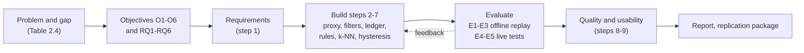
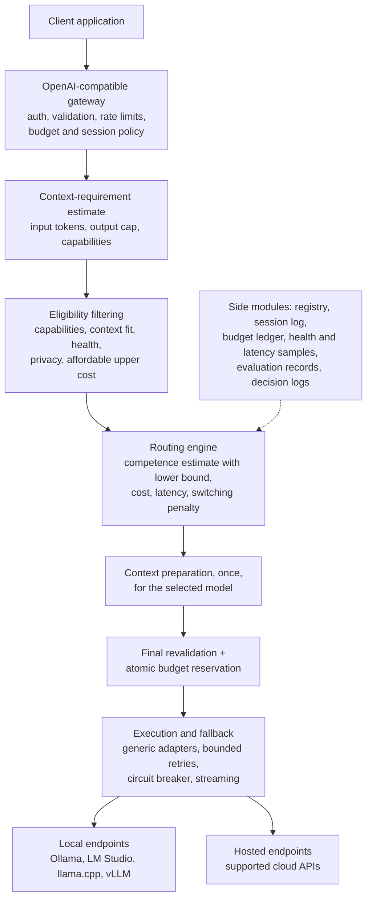

# CHAPTER THREE: METHODOLOGY, SYSTEM ANALYSIS AND DESIGN (draft, reworked to follow the 26 Oct team guide)

**Drafting notes (delete before pasting)**

- **Governing design.** Follows the 26 Oct 2026 team guide where it conflicts with the 16 Oct proposal (supervisor decision, user to confirm). `design-reconciliation.md` lists every conflict. Items still open are marked `DECISION-NEEDED`. Proposal-only elements kept because the guide does not contradict them: OpenAI-compatible gateway, hosted plus self-hosted backends, circuit breaker, p95 latency, RouterBench, always-strong and always-weak baselines.
- Tense: future (proposal). Fact IDs such as [P-04] point to `00-source-facts.md`; "guide" means the team guide (section numbers refer to it).
- Numeric targets and margins are **not set**. The guide says each must be justified and approved before test data are examined, so every one is `TODO-confirm-with-supervisor`. The only numbers fixed in the guide are: 3 to 4 candidate models; at least 5 interviews; at least 80% line coverage; SUS with at least 8 participants (preferred); an illustrative 60/20/20 split; pilot of 30 to 50 sessions of 8 to 12 turns; 20 to 30 conversations of 10, 20 and 40 turns for E3.
- Citations are APA author-date and exist in `literature-review/references.md`. `[CITE-09]` and `[CITE-10]` mark topics 09 and 10 whose references were not yet in `references.md`. Same-surname initials as in Chapter 1.
- The template numbers the first three Chapter 3 tables as 3.1 to 3.3; other tables continue in order of appearance. Renumber with Word's caption tool.
- Principle from the guide: build the smallest complete version, reuse existing libraries, add complexity only where a measured problem justifies it, and never omit security checks, budget correctness, failure handling or tests.

---

This chapter describes how the router will be researched, specified, designed and evaluated. It sets out the methodology and build order, how requirements will be gathered, an analysis of how requests are handled today, the proposed system, the requirements, the design including the selection algorithms, the data, the tools, the five experiments and the software-engineering evaluation, and the ethical considerations. The aim is that someone with similar skills can reproduce the work from this chapter alone.

## 3.1 Research and Development Methodology

**Research design: Design Science Research (DSR).** The project builds an artefact, the router, and evaluates it against stated criteria, which is the pattern of design science [CITE: Design Science Research methodology; candidate sources named from the drafter's knowledge, verify before citing: Hevner et al. (2004) and Peffers et al. (2007)]. Experiments on public data and controlled live tests supply the evidence [CITE: Wohlin et al. (2012), cited in the course module]. ASSUMPTION: the guide names no methodology; DSR plus iterative development is the drafter's choice. TODO-confirm-with-supervisor.

**Development model: iterative and incremental, following the guide's nine-step order.** Each step ends with its "done" condition, unit and integration tests written with the deliverable, and an update to the traceability matrix.

**Table 3.4: Build order and done conditions (guide section 10)**

| Step | Deliverable | Done condition | Objective |
|---|---|---|---|
| 1 | Requirements: at least 5 developer interviews or surveys; MoSCoW priorities; traceability matrix started | Prioritised requirements with IDs and acceptance criteria; supervisor agrees the MVP scope | O6 |
| 2 | Proxy plus one local and one hosted adapter | The same API request runs through both; non-stream and stream verified | O5 |
| 3 | Registry, context estimate and hard filtering (lifecycle steps 3 and 4) | Capability, context and budget exclusions have automated tests | O4 |
| 4 | Budget ledger and policy bands, with final revalidation and reservation (steps 7 and 8) | Atomic concurrent reservation and reconciliation tested | O4 |
| 5 | Rule-based router (step 5) | Deterministic baseline and decision logs work | O1 |
| 6 | k-NN router with calibration check and insufficient-evidence fallback | Historical outcomes indexed; test-set selection cannot see answers; reliability table produced; compared with rules | O1 |
| 7 | Optional managed session and hysteresis | Exact transcript preserved; switch reasons and outcomes logged | O2, O3 |
| 8 | Reliability, performance and quality evaluation | Fault injection, TTFT, cost and quality reports, CSV export; at least 80% line coverage; ISO/IEC 25010 table completed | O4, O5, O6 |
| 9 | Developer usability evaluation | Preferably at least 8 developers complete the tasks and SUS; issues fixed or logged | O6 |

TODO: calendar dates for the nine steps (feeds the "time-bound" part of the objectives and Appendix F). `DECISION-NEEDED`: dates, team allocation, supervisor meeting cadence.

Only a learned classifier, vector-based context retrieval or a graph experiment is added if the core works and there is a specific research question it helps answer (guide section 10).

**Figure 3.1: Methodology diagram.**



## 3.2 Requirements Elicitation

The guide requires **at least five** potential developer users, such as students or engineers who call hosted or local LLM APIs, to be interviewed or surveyed (guide section 9). Questions are open, so they do not simply confirm the design.

| Item | Plan |
|---|---|
| Participants | At least 5 developers; TODO: how many, how selected (students, engineers, other). Selection method TODO. |
| Topics | Providers used; cost and privacy concerns; latency tolerance; existing gateways; integration pain points; what quality loss they would tolerate for a saving (this informs the non-inferiority margin). |
| Consent and data | Obtain consent; avoid storing identifying details; anonymise; TODO: consent approach agreed with the supervisor. Interview guide and consent form go in Appendix C. |
| Output | A coded list of functional and non-functional requirements, each with its source (interview, literature or policy). |

Other sources: the review of existing routers and gateways (Chapter Two), the team guide, and the literature. `DECISION-NEEDED`: confirm whether department ethics approval is needed for interviews and the SUS study (also Section 3.10).

## 3.3 Analysis of the Existing System

### 3.3.1 Description of the Existing System

"Existing system" here is how teams send LLM requests today: (1) **a hard-coded single model** called for every request, with no per-prompt choice, no spending control and no fallback [P-01, P-04]; (2) **gateways and routers** (OpenRouter, LiteLLM, vLLM Semantic Router, Not Diamond and others, vendor documentation reviewed in Section 2.5), which provide authentication, budgets, fallbacks and, increasingly, automatic model choice; and (3) **research routers** that choose a model from preference or benchmark data (Ding et al., 2024; Ong et al., 2025) or from similar past requests [CITE-09]. Figure (draw): activity diagram of the hard-coded path, client, one model API, response, and "error returned" on failure. TODO: draw.

### 3.3.2 Limitations of the Existing System

**Table 3.5: Limitations of the existing way of working**

| ID | Limitation | Evidence | Gap (Table 2.4) |
|---|---|---|---|
| L-a | One model for all requests wastes money or lowers quality | Hard-coded setups [P-02, P-03] | R1 |
| L-b | Competence estimates are not shown to be calibrated and the evidence rule is unstated; simple baselines are hard to beat | Hu et al., 2024; H. Li et al., 2026; [CITE-09] | R1 |
| L-c | Switching models inside a conversation is not evaluated for cost and cache effects | [CITE-09: Zhang et al., 2026]; Srivatsa et al., 2025 | R2 |
| L-d | Context after a switch is rebuilt without a measured policy | [CITE-10] | R3 |
| L-e | Spending limits are engineering practice, not shown to hold under concurrency | Vendor documentation (Section 2.5) | R4 |
| L-f | Failover and circuit-breaker behaviour for LLM calls is thinly evidenced; gateway overhead is rarely measured | Pandey & Singh, 2026a; Huang et al., 2022; Romero et al., 2021 | R5, L7 |
| L-g | Offline benchmarks do not measure live latency, caching or failures; usability and software quality of routers are not reported in the reviewed papers | Hu et al., 2024; H. Li et al., 2026; Y. Lu et al., 2026 | R6, L6 |

## 3.4 The Proposed System

### 3.4.1 Description of the Proposed System

The AI Request Router is **one modular FastAPI application and a relational database** that exposes an OpenAI-compatible `/v1/chat/completions` endpoint. For each request it validates the client, resolves the budget and session policy, estimates the context requirement, filters out ineligible deployments, ranks the eligible ones by estimated competence (with an uncertainty lower bound), cost and latency, prepares the context once for the chosen model, revalidates, atomically reserves budget, and dispatches through a generic adapter with bounded retries and a circuit breaker (guide section 3). Local engines (Ollama, LM Studio, llama.cpp server, vLLM) and hosted APIs are both first-class backends.

- **Users:** developers and organisations that call hosted or local LLM APIs; the operator who configures models, prices and budget bands; the evaluator who runs experiments.
- **Main modules (logical, not services):** gateway; context-requirement estimator; eligibility filter; routing engine (rule and k-NN); context preparation; budget ledger; execution and fallback layer with adapters; model and deployment registry; session log; health and latency samples; evaluation records; decision logs.

### 3.4.2 Justification for the Proposed System

**Table 3.6: How the proposed system addresses each limitation**

| Limitation (Table 3.5) | What the router does | Requirements |
|---|---|---|
| L-a | Chooses among 3 to 4 deployments per request | FR-05, FR-06, FR-07, FR-08 |
| L-b | Validates competence estimates with a reliability table and Brier score, applies a minimum-evidence rule and an uncertainty lower bound, and compares against simple rules and always-strong and always-weak baselines | FR-07, FR-08, FR-09, FR-21 |
| L-c | Session-aware hysteresis compared with locked and free switching | FR-18 |
| L-d | Explicit, bounded context policies compared with full replay | FR-16, FR-17, FR-19 |
| L-e | Budget bands and atomic reservation, verified under concurrency | FR-10, FR-11 |
| L-f | Bounded retries and a circuit breaker; overhead measured against direct calls | FR-13, FR-14, FR-15 |
| L-g | Live tests (E4, E5), requirements, quality table, tests and a SUS study | FR-21, NFR-01 to NFR-14 |

## 3.5 Requirements Specification

### 3.5.1 Functional Requirements

MoSCoW priorities are the drafter's reading of the guide (ASSUMPTION): what the guide's build order or experiments require is Must; supporting features are Should; optional or conditional items are Could; items on the guide's out-of-scope list are Won't. TODO-confirm-with-supervisor, and revise after the requirements interviews (step 1), which may change them. Use the IDs again in the test cases in Chapter 4.

**Table 3.1: Functional requirements**

| ID | Requirement | Actor | Priority |
|---|---|---|---|
| FR-01 | The system shall expose an OpenAI-compatible `/v1/chat/completions` endpoint supporting non-streamed and server-sent-event streamed responses. (Tools and structured output only if needed and verified.) | Client application | Must |
| FR-02 | The system shall authenticate clients and validate each payload, allowed endpoint and user or project policy, with rate limits. | Client application | Must |
| FR-03 | The system shall keep a registry of models (version, context window, formats, tool ability, per-domain evaluation records, evaluation date) and of deployments (base URL, engine, observed TTFT, failure and 429 rate, queue estimate, ready state, price settings, health timestamp). | Operator | Must |
| FR-04 | The system shall estimate the input-token count conservatively per model (with a safety margin), the output cap and the required capabilities for each request. | System | Must |
| FR-05 | The system shall exclude deployments that lack required capabilities, cannot fit the estimated input plus output cap, are unhealthy, are forbidden by privacy or data-location policy, or whose estimated upper cost exceeds the remaining budget. | System | Must |
| FR-06 | The system shall provide rule-based routers: static cheapest eligible, and domain average computed from training data only. | System | Must |
| FR-07 | The system shall provide a k-NN competence estimator over scored past tasks, per model, with a minimum-evidence rule and fallback to the domain average, then to "unknown". Unknown shall never be treated as good. | System | Must |
| FR-08 | The system shall select the lowest expected-cost eligible deployment whose success lower bound meets the target quality; if none qualifies it shall fail or use a client-authorised fallback labelled below target, and shall never silently violate a guaranteed threshold. | System | Must |
| FR-09 | The system shall produce a calibration report (reliability table, Brier score) for the competence estimates, and shall support optional monotone recalibration fitted on validation data. | Evaluator | Must (report); Could (recalibration) |
| FR-10 | The system shall provide three configurable cost budget bands (Economy, Balanced, Quality) with request, session and project caps, units, time window, output cap and behaviour at exhaustion. | Operator | Must |
| FR-11 | The system shall revalidate the final prompt, atomically reserve the maximum estimated spend before dispatch, reject unaffordable requests before dispatch, and reconcile actual provider usage afterwards. | System | Must |
| FR-12 | The system shall call backends through a generic OpenAI-compatible adapter for at least one local engine and one hosted API, with further engines (LM Studio, llama.cpp server, vLLM) as time allows. | System | Must (one local, one hosted); Should (others) |
| FR-13 | The system shall retry a failed request a bounded number of times on the next-ranked eligible deployment, shall not duplicate tool side effects, shall not continue an already started stream on a different model as if nothing happened, and shall not let a free local fallback bypass privacy or capability rules. | System | Must |
| FR-14 | The system shall keep a circuit breaker per deployment (closed, open, half-open) that temporarily stops traffic to a repeatedly failing deployment. | System | Must |
| FR-15 | The system shall log, per request, the chosen deployment, reason, scores, tokens, cost, TTFT, end-to-end time, outcome and switch reason, without storing raw sensitive prompts by default. | System | Must |
| FR-16 | The system shall by default leave conversation context with the client (stateless), never silently dropping or compressing supplied messages. | System | Must |
| FR-17 | The system shall optionally offer router-managed sessions that store the full ordered transcript and the selected-model history. | Client application | Should |
| FR-18 | The system shall provide session-aware hysteresis: stay with the current model unless the expected benefit exceeds a threshold, a capability requirement changes, the current deployment fails, or budget or permission rules require a change. | System | Should |
| FR-19 | The system shall provide bounded and retrieval context policies and shall never silently truncate system instructions, the current request, tool-call and result pairs or exact artefacts; it shall return an explicit context-too-large error instead. | System | Should |
| FR-20 | The system shall support graph-retrieval context arms (manual and automatic) as an experiment only. | Evaluator | Could (conditional on E3) |
| FR-21 | The system shall provide an evaluation harness for E1 to E5 that saves configuration version, dataset version, model and backend versions, seed, date, machine specification, pricing snapshot and raw outputs. | Evaluator | Must |
| FR-22 | The system shall refresh health and latency estimates in a background job so expensive evaluations do not block live requests. | System | Should |
| FR-23 | The system shall accept an optional per-request latency budget. (Proposal element kept; the guide does not contradict it.) `DECISION-NEEDED`. | Client application | Could |
| FR-24 | The system shall read vLLM `/metrics` (queue, KV-cache, latency) when a server exposes it and feed it to the router (optional extension X1). | System | Could |
| FR-25 | The system shall provide a learned difficulty classifier as an E1 comparator. | Evaluator | Could |
| FR-26 | The system shall export reports as CSV or a basic dashboard. | Evaluator | Should |
| FR-27 | The system shall train or fine-tune models, transfer KV caches across models, schedule GPUs across hosts, manage engine installation, use online RL or bandits, act as a general agent framework or build LLM graphs on every live request. | n/a | Won't (out of scope, guide section 10) |

### 3.5.2 Non-Functional Requirements

The guide requires each indicator to have a target fixed **before measurement** and justified by a requirement or a measured baseline, not invented. Targets are therefore TODO-confirm-with-supervisor, except where the guide or template fixes a number or the check is pass or fail.

**Table 3.2: Non-functional requirements**

| ID | Category (ISO/IEC 25010) | Requirement | Measure / target |
|---|---|---|---|
| NFR-01 | Performance efficiency | Gateway overhead | Proxy overhead = gateway-to-endpoint TTFT minus direct-to-endpoint TTFT under equivalent settings, warmed and cold. Target: TODO-confirm-with-supervisor, set from the measured direct baseline. |
| NFR-02 | Performance efficiency | Throughput under concurrent clients | Requests per second and p95 latency at stated concurrency. Target and hardware: TODO |
| NFR-03 | Reliability | Completion under injected faults | Completion rate with slow response, 429, connection failure, malformed output and mid-stream disconnect. Target: TODO-confirm-with-supervisor |
| NFR-04 | Reliability | Circuit-breaker and fallback rules | Pass or fail on timeout, open, half-open recovery and fallback behaviour. Parameters: TODO |
| NFR-05 | Reliability (budget correctness) | Spending limits hold | No authorised request exceeds the declared reservation limits and unaffordable requests are rejected before dispatch (pass or fail, 10 and 100 concurrent requests); overshoot and reconciliation failures reported |
| NFR-06 | Security | Authentication, authorisation, secrets, allow-listing | Pass or fail review: API keys required; secrets out of prompt and telemetry logs; only registered, authorised endpoints; URL validation and SSRF and private-network blocking where not permitted |
| NFR-07 | Security (privacy) | Raw sensitive prompts not stored by default; retention and deletion policy | Pass or fail; Nigeria Data Protection Act 2023 where personal data is processed [CITE: Nigeria Data Protection Act 2023] |
| NFR-08 | Maintainability | Modularity and testability | At least 80% line coverage measured automatically (guide), reported per module with the most careful tests on budget, filtering and routing logic |
| NFR-09 | Maintainability | Effort to add a new adapter | Indicator (for example files changed or time taken) and target: TODO |
| NFR-10 | Usability | Developer usability | SUS mean with an interval from preferably at least 8 participants, plus completion, time on task, errors. Target: TODO-confirm-with-supervisor (the template's SUS benchmark of 68 is a candidate) |
| NFR-11 | Compatibility | Works with an unmodified OpenAI client library | Pass or fail test (library choice TODO) |
| NFR-12 | Observability | Every request has a decision log | Pass or fail (FR-15) |
| NFR-13 | Estimate quality | Calibration of competence estimates | Reliability table and Brier score reported; target for acceptable calibration: TODO-confirm-with-supervisor |
| NFR-14 | Reproducibility | Anyone can repeat the experiments | Replication package with versions, seeds, scripts and pricing snapshots (pass or fail) |

State the edition of ISO/IEC 25010 cited, because characteristic names differ between the 2011 and 2023 editions (guide section 9).

### 3.5.3 Use Case Model

**Actors.** Client application (developer's software); Operator (configures models, prices, bands, policies); Evaluator (the team); external systems: hosted APIs and local engines.

| ID | Use case | Actor | Requirements |
|---|---|---|---|
| UC-01 | Route a chat request | Client application | FR-01 to FR-08, FR-11, FR-12, FR-15 |
| UC-02 | Recover from a backend failure | System | FR-13, FR-14 |
| UC-03 | Enforce a budget under concurrency | System | FR-10, FR-11 |
| UC-04 | Continue a managed session after a possible switch | Client application | FR-16 to FR-19 |
| UC-05 | Manage registry, bands and policies | Operator | FR-03, FR-10 |
| UC-06 | Run an experiment | Evaluator | FR-09, FR-21, FR-26 |

**UC-01: Route a chat request**

| Field | Content |
|---|---|
| Actor | Client application |
| Preconditions | At least one deployment is registered; the client holds a valid key; a budget band applies |
| Main flow | 1. Receive and validate. 2. Resolve budget band, remaining allowances and session policy. 3. Estimate input tokens, output cap and required capabilities. 4. Filter to eligible deployments. 5. Rank by competence lower bound, cost and latency, plus any switching penalty. 6. Prepare the context once for the chosen model. 7. Revalidate the final prompt. 8. Atomically reserve budget. 9. Dispatch, stream, reconcile usage, log. |
| Alternative flows | A. No eligible deployment or none meets the target: fail, or use the client-authorised degradation, labelled below target. B. Revalidation fails: next-ranked candidate (bounded attempts) or explicit error. C. Reservation fails because a concurrent request used the allowance: next candidate or reject before dispatch. D. Backend call fails: UC-02. |
| Postconditions | The client holds a response or an explicit error; a decision record exists; the ledger is reconciled. |

**UC-02: Recover from a backend failure**

| Field | Content |
|---|---|
| Trigger | A call times out, returns 429 or a connection error, or returns malformed output |
| Main flow | 1. Record the failure for that deployment. 2. If the failure count reaches the threshold, open the circuit for a cool-down. 3. Retry on the next-ranked eligible deployment, within the bounded number of attempts, without charging the budget twice for an attempt that did not bill. 4. Return the first success. |
| Alternative flows | A. All attempts fail: explicit error. B. Mid-stream failure: do not silently continue on a different model; return an explicit error or an indicated retry. C. Cool-down ends: half-open probe decides. |
| Postconditions | Health state and decision log updated. Thresholds, cool-down and maximum attempts: TODO-confirm-with-supervisor. |

## 3.6 System Design

### 3.6.1 System Architecture

Style: one modular FastAPI process with a relational database, logical modules and no separate services. This is the guide's choice: independent microservices, graph databases and distributed GPU scheduling are not justified yet; Redis, a separate vector database or a graph database enter only after a measured concurrency, scale or query problem (guide section 10). The same separation of gateway, routing, adapters, fallback and telemetry appears in published designs of model gateways and serving layers: INFaaS selects a variant per query from a dynamic state machine using a constant-time metadata store, and reports a median selection overhead of 2.2 to 3.5 ms (Romero et al., 2021); AIBrix places an LLM-aware gateway in front of engine instances (Shan et al., 2025) (preprint); Clockwork centralises scheduling decisions and runs a request only when it is predicted to meet its deadline (Gujarati et al., 2020). Clockwork and AlpaServe state that their central controller is a single point of failure (Gujarati et al., 2020; Z. Li et al., 2023), so the router's state must be restartable.

**Figure 3.2: Logical pipeline and request flow**



**Request lifecycle (guide section 3.1).** (1) Receive and validate. (2) Resolve budget and session policy. (3) Estimate context requirements and input tokens (conservative: the best available tokenizer per model plus a safety margin). (4) Filter models. (5) Rank eligible models. (6) Prepare the final context once for the selected model: pass-through by default, optional router-owned history. (7) Revalidate: recompute the final token count and re-check capabilities and maximum cost; on failure go back to step 5 (bounded) or fail. (8) Atomically reserve budget. (9) Dispatch and record: stream, handle errors and fallback, reconcile usage, log. Context is not built per candidate; for managed sessions with bounded or retrieved context, step 3 uses each candidate's maximum allowed input budget and step 7 catches any mismatch.

**Deployment diagram (draw).** Nodes: client machine; router host (FastAPI process, embedding model for k-NN, relational database); local inference host(s) running Ollama or another OpenAI-compatible engine; external hosted API providers. For hybrid setups, "localhost" on a cloud-hosted router is not the user's laptop: allow only registered, authorised endpoints (Section 3.6.7). TODO: actual hardware and network layout.

### 3.6.2 Structural Design (Class Diagram)

ASSUMPTION: candidate classes, to confirm during implementation.

| Class | Responsibility |
|---|---|
| `Gateway` | HTTP endpoint, authentication, validation, rate limits |
| `PolicyResolver` | Budget band, remaining allowances, session policy and current model affinity |
| `ContextEstimator` | Input-token estimate with safety margin, output cap, required capabilities |
| `Registry` | Model facts and deployment facts (FR-03) |
| `EligibilityFilter` | Hard requirements (FR-05) |
| `CompetenceEstimator` (interface) | `RuleEstimator` (static, domain average) and `KnnEstimator` (FR-06, FR-07); optional `ClassifierEstimator` |
| `SelectionPolicy` | Lower-bound and cost rule (FR-08); hysteresis wrapper (FR-18) |
| `ContextBuilder` | Pass-through; bounded; retrieval (and graph arms) policies (FR-16, FR-19) |
| `BudgetLedger` | Atomic reservation, release and reconciliation (FR-10, FR-11) |
| `Adapter` (interface) | OpenAI-compatible adapter for local and hosted endpoints (FR-12) |
| `FallbackExecutor`, `CircuitBreaker` | Bounded retries and per-deployment state (FR-13, FR-14) |
| `DecisionLogger` | Persists the decision record (FR-15) |
| `EvaluationHarness` | Runs E1 to E5 and exports reports (FR-21, FR-26) |

### 3.6.3 Behavioural Design (Sequence and Activity Diagrams)

Draw: (a) sequence diagram for UC-01 with lifelines Client, Gateway, PolicyResolver, EligibilityFilter, SelectionPolicy, ContextBuilder, BudgetLedger, Adapter, Backend; (b) sequence diagram for concurrent reservation (two requests, one allowance); (c) sequence diagram for UC-02 with CircuitBreaker and two backends; (d) activity diagram of the selection algorithm (Section 3.6.5); (e) state diagram of the circuit breaker; (f) activity diagram of the hysteresis decision.

### 3.6.4 Database Design

ASSUMPTION: draft schema; the guide asks only for a relational database and prefers CSV or SQLite for early experiments. `DECISION-NEEDED`: SQLite or a server database. Aim for at least Third Normal Form and provide a data dictionary (type, constraint, description) when final.

| Table | Main columns | Notes |
|---|---|---|
| `model` | `model_id` (PK), `version`, `context_window`, `formats`, `tool_ability`, `evaluated_on` | One row per model version (a new version is a new model) |
| `deployment` | `deployment_id` (PK), `model_id` (FK), `base_url`, `engine`, `kind` (hosted or local), `price_in`, `price_out`, `ready`, `health_ts` | Price settings are a snapshot |
| `deployment_sample` | `sample_id`, `deployment_id` (FK), `ts`, `ttft_ms`, `failed`, `rate_limited`, `queue_est` | Feeds latency and health estimates |
| `eval_record` | `record_id`, `task_id`, `domain`, `model_id` (FK), `outcome`, `input_tokens`, `output_tokens`, `cost`, `split` | One row per task answered by one model (guide E1) |
| `task` | `task_id` (PK), `task_text`, `domain`, `embedding_ref` | Split is by task, not by row |
| `budget_policy` | `policy_id`, `band`, `request_cap`, `session_cap`, `project_cap`, `currency`, `window`, `output_cap` | Caps are configuration |
| `reservation` | `reservation_id`, `policy_id`, `request_id`, `reserved`, `actual`, `status`, `ts` | Atomic transaction; reconciled later |
| `session`, `session_message` | `session_id`, `current_model_id`; `msg_id`, `session_id`, `seq`, `role`, `content` | Managed sessions only; exact transcript |
| `request_log` | `request_id`, `session_id`, `turn`, `chosen_deployment_id`, `previous_deployment_id`, `reason`, `input_tokens`, `output_tokens`, `cached_tokens`, `cost`, `ttft_ms`, `e2e_ms`, `outcome` | Raw sensitive prompts not stored by default |
| `circuit_state` | `deployment_id`, `state`, `failures`, `reopen_at` | In the database or in memory |
| `experiment_run` | `run_id`, `experiment`, `config_version`, `dataset_version`, `seed`, `date`, `machine` | Reproducibility (FR-21) |

### 3.6.5 Algorithm and Model Design

**A. Eligibility (guide 3.3).** Deployment m is eligible for request x only if all hold: required capabilities present; estimated input plus output cap fits the context window; provider allowed by privacy and data-location policy and healthy; estimated upper spending at most the remaining budget.

**B. Competence estimate (guide 3.4).** A model's per-domain score is its observed outcome on scored tasks, not a leaderboard number. Records come from public routing-benchmark data for the chosen models (RouterBench; LLMRouterBench), plus a small set of tasks the team scores where coverage is missing. For task x and model m:

- *Domain-average rule (baseline B):* the training-set average outcome of m in x's domain.
- *k-NN (method C):* p̂(m, x) = Σᵢ wᵢ·yᵢ / Σᵢ wᵢ over the k nearest scored tasks i (by embedding similarity) where yᵢ is m's outcome on task i and wᵢ is a similarity weight (ASSUMPTION: weights equal to 1 for plain k-NN, which is the variant that matched a learned router in the closest published work [CITE-09: Varangot-Reille et al., 2026 (EACL)]).
- *Minimum-evidence rule:* trust p̂ only if at least n_min scored neighbours lie within a similarity cutoff; n_min and the cutoff are tuned on validation data, not guessed. Below it, fall back to the domain average; below the domain minimum, the estimate is **unknown**. Unknown is never treated as good: the router escalates to the strongest eligible model within budget or applies the fail or degrade policy for the band.
- *Calibration:* check p̂ on validation data with a reliability table (binned predicted against observed success) and the Brier score. Choose the quality threshold by the success it actually achieves, not by the nominal value. Apply isotonic or Platt-style recalibration fitted on validation data only if the check shows a problem and the fix helps.

Why per-model success rather than a single difficulty score: difficulty predictors are tied to a model pool and cross-model transfer of hidden-state probes was near chance (Zhu et al., 2025); frozen-embedding predictors with a light head are the family cheap enough for a gateway (Šakota et al., 2024; Zotos et al., 2025; Shnitzer et al., 2023). A learned classifier remains an optional E1 comparator (FR-25).

**C. Uncertainty lower bound.** Neighbours resemble one another and may be similarity-weighted, so they are not independent trials, and a textbook binomial interval on the neighbour count would be over-confident (guide 3.4). ASSUMPTION: start from

> LB(m, x) = p̂(m, x) − z · sqrt( v̂ / n_eff ),  with n_eff = (Σᵢ wᵢ)² / Σᵢ wᵢ²

where v̂ is the weighted variance of neighbour outcomes (for 0/1 outcomes, p̂(1 − p̂)) and z is a tuning constant chosen on validation data. The margin shrinks with the effective number of neighbours and grows with how much outcomes disagree, as the guide requires. Whether LB beats the raw average is an ablation in E1, and in the E1 test the team reports whether achieved success actually met the target whenever LB did.

**Worked example (ILLUSTRATIVE VALUES ONLY: invented to show how the formula behaves, not measurements).** Target quality 0.70, z = 1. Model A has five neighbours with weights 0.9, 0.8, 0.8, 0.7, 0.6 and outcomes 1, 1, 0, 1, 1: Σw = 3.8, p̂ = 3.0 / 3.8 = 0.789, Σw² = 2.94, n_eff = 3.8² / 2.94 = 4.91, v̂ = 0.789 × 0.211 = 0.166, margin = sqrt(0.166 / 4.91) = 0.184, so LB = 0.606, below the target, and A is not selected. Model B has p̂ = 0.85 with n_eff = 20: margin = sqrt(0.1275 / 20) = 0.080, LB = 0.770, which meets the target, so B is selected even if A is cheaper. Thin evidence widens the margin, so the router escalates rather than gambles.

**D. Selection rule (guide 3.3).** Among eligible deployments with LB at least the target, choose the lowest expected total cost (prompt and completion tokens, cache discounts where observed, context preparation, routing overhead and known retry penalties, without double-counting input tokens); break ties by observed deployment latency (observed TTFT, not a global benchmark speed). If none qualifies, fail or use the client-authorised fallback and label the result below target. Local models: report external API charges separately from estimated local resource cost (GPU time, electricity, memory, loading delays) and never present estimated resource costs as billed dollars; tokens per dollar from GPU price is one published way to estimate self-hosted cost (Griggs et al., 2024) (preprint). This selection form follows the budget-constrained formulations in the routing literature, where estimator quality dominates the outcome (Dekoninck et al., 2025; Ding et al., 2024; Ong et al., 2025), and a weighted score of predicted quality, latency and cost is the design of the closest load-aware prior art (Da & Kalyvianaki, 2026) (preprint).

**E. Budget ledger (guide 3.5, E4).** After the final prompt is known (lifecycle steps 6 and 7), reserve R = n_in·p_in + max_output_tokens·p_out (plus a safety margin where exact accounting is unavailable) in one atomic transaction or lock-protected ledger. If a concurrent request has used the allowance, the reservation fails and the request moves to the next candidate or is rejected before dispatch. After the response, reconcile actual provider usage and release the difference. A perfect hard ceiling on a provider's final invoice is not always possible when provider usage is delayed or token estimates differ, so estimated and reported billing are tracked separately.

**F. Session-aware hysteresis (guide 3.6, E2).** With current model m₀ and best alternative m*, switch only if ΔU = U(m*) − U(m₀) exceeds a threshold θ, where U is a standardised utility on a single scale (ASSUMPTION: relative expected cost saving minus a switching penalty for cache loss and context re-processing, defined only for alternatives whose LB meets the target). Exceptions that override stickiness: a capability requirement changes, the current deployment fails, or budget or permission rules require a change. θ is chosen on pilot sessions; an arbitrary value is meaningless without normalisation. Track observed cached-token counts where the backend exposes them; otherwise treat cache benefits as estimates and sensitivity-test them. Motivation: a different model generally cannot reuse another model's KV cache, and turn-level routing work reports cost savings from switching selectively, while noting that switching loses prefix reuse [CITE-09: Zhang et al., 2026 (MTRouter)]; prefix sharing in serving is studied by Srivatsa et al. (2025). The guide's stop rule applies: keep hysteresis only if the switching and cost benefit survives the quality constraints and the logic has tolerable overhead.

**G. Context policies (guide 3.6, E3).** Stateless by default. For opted-in sessions the router stores the full ordered transcript and builds context once, after selection: C0 full replay (within the window); C1 bounded (pinned instructions, recent valid turns, explicitly preserved critical state); C2 text or vector retrieval added to C1; C3a manual graph and C3b automatic graph (optional, conditional on E3). A graph would be a derived index of source messages, never the source of truth; the assembler traverses it and passes model-readable text. [CITE-10: conversation memory and context management, including LongMemEval and temporal graph memory]

**H. Failover (guide 3.1 and E5; proposal pattern kept).** Bounded retries on the next-ranked eligible deployment; per-deployment circuit breaker with closed, open and half-open states and a cool-down; never continue a started stream on a different model; never let a free local fallback bypass privacy or capability rules. Retries can sustain outages, so they are bounded, jittered and checked against the fallback's headroom (Huang et al., 2022; Aderaldo & Mendonça, 2026); the failures that matter often return normally but degraded (Yan et al., 2025); and the direct evidence on gateway failover is two preprints from one vendor (Pandey & Singh, 2026a, 2026b). Parameters (failure threshold, window, cool-down, maximum attempts, timeouts): TODO-confirm-with-supervisor.

**Pseudocode.**

```
function ROUTE(request, session):
    policy  ← RESOLVE_POLICY(request, session)             # band, caps, affinity
    need    ← ESTIMATE(request)                            # tokens (margin), output cap, capabilities
    cands   ← [d for d in REGISTRY if ELIGIBLE(d, need, policy)]
    scored  ← []
    for d in cands:
        est ← COMPETENCE(d.model, request)                 # rule or k-NN, with minimum-evidence rule
        if est is UNKNOWN: continue                        # unknown is never good
        lb  ← LOWER_BOUND(est)
        if lb >= policy.target: scored.append((d, EXPECTED_COST(d, need), OBSERVED_TTFT(d), lb))
    if scored is empty: return ESCALATE_OR_FAIL(cands, policy)   # strongest eligible within budget, or explicit failure
    ranked ← sort(scored, by expected cost, then TTFT)
    if session.current in ranked and not SWITCH_JUSTIFIED(session, ranked[0], theta): ranked ← move session.current to front
    for d in first K of ranked:                            # K = maximum attempts (TODO)
        ctx ← BUILD_CONTEXT(request, session, d)           # once, for d
        if not REVALIDATE(ctx, d, policy): continue
        if not RESERVE(policy, MAX_COST(ctx, d)): continue # atomic; may fail under concurrency
        res ← CALL(d, ctx)                                 # circuit breaker applied; streaming
        RECONCILE(policy, res.usage); LOG(request, d, res)
        if res.ok: return res
    return ERROR("no deployment could serve the request")
```

### 3.6.6 User Interface Design

The router has no end-user interface in the core design. The visible parts are the OpenAI-compatible API (error format and response fields), the decision log, and CSV or basic export of reports (FR-26). Usability evaluation uses four developer tasks (Section 3.9.7): point an existing OpenAI-compatible client at the gateway, choose a budget band, register a local deployment, and read a routing decision log. TODO: wireframes of any dashboard. `DECISION-NEEDED`: whether any dashboard is a deliverable.

### 3.6.7 Security and Privacy Design

Keep secrets out of prompt and telemetry logs; do not store raw sensitive prompts by default; implement retention and deletion; use allowlisted backends, authentication and authorisation; validate URLs and block SSRF and private-network access unless explicitly permitted; do not publish unauthenticated local inference endpoints to the public internet; collect user-study data with consent; and never change a user's deployment or data-location choice silently during fallback (guide section 8). The Nigeria Data Protection Act 2023 applies where personal data is processed [CITE: Nigeria Data Protection Act 2023].

## 3.7 Data Collection and Preparation

The project uses public benchmark records and small sets the team creates and scores. Everything beyond the names is `TODO: confirm licence, size, model coverage and date from the dataset papers and repositories`.

| Item | Content |
|---|---|
| Datasets | E1: RouterBench (Hu et al., 2024) and LLMRouterBench (H. Li et al., 2026): check licences and which of the chosen models they cover; E3: LongMemEval [CITE-10] if it suits the models and budget; E2 and E3: scripted or synthetic and consented conversations created by the team |
| Models and domains | 3 to 4 distinct models and 3 to 5 domains (for example code, math, extraction, writing). Compare only models with available outcomes or run missing models on a small controlled set; do not substitute unrelated benchmark scores. |
| Record schema | One row per task answered by one model: task_id, task_text, domain, model_id, correctness_or_quality, input_tokens, output_tokens, measured_or_repriced_cost |
| Correctness definitions | Per domain (for example tests for code, exact answer for math, a blinded human rubric for subjective output). An LLM judge is not unquestionable ground truth; judge and crowd labels carry measured noise (Zheng et al., 2023; Chiang et al., 2024). |
| Split | By task, not by task–model row: training, validation and test (illustrative 60/20/20), all model outcomes for a task in the same partition; remove duplicates, version changes and leaked answers; avoid near-duplicates from the same problem family across splits |
| Cold start and shift | Repeat with 10%, 25%, 50% and 100% of training records; rerun on a held-out domain if feasible |
| New model test | Remove one model's records and add them back in steps (for example 0, 20, 50, 100 per domain) |
| Reproducibility | Save configuration, dataset version, model and backend versions, seed, date, machine, pricing snapshot and raw outputs for every experiment |

## 3.8 Tools and Technologies

Names are from the guide (section 10) or the proposal where the guide does not contradict them. Versions are TODO until the environment is fixed.

**Table 3.3: Tools and technologies**

| Tool / technology | Purpose | Justification |
|---|---|---|
| Python | Implementation language | Used by the guide's reference simulation and the routing stack |
| FastAPI | One modular gateway application | Guide: a modular FastAPI application first; asynchronous Python framework |
| Relational database (SQLite or a server database: DECISION-NEEDED) | Registry, ledger, logs, sessions, evaluation records | Guide: relational database; prefer CSV or SQLite for initial experiments |
| NumPy, pandas, scikit-learn | k-NN, calibration, evaluation | Guide E1; scikit-learn kept from the proposal |
| sentence-transformers or another embedding model (DECISION-NEEDED) | Task embeddings for k-NN | ASSUMPTION: the proposal's embedding tool; the guide says "a small embedding model" |
| Small in-process vector index | Nearest-neighbour search | Guide: prefer a small in-process index over a separate vector database |
| Ollama, LM Studio, llama.cpp server, vLLM | Local backends through OpenAI-compatible APIs | Guide: first-class local deployments; use vLLM `/metrics` only when exposed |
| Hosted LLM APIs | Hosted backends | TODO: providers |
| Mock provider | Adjustable usage, delay and failure for E4 | Guide E4 |
| pytest, coverage tool, CI | Tests, at least 80% line coverage | Guide section 9; TODO: tools |
| RouterBench, LLMRouterBench, LongMemEval | Datasets | Guide E1, E3 |
| Load generator | Concurrency tests | TODO: tool |
| SUS questionnaire and consent forms | Usability and interviews | Guide section 9 |

**Not used until a measured need (guide):** Redis, Prometheus, Grafana, a graph database, microservices. Proposal-era choices dropped for this reason are recorded in `design-reconciliation.md`.

## 3.9 Evaluation Plan

Two kinds of evidence: **offline replay** for model selection, where every strategy is compared on identical tasks and already-evaluated model outcomes (E1 to E3), and **live engineering tests** on real or controlled local and hosted endpoints for latency, streaming, caching, budget concurrency, timeouts and failures (E4, E5), because replay cannot measure those reliably. Replay benchmarks store outputs and none of the reviewed routing benchmarks measures latency under load or injects failures (Hu et al., 2024; H. Li et al., 2026; Y. Lu et al., 2026).

### 3.9.1 Principles, variables and measurements

**Evaluation rules for E1 to E3 (guide section 5).** Declare first: before examining results, record the primary metric, the comparison, the non-inferiority margin and how failed or missing requests are counted. A margin is a design decision justified by what quality loss a user would tolerate (informed by the interviews) and approved by the supervisor; 3 percentage points is only a placeholder in the guide, not a recommendation. Keep validation and test data separate: tune k, thresholds, the minimum-evidence rule and hysteresis on validation data or pilot sessions; use the test set once. Pair wherever possible and analyse paired differences (paired bootstrap; McNemar for paired pass or fail outcomes if a test is wanted). Report 95% intervals with raw counts. Separate three kinds of finding: meaningful, detectable but practically small, and inconclusive; claim non-inferiority only when the lower bound of the quality difference lies above the negative margin. Confirmatory tests are limited to H1 to H3; ablations, sensitivity tests and E4 and E5 are exploratory or descriptive and labelled so. Size samples from observed variability and the declared margin; if resources fall short, report the achieved interval and call the result inconclusive rather than lowering the bar. Routing benchmarks report several seeds and relative gains, baselines such as best single, random and oracle, and distance to the oracle (H. Li et al., 2026); simple baselines are hard to beat (Hu et al., 2024), so always-strong, always-weak and rule baselines are essential controls.

**Variables (course module).**

| Role | Variable | Scale |
|---|---|---|
| Independent | Routing method (static cheapest eligible, domain average, k-NN, optional classifier); switching policy (locked, free, hysteresis); context policy (C0 to C3b); budget band | Nominal |
| Dependent | Task success (correctness on objective benchmarks, or blinded rubric) | Ratio (proportion) |
| Dependent | Total effective cost (hosted charges plus routing and context calls; local resource estimate reported separately) | Ratio (currency or tokens) |
| Dependent | Calibration (Brier score; reliability table) and share of insufficient evidence | Ratio |
| Dependent | p50 and p95 TTFT, end-to-end latency, router overhead | Ratio (ms) (TTFT and latency definitions: Agrawal et al., 2024b; Zhong et al., 2024) |
| Dependent | Model switches per session; fallback count; completion and rejection rates (report the denominator, so refusal of hard requests cannot flatter a router) | Ratio |
| Dependent | Context accuracy, evidence recall, temporal correctness, false memories, abstention correctness, tokens | Ratio |
| Dependent | Budget overshoot, rejected requests, reconciliation failures | Ratio |
| Extraneous or moderating | Provider caching and cold starts; pricing at test time; task domain; session length; hardware and engine versions | Controlled by recording and by warm and cold conditions |

### 3.9.2 Experiment E1: does k-NN beat rules? (primary research; RQ1, H1; O1)

1. Choose 3 to 4 distinct models and 3 to 5 domains; define correctness per domain.
2. Store one row per task–model pair; split by task into training, validation and test.
3. Baselines: **A** static cheapest eligible; **B** domain average from training data only; **C** k-NN; optional comparator: lightweight classifier; reference policies: always-strong and always-weak.
4. Tune k (for example 3, 5, 10, 25), quality thresholds and the minimum-evidence rule on validation only; add a fallback for sparse or absent neighbours. Do not use gold test outcomes when selecting models.
5. Check calibration on validation data; compare the raw neighbour average with the uncertainty lower bound; recalibrate only if needed; report how often evidence was insufficient and how those requests were routed.
6. Evaluate every router on the same held-out tasks at identical budgets with the primary metric declared beforehand; report total cost, success, routing decision time and the cost–quality curve across bands, not only accuracy.
7. Repeat with 10%, 25%, 50%, 100% of training records, rerun on a held-out domain if feasible, and optionally run the new-model test.

If k-NN does not beat cheap rules by more than the uncertainty, keep the simpler rule and report the negative result (guide).

### 3.9.3 Experiment E2: does controlled switching help? (primary research; RQ2, H2; O2)

Three policies: **Free** (re-select every turn), **Locked** (one model except for failures or hard incompatibility), **Hysteresis** (switch only if another eligible model has enough net advantage, with optional cooldown; mandatory exceptions allowed). Scripted multi-turn sessions with known required facts and quality checks (for example code debug, follow-up patch, new maths question); freeze scripts; keep pilot and test sessions separate. The first 30 to 50 sessions of 8 to 12 turns are a pilot for debugging the harness, estimating the variability of paired per-session differences and selecting 2 to 3 hysteresis thresholds on a common utility scale; they are not assumed enough for the final evaluation. First use recorded per-model outputs to isolate selection decisions, then a smaller live sequential test to measure caching and latency, under at least a warm repeated-prefix and a cold new-prefix condition (and, for local engines, loaded and cold-loading models). Log session, turn, chosen and previous model, reason for switch, input, output and cached tokens, cost, TTFT, end-to-end time, success and backend state. Compare mean cost per completed session, p50 and p95 TTFT, success, switch count, fallback count and completion rate with paired bootstrap intervals; report live sessions separately because model-generated outputs make them not perfectly counterfactual. Stop rule: keep hysteresis only if the benefit survives the quality constraint and the logic has tolerable overhead; no extra phase classifier unless basic hysteresis fails measurably.

### 3.9.4 Experiment E3: context after switching (supporting research; RQ3, H3; O3)

Test corpus: 20 to 30 synthetic or consented conversations of 10, 20 and 40 turns, with at least five fact types: early stated facts, updated or corrected decisions, multi-hop relationships, exact code, JSON or tool output, and questions whose answer is absent; later optionally sample LongMemEval [CITE-10]. Create an answer key first (correct answer, evidence message IDs, whether the fact was superseded, whether "I don't know" is correct). Compare C0 full replay, C1 bounded, C2 text or vector retrieval, and optionally C3a (hand-built graph, an optimistic reference that isolates retrieval from extraction errors) and C3b (graph built by an LLM prompt, the realistic condition). A facts table with source-message links is enough; no graph database is needed. Enforce the same maximum context-token allowance across C1 to C3b and keep the answer model, settings and questions fixed. Score context accuracy, evidence recall, temporal correctness, false memories, abstention correctness, tokens, indexing tokens and latency, retrieval latency and total cost, for cold and amortised indexing. If C1 or C2 already solves the tasks, stop: the graph is out of scope. If C3a beats C2 but C3b does not, report that the gain exists in principle but was not realised by the extraction approach tested. A graph is monetarily beneficial only if avoided context inference cost exceeds graph creation, updates, retrieval and any added verification costs, with cache discounts counted.

### 3.9.5 Experiment E4: do budget bands enforce spending correctly? (software-engineering verification; RQ4; O4)

Create three test policy configurations with explicit per-request and per-session limits, chosen after observing example input and output lengths and prices. Build a mock provider with adjustable token usage, delay and failure. Send one request, then 10 and 100 concurrent requests sharing one project budget. Calculate a conservative reservation from the final input-token count and `max_output_tokens`, hold it in an atomic or lock-protected ledger, and reconcile after the response. Test 429s, timeouts, partial streams and retries: an internal retry that did not bill must not be charged twice, and actual provider charges must be counted. Assert that authorised requests do not exceed the declared reservation limits and unaffordable requests are rejected before dispatch; track estimated against provider-reported billing separately; check that falling back to a local model never bypasses privacy or capability constraints. Metrics: rejected requests, cap overshoot, reserved against actual spending, average cost per completed request, reconciliation failures and p95 gateway overhead. Pass or fail assertions; no hypothesis test.

### 3.9.6 Experiment E5: local backend and gateway overhead (software-engineering verification; RQ5; O5)

Start one local inference engine (initially Ollama or LM Studio) and load a small model that fits the hardware; do not load several models on an 8 GB GPU merely to mimic a production pool. Point the generic adapter at its OpenAI-compatible `/v1/chat/completions` endpoint and send the same prompt directly and through the router, verifying the complete response, streaming events, cancellation and usage capture. Repeat on a second engine when available (llama.cpp server or vLLM); use native vLLM `/metrics` only when exposed and do not claim every local server supplies VRAM or queue-depth metrics. Measure proxy overhead as gateway-to-endpoint TTFT minus direct-to-endpoint TTFT under equivalent settings with repeated warmed and cold trials, plus full request time and concurrent clients (reported descriptively with intervals; a published precedent reports a median selection overhead of 2.2 to 3.5 ms for a constant-time store, Romero et al., 2021). Inject a slow response, 429, connection failure, malformed output and a mid-stream disconnect; verify timeout, circuit-breaker and fallback rules, and that an already emitted stream is never transparently continued on a different model. Record hardware, engine versions, quantisation, loaded model state, batch size, power settings and concurrency; performance and reliability targets come from the requirements and quality table, not from invented figures.

### 3.9.7 Software-engineering evaluation (O6, RQ6)

| Activity | Plan | Output / done condition |
|---|---|---|
| Requirements gathering | At least 5 developer interviews or surveys (Section 3.2) | Coded requirements with sources |
| Requirements specification | Every requirement has an ID, acceptance criterion and MoSCoW priority; traceability matrix: requirement, design module, implementation, test case(s), experiment (E1 to E5); the guide's out-of-scope list gives the initial Won'ts | MoSCoW table and matrix updated at each step; every Must has at least one passing test or experiment |
| Software quality | Four ISO/IEC 25010 characteristics: performance efficiency (overhead, throughput; E5), reliability (injected failures; E4, E5), security (authentication, authorisation, secrets and logs, endpoint allow-listing, SSRF controls), maintainability (modularity, testability, effort to add an adapter). Each has a measurable indicator and a target fixed before measurement. State the edition. | Quality table: characteristic, indicator, target, justification, measured result |
| Testing | Unit (filters, budget arithmetic, rule and k-NN routers, adapters with mocks); integration (gateway, mock provider, local endpoint, database); concurrency (10 and 100 concurrent requests; E4); fault injection (429, timeout, malformed output, mid-stream disconnect; E4, E5); performance (E5). At least 80% line coverage, automatically measured and reported per module (coverage shows what the tests execute, not that behaviour is correct) | Automated suite in CI; coverage report; fault-injection log |
| Usability | Preferably at least 8 developers complete four integration tasks, then the System Usability Scale; record completion, time on task, errors and help requests. With about 8 participants this is formative evidence, not statistical proof: report SUS as a mean with an interval and task measures descriptively | Task script, SUS scores, task measures, issues fixed or deferred |

### 3.9.8 Anticipated threats and risks (carried to Section 4.8)

| Threat or risk | Type | Handling |
|---|---|---|
| k-NN estimates miscalibrated or built on unrepresentative neighbours | Construct validity | Reliability table, Brier score, lower bound, minimum-evidence rule (E1) |
| Benchmark labels are noisy or flawed [CITE-09] | Construct validity | Objective checks where possible, blinded adjudication, intervals |
| Replay cannot capture live caching, local load or network resilience | External validity | E2 live run, E4 and E5 live tests; state the limit |
| Provider caching, cold starts and price changes | Internal validity | Warm and cold conditions; pricing snapshot; repeated trials |
| Pilot sessions used to tune thresholds also used to claim results | Conclusion validity | Separate pilot and test sessions; test set used once |
| A cheap router looks good by refusing hard requests | Construct validity | Report completion and rejection denominators |
| Small usability sample | Conclusion validity | Treat as formative; report intervals |
| Competitors change | Relevance | Re-fetch vendor documentation before submission (proposal R-04) |

### 3.9.9 Optional extension X1: live-load signals

If time allows (`DECISION-NEEDED`): add registry-level health, latency and queue estimates and, where a server exposes it, vLLM `/metrics` (queue length, KV-cache use, latency histograms) to the ranking step, and compare a load-aware with a load-blind variant on p95 TTFT under concurrent load. Evidence from the literature: request counts are weak signals (join-shortest-queue was only 0.46% better than round-robin in Jain et al., 2024, a preprint); memory- and token-based load is stronger (Sun et al., 2024; Kossmann et al., 2024); correcting between scrapes avoids acting on stale values (Kossmann et al., 2024; Da & Kalyvianaki, 2026); scrape-interval sensitivity is reported by no paper and would be a contribution if measured. Prediction error rises near saturation, so a backend above about 85% of capacity should be treated as unable to meet tight deadlines (Agrawal et al., 2024c).

## 3.10 Ethical Considerations

- **Human participants.** Developer interviews (at least 5) and a usability study (preferably at least 8) involve participants. Obtain consent, avoid storing identifying details, anonymise, store data securely, and give consent forms and the interview guide in Appendix C. `DECISION-NEEDED`: whether department ethical approval is required and the consent approach agreed with the supervisor.
- **Data.** Public benchmark data only for E1; check each licence and cite it. Conversations for E2 and E3 are synthetic or consented. No raw sensitive prompts are stored by default. Where personal data is processed, apply the Nigeria Data Protection Act 2023 [CITE: Nigeria Data Protection Act 2023].
- **Third-party services.** Sending prompts to hosted providers must follow each provider's terms of use and the router's privacy policy; provider keys are kept secret (NFR-06). ASSUMPTION: terms of use to be checked.
- **Research integrity.** Primary metrics and margins declared before results; failures and negative results reported; synthetic assumptions never labelled as observed results (the guide's synthetic simulation is a design sanity check only); replication package shared.
- **Generative AI.** Any use is declared in the front-matter table.

## 3.11 Chapter Summary

TODO: one or two paragraphs when the chapter is final. Content to cover: Design Science with a nine-step build order; requirements from at least five developer interviews with MoSCoW and a traceability matrix; one modular FastAPI application with eligibility filtering, k-NN competence estimates with a lower bound, budget bands with atomic reservation, hysteresis, bounded retries and a circuit breaker; offline replay experiments E1 to E3 and live verification E4 and E5; and a software-engineering evaluation with an ISO/IEC 25010 table, at least 80% line coverage and a SUS study.
